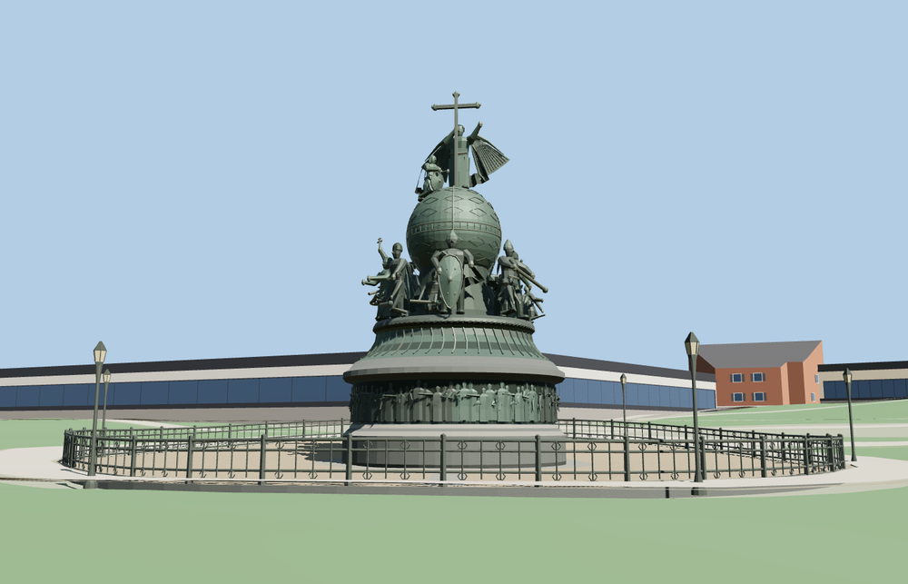

# Millennium of Russia

The Novgorod Kremlin monument rises from a circular granite pedestal to a bronze high-relief band, fluted bell and six groups of figures. A decorated globe carries a winged angel, a kneeling figure and a trefoil cross. The cobbled enclosure, cast-iron railing and six lanterns sit inside the mapped circular footway.

The 166,252-triangle source master rebuilds from the editable geometry. The four runtime levels have 981, 3,993, 15,698, 63,995 triangles. Skyline and district total 438,344 bytes, or 132,858 bytes compressed with gzip. All six GLBs validate with zero errors, warnings or embedded images.

The viewer places the plinth within the mapped circular footway and keeps all 35 building and 71 transportation records. Probes cover the crown, plinth, globe, six principal figures, graded paving and fence at each level. The bronze body connects the globe to the bell platform. The six lamp posts gain detail at district through close-up. A failed load preserves the mapped plaza. Eviction releases model geometry.

Inspected 28 geographic and 14 standalone views, including all six statue groups, the summit and base friezes. The 15.7 m height and 9 m granite plinth diameter follow the Novgorod Museum. Intermediate moulding profiles, fence radius and lamp offsets are estimates from the photographs. The closed PMTiles footway provides the site center. The named point is within 0.49 m of this center. Rurik faces south and the Peter I group faces the mapped cathedral side. Exact bearings of individual sculptures are estimates. The 18 middle figures and two summit figures preserve the main photographed poses and attributes. The 109 lower relief figures preserve crowding and overall silhouettes in four sections. Individual faces, small ornaments, and inscriptions are simplified. Photographs are reference only. The model and path sit on standard Terrarium terrain. Surrounding roads, buildings, water and land cover remain in the viewer. Fine relief, fence castings and globe tracery gain detail at closer levels. Physical-device timings remain unmeasured.

Run `node packages/worldgen/scripts/generate-millennium-of-russia.mjs --check --ids=millennium_of_russia` to confirm the source rebuild.
