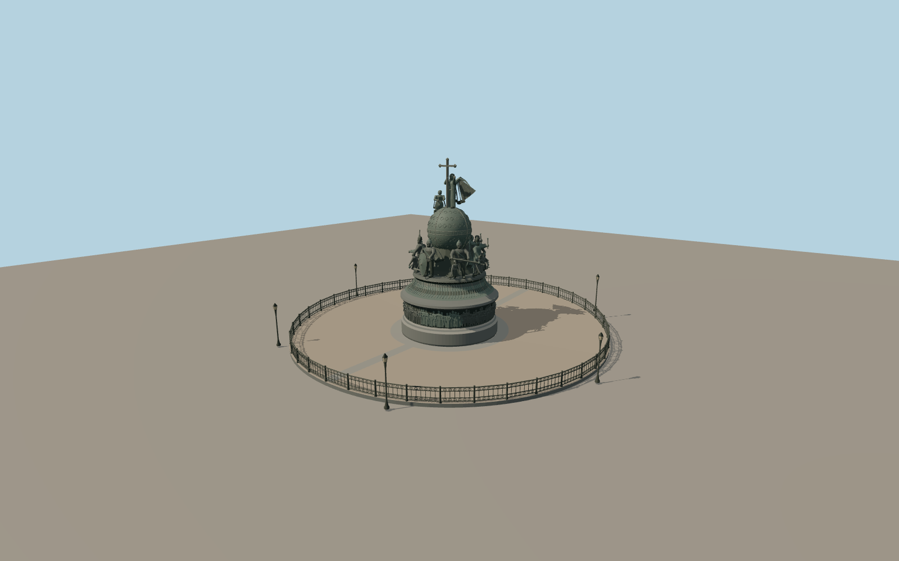

# Millennium of Russia

The Novgorod Kremlin monument rises from a circular granite pedestal to a bronze high-relief band, fluted bell and six groups of figures. A decorated globe carries a winged angel, a kneeling figure and a trefoil cross. The cobbled enclosure, cast-iron railing and six lanterns sit inside the mapped circular footway.

Run `node packages/worldgen/scripts/generate-millennium-of-russia.mjs` to rebuild the source master. Append `--check` to compare the exact bytes. Use `--ids=millennium_of_russia` for targeted import, LOD generation and placement.

The 15.7 m height and 9 m granite plinth diameter follow the Novgorod Museum. Intermediate moulding profiles, fence radius and lamp offsets are estimates from the photographs.

The closed PMTiles footway provides the site center. The named point is within 0.49 m of this center. Rurik faces south and the Peter I group faces the mapped cathedral side. Exact bearings of individual sculptures are estimates.

The 18 middle figures and two summit figures preserve the main photographed poses and attributes. The 109 lower relief figures preserve crowding and overall silhouettes in four sections. Individual faces, small ornaments, and inscriptions are simplified. Photographs are reference only.

The model and path sit on standard Terrarium terrain. Surrounding roads, buildings, water and land cover remain in the viewer. Fine relief, fence castings and globe tracery gain detail at closer levels.

Original geometry follows the repository license. Map data is © OpenStreetMap contributors under ODbL-1.0 via Protomaps. Terrain samples are described in terrain-grid.json. Ordinary pictures stay local and are not redistributed or used as textures. Current acceptance is recorded in qa.json.
