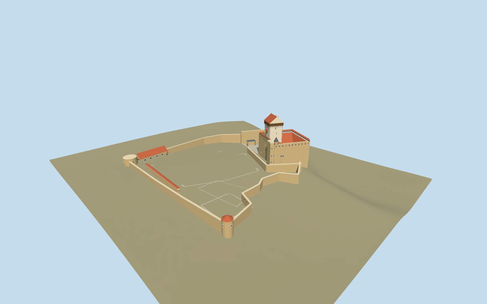

# Hermann Castle

Restored Narva castle: off-white Tall Hermann with projecting timber hoarding and red gable, inward red-roofed stone convent around an open court, southwest octagonal turret and broad western/northern yards.

## Evidence and reconstruction

Published dimensions and reconstructed details are separated in spec.json. Primary references:

- [Reference](https://narvamuuseum.ee/en/muuseum/narva-castle/)
- [Reference](https://narvamuuseum.ee/en/muuseum/meie-ajalugu/)
- [Reference](https://narvamuuseum.ee/en/muuseum/projects/projektid/castle-development/)
- [Reference](https://narvamuuseum.ee/userfiles/files/LH-AS-1_Asendiplaan.pdf)
- [Reference](https://narvamuuseum.ee/en/muuseum/north-courtyard/)
- [Reference](https://bastion.visitnarva.ee/wp-content/uploads/2024/02/narva-bastions-route-booklet-en.pdf)
- [Reference](https://www.openstreetmap.org/relation/5434279)

No third-party geometry, photograph or bitmap texture is embedded. Shared surface graphs come from the central library; vertex tints carry model colors. Glazing uses PBR materials; transparent surfaces are declared per model.

## Model and axes

5,348 triangles; 16,044 vertices; 4 material groups; 644,572 bytes. Native bounds: -105.293, -13.738, -89.442 to 99.970, 51.800, 85.100. Source hash: `sha256:be6e372fe15743400d6ba928067a91185ca3db853f4ff72cffc98798a56dc5fd`.

{"up":"+Y","longitudinal":"+X east-northeast,11.35 degrees north of east","front":"-X Western Yard; river on +X; North Yard toward -Z","origin":"Site anchor; Y0 standard PMTiles working datum."}

The inspected aerial picture confirms the white tower, timber hoarding, steep red gable, inward red roof ring and small turret. Standard viewer PMTiles and the retained site outline set approximate location and river-facing orientation. Convent working floor rises0.8m; foundations extend into the coarse riverbank. Broad lawn geometry is omitted from the derivative so actual viewer terrain supplies the yards; low exterior paving follows coarse ground. Anchor 28.200695255,59.375639522; heading 0.198046850682; standard PMTiles datum 25.698401887691865m. Floors are reconstructed and foundations extend below the coarse sampled ground.

## Reproduce

Run `node packages/worldgen/scripts/generate-signature-towers.mjs --ids=N0274` (or add `--check`). The generator preserves manually edited masters by checking their baseline hashes. Import through the standard authored-model workflow with optimization disabled; then capture all QA cameras, including shared-surface views.

## Pending work

- Approximate current exterior from inspected picture and standard viewer PMTiles; no bespoke survey or exact doorway thresholds.
- Original architectural master and recipe preserved; independent derivative fits the working floor, foundations and exterior paving.
- White Tall Hermann, timber gallery, steep red gable, inward roof ring, southwest turret, stone hall and yard curtains retained. Openings and component heights are reconstructed.
- Viewer terrain supplies lawns. Natural river cliff, moat/river, Ivangorod and navigable interiors outside model scope. No artificial ground cutout.
- Three shared material graphs and local opaque glass, no embedded images. Physical-device timing remains pending.

This bundle follows the medium-fi standard. Medium-fi appearance and geographic fit are reviewed separately. Hash-bound visual acceptance is recorded separately after capture inspection.

## Additional geographic data

© OpenStreetMap contributors, ODbL-1.0. Narva Museum operator plan/photos and city bastion booklet used as research only.
