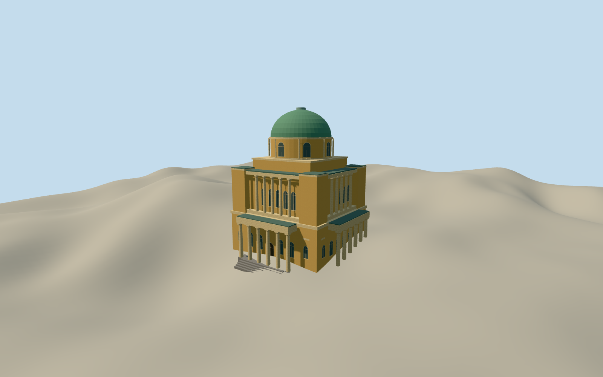

# Arctic and Antarctic Museum

The Saint Petersburg Arctic and Antarctic Museum exterior with two classical tiers, six-column Marata entrance and green dome, around February 2008.

Authoring state: **review-in-qa.json**. Current completion evidence is in [qa.json](qa.json) and the [completion ledger](../../../../qualla-structures/batches/qualla-003.PROGRESS.md).

- [Arctic and Antarctic Museum](https://qualla.com/arctic-and-antarctic-museum/)

The dome profile, green finish and overall mass are visible in the exact 2008 photograph. The restoration scaffold obscures façade details. Doric porticoes, upper colonnades, closed rear bay, dome drum and smaller opening positions are interpreted from the historical descriptions and native outline.

The original source elevation grid is unchanged. Nearby DEM elevations include built-surface effects. The preview opening is limited to the native envelope. The independent unmasked original field records the difference between its surface and inferred floor levels.

The model represents the museum’s permanent exterior around February 2008. Separate chapels, temporary scaffolding and interior exhibits are outside scope.

Build: `node content/worldgen/source/places/ud/udt/arctic_and_antarctic_museum/models/generate-arctic-museum.mjs`. Add `--check` to verify exact regeneration. 7920 triangles; 5 materials; no embedded photographs.
