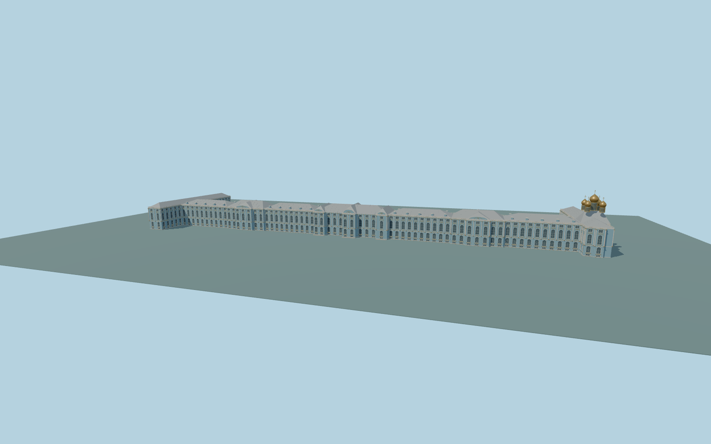

# Catherine Palace

Complete principal Catherine Palace exterior: long blue/white/gold baroque body, returned north and south wings, three raised hall roofs and five projecting crowns, recessed multi-story windows, paired white pilasters, original simplified gilded trim, roof balustrades, supported main forecourt entry and five-domed palace chapel. Detached curved low forecourt ranges, Lyceum/connecting arch, Cameron gallery, garden pavilions and park stay native context. No interiors or copied statues,heraldry or inscriptions.

Rebuild: `node packages/worldgen/scripts/generate-catherine-palace.mjs`;append `--check` for exact source bytes. Select import/LOD/placement with `--ids=catherine_palace`. Detailed source and four browser tiers are separate ignored GLB outputs.

Complete principal Catherine Palace exterior: long blue/white/gold baroque body, returned north and south wings, three raised hall roofs and five projecting crowns, recessed multi-story windows, paired white pilasters, original simplified gilded trim, roof balustrades, supported main forecourt entry and five-domed palace chapel. Detached curved low forecourt ranges, Lyceum/connecting arch, Cameron gallery, garden pavilions and park stay native context. No interiors or copied statues,heraldry or inscriptions.

Approximate84m standard global Terrarium reference, palace exterior floor84.5m. Main eave is16.1m above that floor; main roof rises about20-21m, chapel finial35m. Picture-guided facade proportions are reconciled with native3D part heights. Interior building-biased DEM returns are masked only within occupied palace bounds; surrounding garden/forecourt terrain stays unchanged. Original bounded entrance transition matches sampled coarse field.

Original medium-fi interpretation of individual roof transitions, facade/window inventories, gilded ornament and concealed joints. No copied artwork, statues or interior rooms; detached courtyard ranges and independent buildings are outside this principal-palace scope. Exact historic grades, survey accuracy, numerical LOD error and physical-device timings remain unmeasured.

Six existing shared256px plaster, limestone, granite, painted metal, painted wood and window grid graphs; gold and gray metal share one texture graph with separate PBR tints. Seven draws maximum, metric UVs and linear colors. Skyline retains complete palace body/returns, major roof halls and five chapel domes; district simplifies window rhythm; street has true closed recesses; close-up adds mullions, curved ribbons, paired pillars and open parapets. Detailed source retains finer curves/roof seams. Numerical LOD error estimates3/1.5/.7/.25m and physical timings are unmeasured.

Original geometry:repository license. Map:© OpenStreetMap contributors,ODbL-1.0;Protomaps. Standard terrain:terrain-grid.json. Ordinary pictures stay local and are not redistributed or used as textures. Current acceptance:qa.json.
