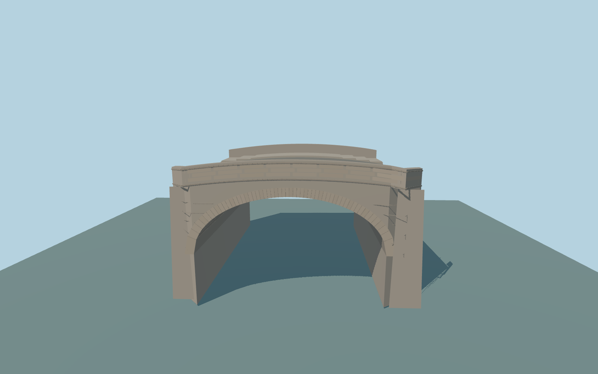

# Hermitage Bridge

Complete individual Hermitage Bridge exterior: one shallow open granite barrel, warm-gray granite spandrels and radial arch blocks, sparse broad courses, rounded retained corner profiles, full road and both broad outer walks with three short mapped stepped reaches, solid low-crown parapets and layered granite coping/cornice. Exclude the separate tall enclosed museum connection and adjacent quays/buildings.

Rebuild: `node packages/worldgen/scripts/generate-hermitage-bridge.mjs`;append `--check` for exact source bytes. Select import/LOD/placement with `--ids=hermitage_bridge`. Detailed source and four browser tiers are separate ignored GLB outputs.

Fixed29m visualization datum. Approximate32m end decks and32.6m crown, with local canal review water 28.310m. The unmodified global city field contains strong building/surface returns. The standard native renderer derives incompatible connected canal/Neva levels: this is not a surveyed elevation or a certified native shoreline fit. Keep native water acceptance pending if the rendered mismatch remains.

Ordinary photos and current PMTiles guide this original medium-fi exterior. Granite courses and arch ring joints, vault profile, low crown, broad walks/short steps, rounded corners and concealed foundations are approximate. No copied photo pixels, downloaded meshes, readable signs, boats, buses or furnished interiors. Neighboring museum connection, buildings, quay walls and roads remain native. Native water and bank fit require current visual acceptance; do not count this preview ready from geometry tests alone. Physical laptop/phone measurements remain pending.

Original geometry:repository license. Map:© OpenStreetMap contributors,ODbL-1.0;Protomaps. Standard terrain:terrain-grid.json. Ordinary pictures stay local and are not redistributed or used as textures. Current acceptance:qa.json.
