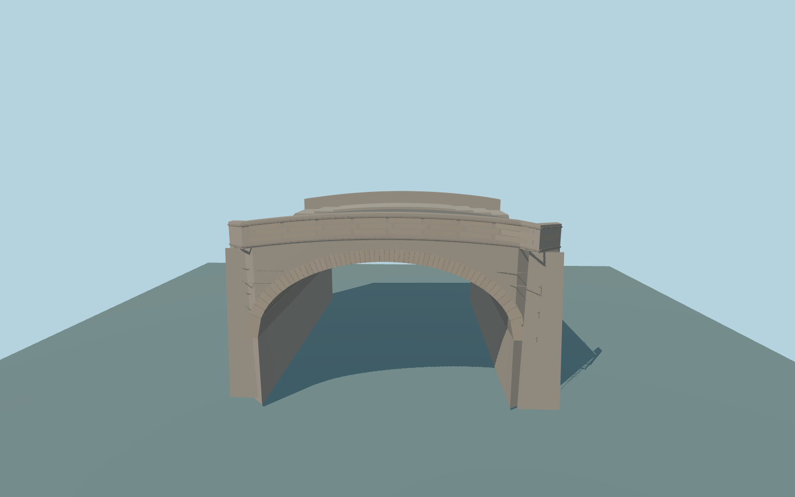

# Hermitage Bridge

Complete individual Hermitage Bridge exterior: one shallow open granite barrel, warm-gray granite spandrels and radial arch blocks, sparse broad courses, rounded retained corner profiles, full road and both broad outer walks with three short mapped stepped reaches, solid low-crown parapets and layered granite coping/cornice. Exclude the separate tall enclosed museum connection and adjacent quays/buildings.

Rebuild: `node packages/worldgen/scripts/generate-hermitage-bridge.mjs`;append `--check` for exact source bytes. Select import/LOD/placement with `--ids=hermitage_bridge`. Detailed source and four browser tiers are separate ignored GLB outputs.

The joined water stage and waterfront grade are visualization elevations derived from the retained terrain. Stone courses, vault profile, rounded corners, step counts and concealed foundations are approximate.

The separate enclosed museum crossing and neighboring buildings and quays are outside the bridge model. The viewer supplies their mapped context.

Original geometry:repository license. Map:© OpenStreetMap contributors,ODbL-1.0;Protomaps. Standard terrain:terrain-grid.json. Ordinary pictures stay local and are not redistributed or used as textures. Current acceptance:qa.json.
