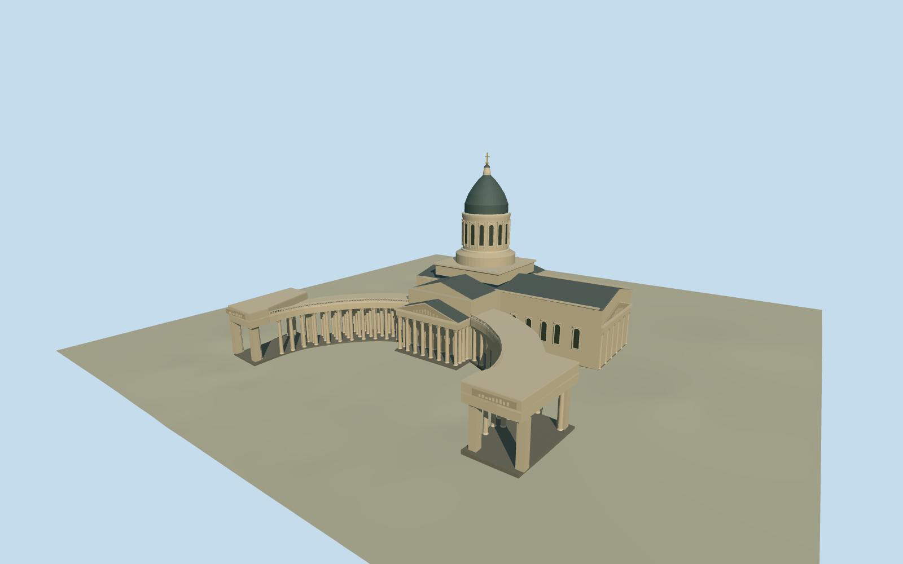

# Kazan Cathedral, Saint Petersburg

The monumental limestone cathedral, with the two open sweeping colonnades, three classical porticoes and the tall cupola.

Authoring state: **review-in-qa.json**. Current completion evidence is in [qa.json](qa.json) and the [completion ledger](../../../../qualla-structures/batches/qualla-004.PROGRESS.md).

- [Kazan Cathedral, Saint Petersburg](https://qualla.com/kazan-cathedral-saint-petersburg/)

Exterior covers the cathedral, both sweeping wings and the terminal pavilions. The detached statues, fountain, landscaping and building interiors are outside its scope.

Historic fabric is grounded in the surveyed footprints and published architectural dimensions. Individual reliefs and capitals are simplified, roof and window finishes approximate. Elevation interpolation uses open ground samples because even the provider DTM retains residual building heights around the monument. The review grade is locally interpolated from sampled open ground.

Build: `node content/worldgen/source/places/ud/udt/kazan_cathedral_saint_petersburg/models/generate-kazan-cathedral-saint-petersburg.mjs`. Add `--check` to verify exact regeneration. 31680 triangles; 7 materials; no embedded photographs.
