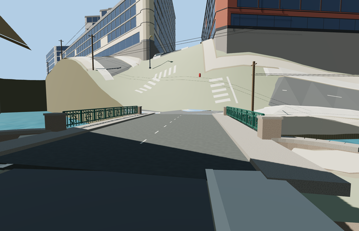

# Kokushkin Bridge

Reviewed2026-10-27. **Scoped exterior source reviewed; geographic fit rejected and disabled.**

Inspected63 current frames:11 portable,10 shared-material asset views,23 medium-fi contexts,15 unchanged-terrain native diagnostics and4 isolated existing-fit-control diagnostics. The full scoped exterior is present: shallow green panel girder with eight alternating circle/lozenge bays per side, brackets, wreath/rosette railings with small rings/swags, raised walks, granite abutments/course joints/flared cheeks and photographed2.6/diamond markers. Fixed abutment caps covering the road, corrected outward wing faces, removed internal wing caps and made opposite-side digits readable during this same authoring pass. Full turntables are small; dedicated railing, fascia, road and end-wall cameras establish detail readability. Native diagnostics do not grant geographic approval.

Three existing shared256px stone_granite, concrete_plain and metal_painted graphs with metric UVs and linear vertex tints. Three near semantic groups, one far tinted group; no private/embedded images or copied pixels. Each shared graph loads once and all model geometry disposes. Foliage/alpha cards are not used in this bridge.

| Level | Triangles | Bytes | Draws |
| --- | ---: | ---: | ---: |
| skyline | 532 | 44900 | 1 |
| district | 3856 | 308712 | 3 |
| street | 15784 | 1210144 | 3 |
| closeup | 32888 | 2440292 | 3 |

Source master 40512 triangles / 4863924 bytes. Runtime triangles 532 / 3856 / 15784 / 32888, bytes 44900 / 308712 / 1210144 / 2440292, draws 1 / 3 / 3 / 3. Initial skyline plus district 353612 bytes. All actual triangle budgets and separate GPU streams pass; physical laptop/phone timings are unmeasured.

Relation5636139/Q2390563 establishes the flared footprint; named current PMTiles bridge35184750129947 establishes the traffic crossing axis. Anchor[30.313628911972046,59.92582028905424], heading2.0450069232296695: +X NNW/Stolyarny Lane, -X SSE/Kokushkin Lane, +Z ENE. Corrected the old0.381882rad rectangle long side, which follows the broad flared width rather than the road. Road extent19.004823m is separate from the catalog18.92m length. Clear span15m, width13.1m and shear0.08 remain photo/map reconstruction controls.

Geographic fit rejected and canonical placement remains draft. Standard Mapzen z14 and z15 both contain a steep bank rise. At z15, native water is16.923998m; the source road is about20.50m while southeast landing ground rises to25–30m and beyond. The unchanged-terrain fixture buries part of the source and retains the original procedural bridge. Some diagnostic cameras are below the noisy terrain; they are not placement evidence. An isolated test of existing road replacement, connected approaches and capped terrain exposes the bridge but leaves cliffs/holes and missing approach-width coverage. It is also rejected. No distorted bridge, fabricated steep ramp or canonical terrain change was used to claim readiness.

The canonical fixture retains all102 resident buildings,369 road records, raw DEM, displayed ground and three water features through four loaded LODs and load failure. Shared graphs load once and unload releases all model geometry. The separate rejected prototype intentionally clips two covered road records (369to367) and changes only its local displayed cutout; original raw inputs, outside ground and water remain, and unload restores ground. Canonical source/placement are unchanged by that experiment.

## Remaining work

Resolve generic urban bank/road fit against the standard viewer terrain without burying or distorting the source, opening cliffs/holes or deleting independent streets. Current source, material and LOD reviews remain reusable while their inputs stay current. No bespoke terrain source is needed.

## Reconstruction limits

- Original photo-led static exterior: mapped19.0048m road segment, flared relation5636139/Q2390563 footprint and approximate15m clear span/13.1m deck width. The map rectangle axis was corrected to the actual road. Metal panel count/details and granite sections are ordinary-photo reconstruction controls, not a measured engineering survey.
- Three existing shared256px granite, plain-concrete and painted-metal graphs; all geometry authored, no photo pixels or downloaded mesh.
- The 2016 green paint and geometric ironwork are the selected photo appearance; the2006 close ironwork photo has older pale paint. No present-day paint survey or engineering/navigation clearance claim.
- Native placement stays disabled: both standard z14 and z15 terrain contain a large bank rise. The z15 fixture water is16.924m, southeast bank25–30m and northwest bank19–22m. Keep the bridge proportions; do not invent steep ramps or stretch its abutments to approve native fit.
- The source is a full static bridge exterior reconstruction with approximate clear-span/skew, width, granite sections, ornamental leaf counts and navigation marker shapes. The fixed2.6 plaque reproduces a photograph, not an operational clearance promise. Neighboring historic buildings, temporary street signs and independent streetlamps remain outside the asset scope. Physical-device timings are unmeasured.

## Native-fit diagnosis

The rejected prototype keeps the southeast approach at about 20.498m for samples 1–16m beyond the landing, while native ground rises from 27.029m to 32.851m. The lowering branch holds a constant seed elevation over the first half of its fade radius. The terrain cap independently projects only its interior down, leaving an abrupt boundary; it does not provide a graded bank transition. Three landing-width samples also have no supporting surface. Reused PMTiles IDs are not sufficient evidence of a graph collision because the graph keys features by object identity. Current compiled bundles already contain these algorithms.

A successful integration needs coherent bounded terrain/paving grades, continuous boundary joins and coverage of the skewed approach widths, followed by fresh affected native captures and preservation/unload checks. This diagnosis changes neither the reviewed exterior nor the disabled canonical placement. `placement-report.json` binds the observed samples and inspected implementation hashes.
