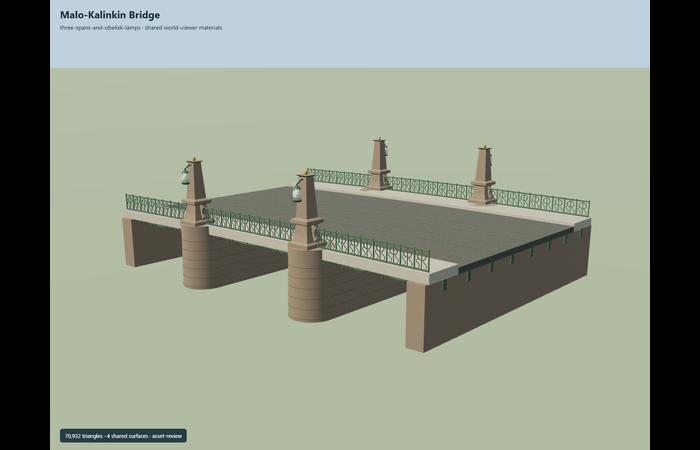
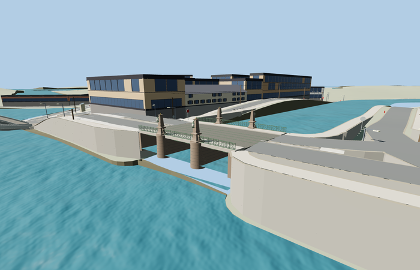

# Malo-Kalinkin Bridge

Reviewed2026-10-29. **Complete medium-fi static exterior and approximate native placement.**

Inspected54 current frames:8 portable,7 shared-material stage,24 medium-fi/context/LOD and15 native PMTiles views. Complete skew three-span green-girder bridge exterior with two rounded granite pier drums,four obelisk posts on curved bases,outboard oval lanterns and gold-colored finials,continuous roadway,both raised sidewalks,twin tram tracks and open circle/scroll ironwork. Actual GLB rays verify all three open spans,the skew deck/sidewalks,projecting pier drums,four finials/lamps and real pierced railing cells. The current pass corrected joint rings to follow the tapering stone radius and added drum copings beneath the outboard obelisk bases; distance tiers aggregate motifs,lantern profiles,girders and courses while preserving the distinctive silhouette.

Four existing shared256px graphs: stone_granite for granite supports/obelisks,metal_painted for green girders/ironwork,concrete_plain for road and stone_limestone_raw for sidewalk edges. Metric UV repeats and linear sRGB-derived vertex tints. Local opaque lantern glass and gold-colored finials; no private or embedded images. Stone/metal wear is an approximation. The four graphs load once and all model/support geometry disposes.

| Level | Triangles | Bytes | Draws |
| --- | ---: | ---: | ---: |
| skyline | 580 | 44916 | 1 |
| district | 2220 | 183352 | 6 |
| street | 7220 | 530100 | 6 |
| closeup | 35140 | 2203472 | 6 |

Detailed source 70932 triangles,8515524bytes. Browser triangles 580 / 2220 / 7220 / 35140,bytes 44916 / 183352 / 530100 / 2203472,draws 1 / 6 / 6 / 6. Initial skyline+district 228268bytes. All four meet1000/4000/16000/64000triangles and at most6draws,with separate GPU position/normal streams. Detailed master retains eight girders,denser scallops,individual railing circles/scrolls,masonry course seams,lantern ribs and fasteners. Browser close-up keeps six girders and coarser ornamental motifs; the source master remains intact. No physical laptop/phone timing claim.

Exact-QID map outline supplies25.622m by16.201m envelope. The mapped road/tram/walk runs are about23.5m with skew approximately-0.138m per transverse meter; member/vertical dimensions remain photo/map approximations. Current PMTiles bridge road35185614704570,tram35184526581440 and sidewalk35184526386510 establish horizontal fit. Anchor[30.28123615,59.91672875],heading-0.08154873428: +X east/southeast,-X west/northwest,+Z south/southwest toward Fontanka mouth,-Z north/northeast along Griboyedov Canal. Standard-viewer water-relative origin10.862507820129167m is a coarse native water plane,not surveyed sea level. Ordinary overview and near-detail pictures establish green scalloped girders,granite drum ends,four obelisk lamps and circle/scroll railings.

All five loaded tiers preserve76 building records,the independent road inputs,the original246 raw transportation records,rawDEM,ground mesh and water. Crossing replacement reduces246to244 nonempty rendered road records; short boundary fragments of walk/tram lines can remain outside the exact outline. Eight roadway/tram-width samples at the bridge ends are within0.014176m of the authored end datum across every tier. Skew means some probes lie over the visible model and some over adjoining paving. Independent neighboring bridge inputs retain their records and receive no authored joins. Coarse PMTiles water fragments have visible height steps around the canal mouth; shoreline heights,generic surrounding buildings and generated road/rail support terraces remain approximations. Exact canal embankments,the larger adjacent bridge and the surrounding street/catenary system are outside this asset. Failed loading preserves all246 roads and native ground/water; unloading releases model/support geometry and restores inputs.

## Reconstruction limits

- Original static medium-fi reconstruction from two ordinary exterior pictures and current standard PMTiles. The exact mapped envelope is25.622m by16.201m; underlying road/sidewalk runs are about23.5m long with a skew of approximately-0.138m per transverse meter. Envelope width/length and reconstructed member dimensions are not surveyed dimensions.
- Three open spans with shallow scalloped green girder fascia, two granite-faced transverse piers with round drum ends, four tapering obelisks on curved bases, outboard hanging oval lanterns and gold-colored finials, continuous roadway, raised sidewalks, two tram tracks and ornate iron railings are modeled. Pier positions, batter, vertical profiles, hanging fixture dimensions and repeating scroll/circle motifs are photo/map approximations.
- Detailed master retains eight girders, denser scallops, wrought railing circles and paired scrolling rods, masonry course joints, lantern ribs and rivet-like fasteners. Browser close-up has six girders and coarser circles/scrolls. Street/district merge motifs and lantern profiles; skyline keeps three open spans,round pier ends and four obelisk silhouettes.
- Four existing shared256px graphs: stone_granite,metal_painted,concrete_plain and stone_limestone_raw, metric UV repeats and linear vertex tints. Local opaque lantern glass and gold-colored finials. No private or embedded images. Shared textures approximate stone blocks/painted iron/road rather than exact surface wear. Lanterns are static daylight geometry.
- Native origin follows the standard viewer water plane from PMTiles/Mapzen, not surveyed sea level. Coarse water fragments can have stepped elevations and raw shore ground is approximate. Connected road/rail approaches use generated supports with steep sidewalls. Exact canal embankments, nearby historic buildings, road signs and the surrounding street/catenary network are outside the bridge asset. No physical laptop/phone timing claim.
- Current hash-bound acceptance is in qa.json and placement-report.json. Native-fit.json and integration-review.json preserve source-promotion controls; their pending text is historical. This is a static exterior and scoped approximate map fit, not engineering dimensions, traffic legality or accessibility verification. Native bulk captures remain local.
