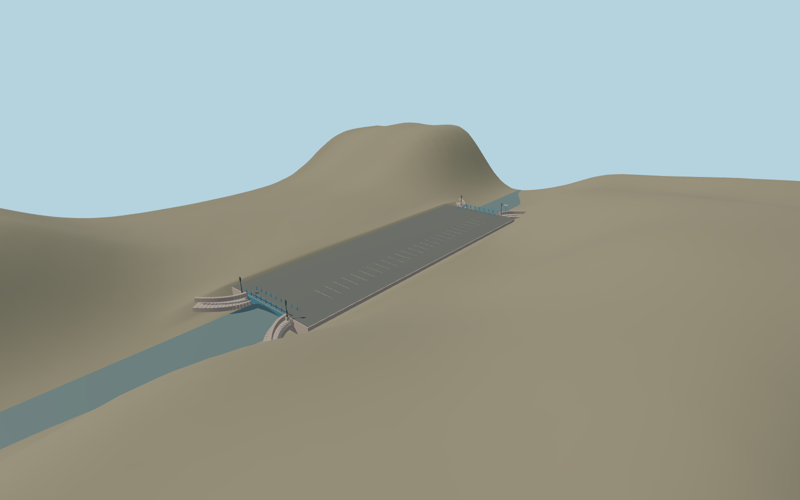

# Blue Bridge

Compact Blue Bridge: split cast/concrete vault, granite abutments and splayed quay walls, ornate blue railing impressions, lanterns and representative parking marks. Detailed master remains independently reproducible.

## Evidence

- [Primary reference](https://mostotrest-spb.ru/bridges/sinij)
- [Primary reference](https://mostotrest-spb.ru/bridege/photoalbum/sinij-most)
- [Primary reference](https://www.pylon.ru/printed-materials/object2016.pdf)
- [Primary reference](https://stpr.ru/upload/encyclopedia.pdf)
- [Primary reference](https://www.openstreetmap.org/relation/3299061)

Published dimensions and reconstruction assumptions are separated in spec.json. Source photos were consulted; no photos or third-party geometry are embedded. Map plan attribution: © OpenStreetMap contributors, ODbL-1.0.

## Source

24230 triangles; 2911068 bytes; 6 material groups. SHA256: sha256:e04f0ec552d9c64277dc4dc84e5c0ad9a390ae99f87fad453e40c5da8ef6d466.

Shared surfaces (metal_painted, concrete_plain, stone_granite) are loaded through the central library; any transparent materials use local PBR parameters. Axis and provisional vertical datum are in spec.json.

Regenerate with node packages/worldgen/scripts/generate-researched-bridges.mjs --ids=N0027; append --check to verify. Import and capture through the standard next-1000 scripts. Geometry validation does not substitute for current-frame visual review.

## Reconstruction limits

- Two inspected street pictures establish blue quatrefoil/circle cast railing, plain inner rail, lantern context and plaza pavement. Existing vault dimensions are retained from the source. Standard viewer PMTiles Moika crossing and square confirm the short southeast crossing axis and broad downstream width. Retain29.4m crossing,95.4m cornice width and113.85m splayed-quay extent; nominal97.3m width is a separate definition. West/east road samples18.9794/19.0298m differ0.05m; source endpoint3.25m gives approximatebase15.7294m. Urban terrain includes bridge/roof imprint, so the source normal-water reference remains approximate. Narrow canal opening and bounded preview contacts remove that imprint; exact water stage/quay levels and parking layout are unverified.
- Shared granite/concrete/painted metal are reused. Low tiers merge casting patterns and omit ribs; closer levels add quatrefoil/circle impressions and representative cast ribs. Exact curls, rib pitch, bolts, individual masonry, parking stripes and Cyrillic sign lettering are simplified; the sign is an unlettered plaque. Original master preserves detailed reconstruction.
- No bespoke datum or parking-registration research. Physical-device timings remain unmeasured.
