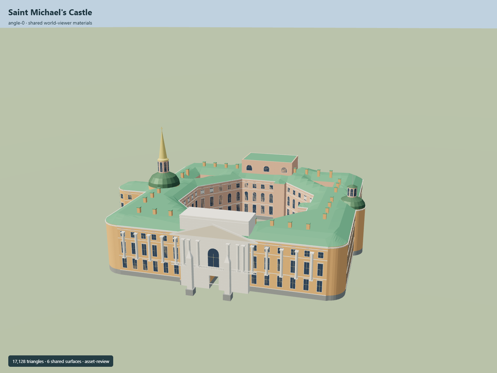

# Saint Michael's Castle

Current Saint Michael’s Castle: rounded near-square salmon exterior around an open octagonal court and two triangular service courts, low green roofs, gold church spire and separate river dome/lantern, monumental south pediment/obelisks, north colonnade/balcony/stair and physically open mapped south entrance.

## Evidence and reconstruction

Published dimensions and reconstructed details are separated in spec.json. Primary references:

- [Reference](https://api.openstreetmap.org/api/0.6/map?bbox=30.3358,59.9397,30.3393,59.9413)
- [Reference](https://rusmuseum.ru/museums/mikhailovsky-castle/)
- [Reference](https://rusmuseum.ru/upload/iblock/ea6/rxyi4rfqjs1728ihlakacrjz0gwe3lna.webp)
- [Reference](https://rusmuseum.ru/upload/iblock/524/4pjmil9zp44n4xeisumxuicgqbh3cs64.webp)
- [Reference](https://rusmuseum.ru/upload/iblock/fb2/a9xm75pkbsv1w9850ygrw7rxqki128wb.webp)
- [Reference](https://upload.wikimedia.org/wikipedia/commons/8/84/Saint_Michael%27s_Castle_Courtyard.jpg?utm_source=commons.wikimedia.org&utm_campaign=imageinfo&utm_content=original)
- [Reference](https://upload.wikimedia.org/wikipedia/commons/5/54/RUS-2016-Aerial-SPB-St_Michael%27s_Castle_02.jpg?utm_source=commons.wikimedia.org&utm_campaign=imageinfo&utm_content=original)
- [Reference](https://upload.wikimedia.org/wikipedia/commons/b/bb/%D0%9C%D0%B8%D1%85%D0%B0%D0%B9%D0%BB%D0%BE%D0%B2%D1%81%D0%BA%D0%B8%D0%B9_%D0%B7%D0%B0%D0%BC%D0%BE%D0%BA_2.JPG?utm_source=commons.wikimedia.org&utm_campaign=imageinfo&utm_content=original)

Six existing shared256-square graphs, linear tints and central metric repeats. Flat glass. No embedded/new image, photo texture, downloaded mesh or printed drawing trace.

## Model and axes

17,138 triangles; 51,414 vertices; 7 material groups; 2,060,744 bytes. Native bounds: -85.000, -24.299, -86.000 to 88.000, 35.400, 88.000. Source hash: `sha256:ca6dcc23f4a5d5e80f59de2bb600ef71c45d1996b8494e412a6becacc471b24c`.

{"up":"+Y","front":"Main entrance faces roughly south-southeast; native +X east and +Z south","longitudinal":"All horizontal map angles baked into East/South geometry; heading0","origin":"Site anchor; Y0 standard PMTiles working datum."}

Inspected entrance picture and retained map geometry set approximate facade, scale and orientation. Standard viewer PMTiles contain a spurious mound under this urban palace. The existing reversible ground-opening mechanism suppresses only the bounded169x170m palace/plaza patch; the model fills it with a reconstructed paved apron atY-21.15, a-21m architecture shift and a2m perimeter taper to the original PMTiles samples. CourtyardY-20.92 and normal-height foundations remain visible. Surrounding terrain is retained and restores on unload. This is approximate visual ground fit, not a surveyed urban datum.

## Reproduce

Run `node packages/worldgen/scripts/generate-signature-towers.mjs --ids=N0300` (or add `--check`). The generator preserves manually edited masters by checking their baseline hashes. Import through the standard authored-model workflow with optimization disabled; then capture all QA cameras, including shared-surface views.

## Pending work

- Approximate current exterior and fit from inspected entrance picture and standard viewer PMTiles; no bespoke survey or exact thresholds.
- Detailed original master/hash/recipe preserved. Spire/dome profiles, columns, inscriptions and restoration details are interpreted; interiors and collision excluded.
- Six common graphs plus explicit glass color slot; zero embedded images. A reversible bounded ground opening and authored paved apron suppress the PMTiles mound under the palace; adjacent raw PMTiles terrain is retained. Actual urban ground datum is not surveyed.
- Footprint replacement remains off; physical-device timing unmeasured.

This bundle follows the medium-fi standard. Medium-fi appearance and geographic fit are reviewed separately. Hash-bound visual acceptance is recorded separately after capture inspection.

## Additional geographic data

© OpenStreetMap contributors; State Russian Museum; Alex Florstein Fedorov, Andrew Shiva (Godot13), and Nadezhda Pivovarova/Wikimedia Commons.
