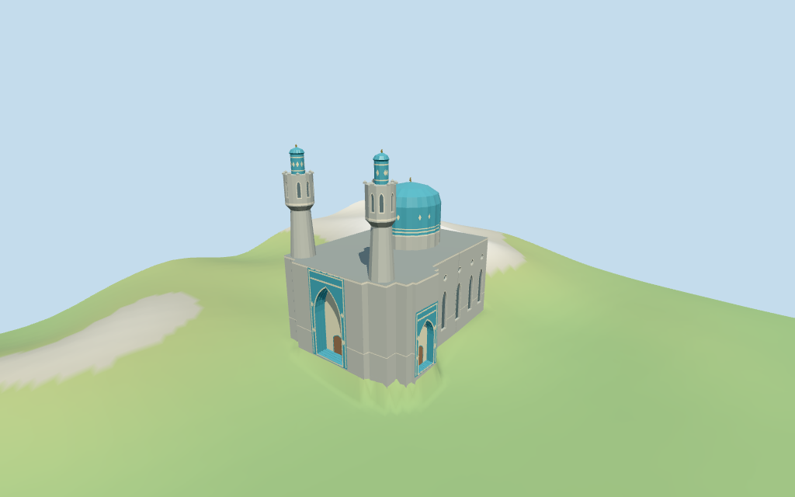

# N0444 — Saint Petersburg Mosque

Reviewed2026-10-17 against current bytes. Accepted for the stated medium-fi exterior and approximate map fit. Exact retained way/QID;height partitions,current finish,unseen interiors,DEM bias and street/paving/threshold joins remain explicitly limited.

## Exterior and shared surfaces

Actually inspected all11 final portable frames,including the1024×640 summary. Gray stone body,large ribbed blue dome on a gray drum,twin tapered minarets with flared arched chambers/blue lanterns and ribbed caps,tiled main/side portals,pointed windows/oculi and crescent finials. Corrected both portal planes to their actual slightly angled facade edges and clipped horizontal trim around the openings. Full tile fields now remain in front of stone. Portal vaults use three broad stepped arch bands;wood doors and opaque window glass close the exterior. Roof,carving,ornament counts,current condition and exact street contact remain approximate.

Actually inspected all11 final shared/geographic-flat views. Six existing256² granite,limestone,mosaic tile,standing-seam metal,plain wood and bronze graphs. Eight merged roles include opaque untextured glass. Metric UVs and linear tints;zero embedded images,unique atlas,baked lighting or copied tile art/calligraphy. All six graphs read once;unload zero live model geometries. North-up base outline,tower corners and dome position align with the retained map frame. The geographic fixture is flat;portable/medium-fi use the declared preview DEM seating. Detail shots crop neighboring forms;whole views cover the model. Actual host street/threshold and terrain-cutout edge joins remain unverified.

## Browser levels

| Level | Triangles | Bytes | Draws |
| --- | ---: | ---: | ---: |
| skyline | 953 | 99,852 | 1 |
| district | 3,252 | 327,324 | 8 |
| street | 7,840 | 811,784 | 8 |
| closeup | 10,233 | 1,075,816 | 8 |

Initial skyline plus district:**427,176 bytes**. Master **1,339,952 bytes /11,127 triangles**;runtime **1,339,244 bytes**. Six shared256² graphs/eight merged roles,zero embedded images;shared textures are additional.

Actually inspected all27 final medium-fi frames:Economy/High,noon/late,three distances,silhouette,six details,four matched browser levels and four transitions. Whole skyline also inspected full size. Skyline953 retains raw lower shaft/base joints,coarse upper chambers/blue caps,large dome,crescents and both spatial portal recesses;window proxies are flat. District3252 adds bands,more window groups and spatial pointed openings while oculi remain flat. Street7840/close10233 add fluting,stepped vault bands,window chambers and selected crest/diamond accents. Initial427176 bytes plus shared textures;one/eight draws,separate attribute streams,equal CPU/GPU reservations. The synthetic context uses continental masonry. Preview edge mounds reflect unresolved DEM bias;exact paving/streets and physical-device timing remain unverified.

## Placement and scope

Retained way28712430 has exact Q281900. Its original anchor[30.323903295,59.95518917] and heading-1.274639227411rad are unchanged. Current encoded way35184400801262 supplies the18-point22m base;separate48m minaret parts and39m dome part fix the tower-side/front and opposite dome-side hand. The main portal is assigned to the tower-side end,the smaller portal to the mapped projecting side bay,using the inspected whole-building pictures.15-degree orientation allowance is an approximate visual assignment,not a surveyed doorway bearing. No height,width or length facts were present in the retained candidate. Current PMTiles tags are preserved:base22m;dome min_height22/top39m;two minarets min_height22/top48m. Their internal gray drum/blue ribbed cap,shaft taper,flared chamber,blue lantern and finial partitions are picture-guided estimates ending at those nominal tops. The lower shaft portions are modeled continuously within the base footprint rather than floating at min_height22. Portal/window dimensions,roof detail,moon orientation and exact current restoration remain unverified;no independent surveyed dimensions are claimed. Standard viewer DEM datum24.730195m. A1m footprint grid plus all raw control vertices yields1581 samples,-6.124..8.608m. The large building-scale variation suggests DEM contamination. 90 samples every2m at1m outside the footprint give a median-1.086472m;working plane-0.836472m is that median plus0.25m. A visible-model ground cutout follows the mapped base so coarse terrain cannot fill the entrance recesses. The preview heightmap seats its interior at floor minus0.2m with a1.8m edge transition;the raw DEM stays in pmtiles-fit.json. Footings extend below retained outside terrain. Exact street/paving joins,steps,thresholds and walking remain unverified;no bespoke survey or broad flattening. All138 viewer-footprint checks cover the four mapped controls,preserve17 separate buildings,and leave two outside-ground samples unfilled across six files. All74 raw map points/properties independently reunited from current PMTiles. Dome source retains23 points;two near-duplicate quantization points are removed only from the21-point geometry ring. Every active dome ring has a matching roof hole. The1581 raw samples and90 outside-perimeter samples reproduce the floor;the preview heightmap interior seats at floor minus0.2m. The visible-model cutout is registered against the same mapped base. Acceptance covers approximate horizontal exterior fit;exact street/paving contact,steps and walking remain unverified.

Individual medium-fi Saint Petersburg mosque exterior:gray granite base,large ribbed blue dome over a stone drum,twin tapered stone minarets with corbel flares/arched chambers/blue lanterns and ribbed caps,tiled main/side pointed recesses with abstract stepped vaults,selected pointed windows and oculi,and nominal-height crescent finials. Six existing shared256² graphs,eight merged roles including opaque untextured window glass,four authored browser levels. Exact carving,inscriptions,room plans,roof detail,current condition and ground/walking remain approximate or unverified. No height,width or length facts were present in the retained candidate. Current PMTiles tags are preserved:base22m;dome min_height22/top39m;two minarets min_height22/top48m. Their internal gray drum/blue ribbed cap,shaft taper,flared chamber,blue lantern and finial partitions are picture-guided estimates ending at those nominal tops. The lower shaft portions are modeled continuously within the base footprint rather than floating at min_height22. Portal/window dimensions,roof detail,moon orientation and exact current restoration remain unverified;no independent surveyed dimensions are claimed. Standard viewer DEM datum24.730195m. A1m footprint grid plus all raw control vertices yields1581 samples,-6.124..8.608m. The large building-scale variation suggests DEM contamination. 90 samples every2m at1m outside the footprint give a median-1.086472m;working plane-0.836472m is that median plus0.25m. A visible-model ground cutout follows the mapped base so coarse terrain cannot fill the entrance recesses. The preview heightmap seats its interior at floor minus0.2m with a1.8m edge transition;the raw DEM stays in pmtiles-fit.json. Footings extend below retained outside terrain. Exact street/paving joins,steps,thresholds and walking remain unverified;no bespoke survey or broad flattening. Blue/cream bands and sparse original diamonds abstract the photographed color fields. The portal facets approximate muqarnas;no copied motifs or inscriptions. Exact rear/roof geometry,window counts,corbel/lobe/rib profiles,finial orientation,current finish,rooms/stairs and navigability remain unverified. No independent surveyed dimensions or sea-level datum are claimed. Three inspected pictures from2006/2008/2021 guide the form;no bespoke research or redistributed pixels.

## Verification

**49 final views inspected;335 geometry probes;138 footprint checks.** Six Khronos validations:zero errors/warnings/images. Targeted byte reproduction,scene validate/sim30,recipe-only Biome and current recipe/input/model/LOD/report/capture/material bindings pass. Six graphs read once;unload zero live model geometry. Current builds reused;next full source checkpoint N0432–N0449.

Source:sha256:a51e9215391682a187aac55af4ce8fa9a2a56d210b4141fd15efc3084c862925

Runtime:sha256:36dc199efe2e9e51b21b7bfed2a3f620db4407ea2eed4be0c1255086ffcb822c

Input:sha256:d3e2c4603cdd06be8a64b6144e919df1ee066dcf6f022f9779a63d62b8d4459f

Simulation:sha256:d6cd89fc6784647535d1250b9a3b516387cc1fbcc295498021ffdca1f98a2886

Commands:targeted generate/import/LOD/register --ids=N0444;generate --check;portable reflections/antialias/fitted shadows;shared reflections/adaptive clipping/bounded placement;medium-fi reflections;scene validate/sim30;recipe-only Biome. Bulk captures remain ignored.

## Inspected pictures

[Bestalex — 2021-03-18](https://commons.wikimedia.org/wiki/File:Saint_Petersburg_Mosque,_2021.jpg). CC-BY-SA-4.0. Actually viewed whole building:gray coursed stone body,two tapered cylindrical minarets with wider window chambers and slender blue lanterns/bulb caps,large blue ribbed dome with near-vertical lower profile,and two tiled pointed portal fields. Trees/wires obscure some lower details;current unseen sides remain approximate.

[Doomych — 2008-07-13](https://commons.wikimedia.org/wiki/File:Saint_Petersburg_Mosque_-_02.jpg). PD-self. Actually viewed close portal vault:deep three-dimensional muqarnas and blue/turquoise/pale tile fields. The model abstracts the vault with broad stepped facets and original sparse geometric accents;no copied motifs or calligraphy.

[Evgeny Gerashchenko / Geevee — 2006-07-04](https://commons.wikimedia.org/wiki/File:Saint_Petersburg_Mosque.jpg). CC-BY-2.5 (also offered CC-BY-SA-3.0/GFDL). Actually viewed second whole/front view:stone shaft taper and corbel flare,upper arched chambers,pointed crest,blue patterned lanterns and ribbed bulbs;large blue ribbed dome over gray cylindrical drum;main rectangular tiled portal and side pointed window/oculus rhythm. Roof/interior details outside the picture remain unverified.
