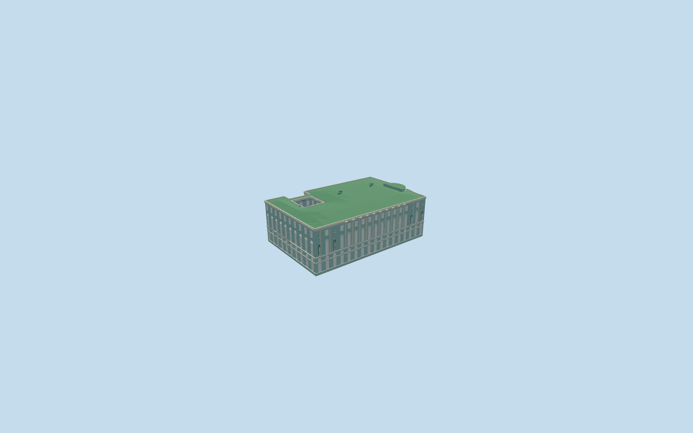

# N0741_THEATRE — Hermitage Theatre

Geometry reviewed2026-10-21. **Incomplete: original terrain fit is unapproved; public placement remains inactive draft.**

## Appearance

Inspected39 current portable/shared/medium-fi frames and13 combined site frames in the same author/build/inspect pass. Exact named theatre block/small rear-east courtyard, pale blue-green three-tier Neoclassical riverfront with ten engaged round giant-order columns, rusticated ground rectangles/separate arched transoms, piano window pediments, four simple original standing niche figures/four bust medallions, projecting cornices and a closed rounded upper canal-side roof corner. Separate rear military-headquarters block and Old Hermitage covered gallery are preserved, not duplicated. No furnished auditorium/historic rooms, copied fine sculpture/inscriptions or artificial courtyard floor. Native terrain fit remains rejected.

## Shared surfaces and browser budgets

Five existing shared256px graphs: stucco, stone_limestone_raw, metal_standing_seam, window_grid and metal_painted. Seven roles merge into five near draws/one skyline draw; niche tint reuses stucco. No embedded images/private atlas/new graph. Every graph read once; separate POSITION/NORMAL streams and equal CPU/GPU accounting. Shared opaque glazing approximates reflections.

| Level | Triangles | Bytes | Draws |
| --- | ---: | ---: | ---: |
| skyline | 115 | 12016 | 1 |
| district | 2173 | 218240 | 4 |
| street | 9304 | 896828 | 5 |
| closeup | 33185 | 3331940 | 5 |

Four authored browser levels 115/2173/9304/33185triangles; initial skyline plus district230256bytes. Main courtyard/rounded upper corner survive every level; district retains engaged columns/transom bands, street framed bays, closeup adds volumetric pediments/capitals/rustication/simple statue forms. Geometry/download/draw/layout budgets pass. Physical laptop/phone/tablet/dense-city timings remain pending.

## Native placement

Independent N0741_THEATRE/Q2349693 member of the five-building main Hermitage complex. Named native theatre parent52776559217972/relation1084724 and the co-located Peter the Great Winter Palace museum POI identify this physical theatre block; the latter does not require a duplicate building asset. Native outline approximately72.9x47.3m includes one12x13m courtyard. Rear block52776559217973 is separately named/typed by the map and remains independent, as does covered gallery52776566225543 owned by Old Hermitage. +X internal runs along the river facade away from Winter Canal, -Z faces Neva, world heading0/native east-south/internal main-site axis0.630352782657rad. Anchor[30.3179794549942,59.94263555424804]. Two ordinary exterior photographs actually viewed establish engaged columns, window/transom/niche rhythm, palette and rounded upper canal corner.

Corrected the common ground-reference metadata without changing any of the 30 GLBs. All five references now sample the existing Winter Palace south-plaza control [30.315047028387312,59.93964319761939] and subtract each member's actual native floorY. In a combined five-building scene, all five floors coincide on the original provider and on controlled flat ground at0m and137m. Controlled providers test placement portability only; they do not approve native terrain fit. All18 owned records are replaced, all507 independent resident records of525 retained; failure retains525 originals. Original native samples/roads/water stay unchanged; each of seven shared graphs is read once, all four native LODs unload to zero live model geometry. Inspected13 combined frames: the original terrain still buries the riverfront and intrudes into courts, so all five public placements remain inactive drafts.

## Scope and limits

Two ordinary exterior photographs actually viewed,2008 and2012; existing standard PMTiles supplies the particular outline and independent ownership. Native theatre parent supplies no qualified height. Picture-led working wall22.2m, ground/clerestory belt8.4m, giant order8.4..21.9m, piano windows9.2..14.9m, attic17.8..20.4m, low green roofup23.7m and rounded upper corner24.35m. Ten-column/17-bay working rhythm, curved roof-corner allocation, statue/bust/pediment/chimney inventory and material optics are visualization approximations. Original common plaza floor-22.89322760622532m relative to raw datum40.43920292386276m retains the existing Winter Palace south-plaza control. Photographs2008/2012 establish visible reference appearance, not surveyed dimensions, engineering/access or current-condition certification. Original coarse statuary forms approximate architectural rhythm; fine sculpture/lettering and interiors are excluded. No bespoke terrain/survey research. Geometry reviewed; geographic completion remains pending.

## Selected checks

Six Khronos files: zero errors/warnings;1124 actual mesh/contact checks;9 actual PMTiles13/14/15 cases;39 model frames plus13 combined site frames inspected. Source/import/draft-placement/strict medium-fi/scene/sim30/lint checks pass. Sim30 sha256:7a4140bfd9f470a2be7455a9eca1f6f39ff6be11392ec4d26b1d102bd9e5e451.

Rebuild: node packages/worldgen/scripts/generate-additional-landmarks.mjs --ids=N0741_THEATRE; node packages/worldgen/scripts/import-next-1000-models.mjs --ids=N0741_THEATRE; node packages/tooling/scripts/generate-landmark-lods.mjs --ids=n0741_hermitage_theatre --force.

## Ordinary picture references

https://commons.wikimedia.org/wiki/File:Hermitage_Theater_in_SPB.jpg — Alex 'Florstein' Fedorov; 2012-07-20; CC-BY-SA-4.0. Viewed only; no copied pixels.

https://commons.wikimedia.org/wiki/File:Hermitage_Theater-3.jpg — Yair Haklai; 2008-08-24; CC-BY-SA-3.0. Viewed only; no copied pixels.

Source sha256:0d6039500d95722cbc966ac4ad1f45739469fe6905cc4090f6ff41ebc593b599

Runtime sha256:d74b27c28925248345ded1c0d1ebd95efa3b110d4f7052a3069841c893cc9f68

Input sha256:973fb0462b2df1b5fa6842a263b5c416e6786254a2b3b51dad15e5c36882abea
