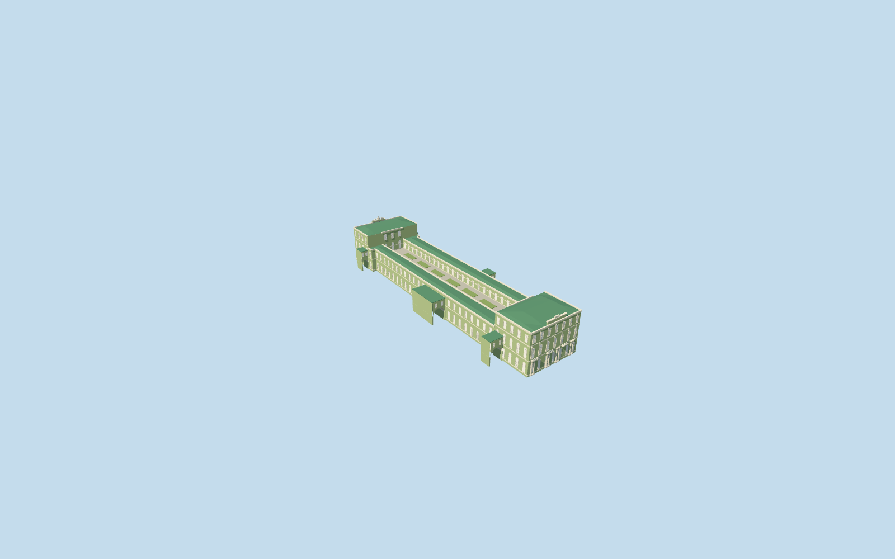

# N0741_SMALL — Small Hermitage

Geometry reviewed2026-10-21. **Incomplete: native terrain fit is unapproved; catalog placement remains inactive draft.**

## Appearance

Inspected all47 current source/shared/medium-fi/native frames in one author/build/inspect/fix pass. Two distinct classical end pavilions, six north giant-order round columns, paired south columns/pilasters/balconies, three facade tiers, green faceted roofscape/attics, long galleries, raised garden over occupied lower rooms and six mapped overhead connecting wings with open ground arches. Fixed missing upper garden-facing windows and changed pointed roof figures to coarse original seated/reclining silhouettes. No furnished galleries, copied art/lettering/reliefs or exact garden sculpture inventory. Geometry appearance reviewed; native terrain fit rejected.

## Shared surfaces and browser budgets

Five existing shared256px graphs support seven surface roles: stucco, stone_limestone_raw, metal_standing_seam, window_grid and metal_painted. Garden beds reuse green-tinted stucco; no new graph, private atlas or embedded images. Each graph read once. Seven near roles/one skyline draw, separate POSITION/NORMAL streams and equal CPU/GPU accounting. Opaque shared glazing approximates reflection; portable fallback panes are pale.

| Level | Triangles | Bytes | Draws |
| --- | ---: | ---: | ---: |
| skyline | 507 | 46524 | 1 |
| district | 2672 | 272608 | 4 |
| street | 7678 | 743260 | 5 |
| closeup | 38086 | 3816436 | 5 |

Four authored browser levels 507/2672/7678/38086triangles; skyline plus district319132bytes. Distinct pavilions/raised garden/roofs/connector openings persist across levels. Street frames use flat trim bands; closeup adds volumetric frames/mullions. Geometry/download/draw/memory-layout budgets pass; physical ordinary-laptop/phone/tablet/dense-city timings remain pending.

## Native placement

Independent Q4279216/Small Hermitage, member N0741_SMALL of N0741 five-building main museum complex; not the Hermitage institution centroid. Exact native parent52776559201196/relation1067948 supplies the approximately36.75x156.8m outline and raised-garden opening. Six small connecting wing records are owned explicitly. Anchor[30.315708965063095,59.941255818912424]/world heading0/native east-south; internal axis0.630352782657rad places north pavilion toward Neva and south pavilion toward Palace Square. Ordinary north/south photographs actually viewed; map footprint establishes fit, photos establish visible architecture. Only Small Hermitage parent and six individually mapped connecting wings replaced. All259 independent resident records of266/all1381 independent wider records of1388 retained. Occupied lower rooms support the raised garden; the terrain opening stays inside that actual footprint and does not remove the streets beneath elevated connectors. Original6m samples, roads and1254396.7961647527square metres water unchanged. Fifteen actual PMTiles13/14/15 cases pass, including all seven detailed owned records. Failure keeps266 originals; every LOD unload restores terrain/water and zero live model geometry. These ownership/lifecycle checks pass; native elevation fit fails. PENDING NATIVE TERRAIN FIT: current standard main-site terrain is roof/tree influenced and Winter Palace fit already failed. Original6m Mapzen samples, roads, water and independent buildings remain unchanged. A shared plaza floor and occupied lower rooms support the garden, rather than treating the native garden hole as an at-grade courtyard. Ground opening is strictly inside the occupied main parent only; all connector streets remain native terrain. No flattening, precinct slab or bespoke terrain source; do not activate or count ready without inspecting native fit.

## Scope and limits

Two ordinary2015/2016 north/south photographs actually viewed plus standard map footprints; no bespoke research. The optional Jardin ermitage1 picture was excluded because its New Hermitage description cannot reliably establish the Small Hermitage hanging garden. Mapped11m main/8m connector heights have unqualified datum. Picture-led working heights: occupied garden floor8.35m, galleries14.6m, pavilions22.5m, roofs24.1m, attic/abstract roof group26.62m. Working common floor-20.20704379702497m relative to anchor datum37.75301911466241m reuses the existing original Winter Palace south-plaza sample, preserving a coherent main-site grade. Column/window/arch/roof/planting/ornament counts and optics are approximations, not surveyed reconstruction. 2015/2016 photographs establish visible reference appearance, not present-condition certification. Garden paths/low beds are neutral picture-led-type approximations with no exact planting or sculpture inventory. Geometry reviewed; geographic completion is pending. N0741 remains incomplete until all five required members are ready.

## Selected checks

Six Khronos files: zero errors/warnings. 435 actual mesh/contact checks; 47 inspected views; fifteen actual map-level cases. Selected source/import/draft placement/strict medium-fi/scene/sim30/lint pass. Sim30 hash77c427d95c41cfbefa3edeb5674c1d6419a1938f0f10a801c69459788efa5896.

Source sha256:815f768acde2d414796c3cff3a112339b752555ab83b20802aafc8a900f0d905

Runtime sha256:4729e96925bcb67f79ae36b51d6c3a3152780156104750eb669463c7407ebc8c

Input sha256:082e329fb9d2bd4f3d54111296d93969c858ea5b7d710cd408baefb5ff3e1aec

Rebuild: node packages/worldgen/scripts/generate-additional-landmarks.mjs --ids=N0741_SMALL; node packages/worldgen/scripts/import-next-1000-models.mjs --ids=N0741_SMALL; node packages/tooling/scripts/generate-landmark-lods.mjs --ids=n0741_small_hermitage --force.

## Ordinary picture references

https://commons.wikimedia.org/wiki/File:Small_Hermitage_SPB.jpg — Alex 'Florstein' Fedorov; 2016-05-01; CC-BY-SA-4.0. Viewed only; no copied pixels.

https://commons.wikimedia.org/wiki/File:Small_Hermitage_SPB_01.jpg — Alex 'Florstein' Fedorov; 2015-05-01; CC-BY-SA-4.0. Viewed only; no copied pixels.

## Common reference correction — 2026-10-21

Corrected the common ground-reference metadata without changing any of the 30 GLBs. All five references now sample the existing Winter Palace south-plaza control [30.315047028387312,59.93964319761939] and subtract each member's actual native floorY. In a combined five-building scene, all five floors coincide on the original provider and on controlled flat ground at0m and137m. Controlled providers test placement portability only; they do not approve native terrain fit. All18 owned records are replaced, all507 independent resident records of525 retained; failure retains525 originals. Original native samples/roads/water stay unchanged; each of seven shared graphs is read once, all four native LODs unload to zero live model geometry. Inspected13 combined frames: the original terrain still buries the riverfront and intrudes into courts, so all five public placements remain inactive drafts.

All six geometry files remain byte-identical. Current model input sha256:082e329fb9d2bd4f3d54111296d93969c858ea5b7d710cd408baefb5ff3e1aec. Existing geometry review retained; capture reports refreshed.
