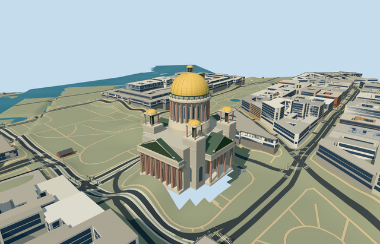

# N0760 — Saint Isaac’s Cathedral

Reviewed2026-10-22. **Authored exterior; unfinished geographic draft. Automatic placement remains disabled.**

## Built and inspected

Mapped cathedral exterior with four double-row granite-columned pediment porticos, four corner pylons/open belfries, main colonnaded drum and clerestory, five gilded domes, lanterns/crosses, raised dome ribs, balustrade and a real1.5m primary entrance recess/arched soffit/1.28m threshold and steps. Two ordinary photos plus standard PMTiles guided one author/inspect/fix pass. Window inventories, hidden elevations, caps and sculpture/relief fields are simplified exterior reconstructions.

## Shared materials and LODs

Seven textured roles use five existing256px graphs: stone_limestone_raw, stone_granite, metal_painted, metal_copper and storefront. Painted metal with a gold tint substitutes for gilding; dark opaque glass/bell/door proxies are deliberate. No embedded images/private atlas/new graph. At most seven textured draws, one skyline draw, separate POSITION/NORMAL buffers and equal CPU/GPU accounting. Every native textured run reads each of the five graphs once.

| Level | Triangles | Bytes | Draws |
| --- | ---: | ---: | ---: |
| skyline | 996 | 96860 | 1 |
| district | 3956 | 387088 | 7 |
| street | 15374 | 1450676 | 7 |
| closeup | 23950 | 2297568 | 7 |

Four authored LODs 996 / 3956 / 15374 / 23950 triangles; initial skyline+district geometry 483948 bytes, closeup 2297568 bytes. Six current GLBs: zero Khronos errors/warnings,204 mesh/contact probes;21 actual PMTiles13/14/15 ownership cases pass. All47 current architecture/context/native frames inspected. All four LODs plus failed loading preserve independent map data; unload restores ground/water and zero live model geometry. Passing lifecycle checks do not cure the rejected visual terrain fit.

## Rejected native terrain fit

GROUND CONTACT REJECTED; inactive draft, not a completed candidate. Q215423 and cathedral relation3229838/native52776561363086 plus13 integral parts identify the site. Anchor[30.30614274,59.934092874], internalX south-southeast/internalZ west-southwest, baked east/up/south geometry and heading0. Controlled placement owns14 records; preserves611 resident/760 wider independent buildings including both nearby5m structures, original201x201/6m terrain, roads and576110.50m² water. Standard Mapzen ground relative to the uncovered southwest attachment ranges-20.819..-0.356m around the cathedral boundary. A genuine1.2m architectural plinth cannot bridge that range: native renders show severe hovering/ground holes and approach burial. No fictional deep foundation, bespoke height source or terrain flattening was used. Keep automatic placement disabled until general standard-terrain handling produces a credible fit.

## Limits

Standalone medium-fi exterior reviewed; geographic completion remains pending. Most mapped height tags, reconstructed wall/roof subdivisions, counts, ornament and unseen surfaces are approximate. Most columns use simple capitals; minor bells are static proxies. Pediment sculpture/relief, copied art/lettering, furnished religious interior and exact historic engineering dimensions are omitted. Skyline reduces columns and simplifies domes/portals; district flattens recesses and reduces rib/trim detail. Physical device/dense-city timings, exact paving, steps and accessibility remain unverified.

## Checks

Selected generation/import/placement, strict medium-fi, scene validation/sim30 and six GLB checks pass. Sim30 sha256:0187e3001d78e051c6b83ecb7c23a1043f0fba086d3e5247eb50d858e38eef73. Current hash-bound evidence: [qa.json](qa.json).

## Viewed references

- https://commons.wikimedia.org/wiki/File:Saint_Isaacs_cathedral_Southern_facade.jpg — Wolfgang Moroder; 2015-10-12; CC-BY-SA-3.0 (multi-license/GFDL). Viewed only; no copied pixels.

- https://commons.wikimedia.org/wiki/File:Saint_Isaac%27s_Cathedral_-_Dome.jpg — GraceKelly; 2010-07-08; CC-BY-SA-3.0 (multi-license/GFDL). Viewed only; no copied pixels.

- https://www.openstreetmap.org/relation/3229838 — site identity and integral parts; ©OpenStreetMap contributors, ODbL-1.0. Standard PMTiles/Mapzen only.

## Completion checklist

- [x] Rebuildable master, import, four budgeted LODs and shared materials.
- [x] Current source/shared/context/native renders inspected and geometry verified.
- [x] Explicit identity/orientation, ownership and loading/failure/unload behavior checked.
- [ ] Credible native ground contact and clear approach.
- [ ] Activate geographic placement and count the candidate complete.
