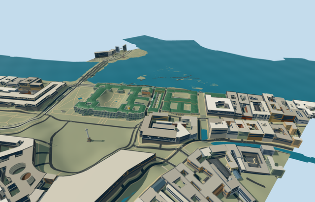

# N0894 — Winter Palace

Geometry reviewed2026-10-21. **Incomplete: native terrain fit is not approved. Catalog placement is inactive draft.**

## Appearance

Inspected all47 current source/shared/medium-fi/native frames in one author/build/inspect/fix pass. Specific Winter Palace perimeter/six courtyard holes, three true central entrance passages and two recessed side porticoes, three facade tiers/giant white order/cornices/pediments, green faceted metal roofs, two distinct gold/green cupolas, coarse roofline statuary silhouettes and chimneys. Narrowed the oversized pediments and bounded repeat detail to the browser budgets. Furnished imperial rooms, copied reliefs/inscriptions/artworks, crowds/trees and independent neighboring Hermitage buildings excluded. Geometry appearance accepted; native terrain fit explicitly rejected.

## Shared surfaces and browser budgets

Six existing256px graphs: stucco, stone_limestone_raw, metal_standing_seam, window_grid, metal_bronze_cast and metal_painted. Shared tinted plaster/trim/floors/roofs/glazing/gilt/metal, no new graph/private atlas/embedded images. Each graph read once; separate POSITION/NORMAL streams and equal CPU/GPU accounting. Shared bronze approximates gilding, opaque glazing approximates reflections. Portable image-free fallback panes are pale; actual shared captures establish the textured appearance.

| Level | Triangles | Bytes | Draws |
| --- | ---: | ---: | ---: |
| skyline | 687 | 64956 | 1 |
| district | 3452 | 328568 | 5 |
| street | 13853 | 1305720 | 6 |
| closeup | 63729 | 6343764 | 6 |

Four authored browser levels: 687/3452/13853/63729triangles; initial skyline plus district 393524bytes. Courtyard/roof/cupola silhouette persists; repeated window/molding/parapet inventory increases near. Geometry, material and download limits pass. Physical ordinary-laptop/phone/tablet and dense-city timing measurements remain pending.

## Approximate native placement

Retained Q182147/relation69424 and named native Winter Palace parent52776558202672 establish the building identity. Standard PMTiles supplies the approximately225.2x182.6m irregular outer and six holes; three integrated projection records lie entirely inside it. Retained axis0.630352782657rad resolves positive internalX northeast toward Small Hermitage and positiveZ southeast toward Palace Square, using actually viewed aerial/south/north/courtyard pictures. Anchor[30.313884235,59.940441442]/world heading0/native east-south. Q132783 describes the Hermitage institution; this is only its Winter Palace member, not a completed Hermitage collection. Only Winter Palace parent52776558202672 and three integrated projection records are replaced. All521 independent resident records of525 originals/all1411 independent wider records of1415 are unchanged, including the other Hermitage buildings and detached courtyard hut. All six courtyard holes remain open. Original6m samples/native roads/1254269.2478414578square metres water remain unchanged. Eleven actual PMTiles13/14/15 cases pass, including all five detailed owned fragments. Mask control vertices are snapped to0.1mm to avoid near-coincident clipping failures; generalized area tolerance is0.001square metres. Failure retains525 originals; every LOD unload restores terrain/water and zero model geometry. These ownership/lifecycle checks pass; the original terrain visibly buries the river facade, so site elevation fit fails and the public catalog placement remains inactive draft. PENDING NATIVE TERRAIN FIT: the current standard grid buries the river facade and intrudes into courts; geographic completion is not approved. Original standard6m Mapzen samples/roads/water and all independent buildings remain unchanged. Owned boundary samples span-2.951511875586874..26.902494995326656m relative to anchor; the coarse DEM spreads roof/tree heights into some riverfront and courtyard margins. A rigid common floor uses the front plaza, not the roof-biased center. Occupied foundations extend to boundary minimum; ground opening is partitioned strictly inside palace floor polygons, preserving every courtyard hole and outside terrain. No precinct-wide slab, terrain flattening or bespoke elevation source. Some native margins remain uneven/partly occlude low walls. Failure retains originals and every LOD unload restores terrain/water/zero model geometry.

## Limits

Four ordinary photographs actually viewed: undated aerial,2014 Palace Square,2016 Neva panorama and2013 courtyard. These establish the particular shape/color/portal/cornice/window/roof/cupola rhythm. Pictures viewed only/no copied pixels. No bespoke survey/archive/terrain research. Mapped22m base/three levels have an unqualified datum. Working front plaza-2.9797029112900084m relative to original anchor datum20.525678228927447m; palace walls22m, cornice/balustrade23.5m, faceted green roof up to25.5m, main pediments27.5m and cupolas approximately34/33m above the working floor. Front portal widths/roof/cupola placement, facade rhythm, ornament/statue/chimney inventory and material optics are picture-led approximations, not surveyed reconstruction or engineering/access certification. Photographs2013/2014/2016 and undated aerial establish visible configuration, not current-condition certification. The rigid palace geometry is reviewed; the current standard elevation fixture cannot establish acceptable ground fit. N0894 is not complete and N0741 Hermitage remains an unfinished multi-building scope.

## Selected checks

Six Khronos files: zero errors/warnings. 1708 actual geometry/material/contact checks, 47 current inspected views, eleven native map-level cases. Selected source/import/placement/strict medium-fi/scene/lint checks pass. Sim30 hash910b2782fc4d413894a71b0df0ec27ea2146e59643a833fa556fbd4553c70266.

Source sha256:7e541926aa577330409389ca2b6db51dba990d1aacd1933e4b4d0efbe0321859

Runtime sha256:d1a179ee927933041a9f4ca9ecf36925baea215d6099f6c63df5b4ddd142d841

Input sha256:7af1afa3f29d5a75b79d8637f156c66b4eea1775c0b5d598cc9adc09efb6203b

Rebuild: node packages/worldgen/scripts/generate-additional-landmarks.mjs --ids=N0894; node packages/worldgen/scripts/import-next-1000-models.mjs --ids=N0894; node packages/tooling/scripts/generate-landmark-lods.mjs --ids=n0894_winter_palace --force.

## Ordinary picture references

https://putidorogi-nn.ru/evropa/1190-zimnij-dvorets — https://putidorogi-nn.ru/images/stories/evropa/rossiya/zimniy-dvorec_2.jpg; Puti-Dorogi, image credit not established; Undated ordinary aerial photograph; Copyright reference, viewed only. Viewed only/no copied pixels.

https://commons.wikimedia.org/wiki/File:Winter_Palace_Panorama_4.jpg — https://thumb.wikimedia.org/wikipedia/commons/thumb/7/7c/Winter_Palace_Panorama_4.jpg/1280px-Winter_Palace_Panorama_4.jpg; Alex Florstein Fedorov; 2016-05-01; CC-BY-SA-4.0. Viewed only/no copied pixels.

https://commons.wikimedia.org/wiki/File:Winter_Palace_Panorama_2.jpg — https://thumb.wikimedia.org/wikipedia/commons/thumb/7/75/Winter_Palace_Panorama_2.jpg/1280px-Winter_Palace_Panorama_2.jpg; Alex Florstein Fedorov; 2014-08-04; CC-BY-SA-4.0. Viewed only/no copied pixels.

https://commons.wikimedia.org/wiki/File:Inner_yard_of_Winter_Palace.jpg — https://thumb.wikimedia.org/wikipedia/commons/thumb/5/51/Inner_yard_of_Winter_Palace.jpg/1280px-Inner_yard_of_Winter_Palace.jpg; Vitold Muratov; 2013-08-08; CC-BY-SA-3.0. Viewed only/no copied pixels.

## Common reference correction — 2026-10-21

Corrected the common ground-reference metadata without changing any of the 30 GLBs. All five references now sample the existing Winter Palace south-plaza control [30.315047028387312,59.93964319761939] and subtract each member's actual native floorY. In a combined five-building scene, all five floors coincide on the original provider and on controlled flat ground at0m and137m. Controlled providers test placement portability only; they do not approve native terrain fit. All18 owned records are replaced, all507 independent resident records of525 retained; failure retains525 originals. Original native samples/roads/water stay unchanged; each of seven shared graphs is read once, all four native LODs unload to zero live model geometry. Inspected13 combined frames: the original terrain still buries the riverfront and intrudes into courts, so all five public placements remain inactive drafts.

All six geometry files remain byte-identical. Current model input sha256:7af1afa3f29d5a75b79d8637f156c66b4eea1775c0b5d598cc9adc09efb6203b. Existing geometry review retained; capture reports refreshed.
