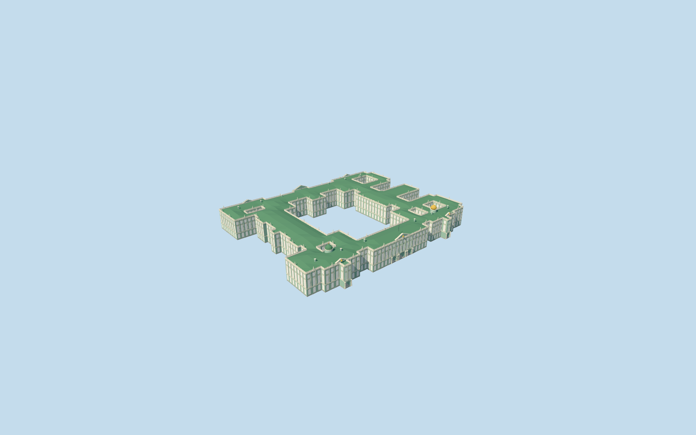

# Winter Palace

Specific Winter Palace exterior, reused as candidate N0894 within the unfinished Hermitage main ensemble. Complete native irregular perimeter and six courtyard openings, three true central entrance passages and two recessed side porticoes, green/white three-storey Baroque facade rhythm, projecting risalits/cornices/pediments, faceted green metal roofscape, two distinct gilded/green cupolas, simplified roofline statuary silhouettes and small roof chimneys. Only four integrated Winter Palace records are replaced. Small/Old/New Hermitage, Theatre, connecting passages, detached courtyard hut, gardens, embankment/Neva and Palace Square remain independent native context. No duplicate Winter Palace asset; no furnished imperial rooms, copied reliefs/inscriptions/artworks, ceremonial crowds or off-site museum branches.

## Evidence and reconstruction

Published dimensions and reconstructed details are separated in spec.json. Primary references:

- [Reference](https://putidorogi-nn.ru/evropa/1190-zimnij-dvorets)
- [Reference](https://commons.wikimedia.org/wiki/File:Winter_Palace_Panorama_4.jpg)
- [Reference](https://commons.wikimedia.org/wiki/File:Winter_Palace_Panorama_2.jpg)
- [Reference](https://commons.wikimedia.org/wiki/File:Inner_yard_of_Winter_Palace.jpg)

Specific Winter Palace exterior, reused as candidate N0894 within the unfinished Hermitage main ensemble. Complete native irregular perimeter and six courtyard openings, three true central entrance passages and two recessed side porticoes, green/white three-storey Baroque facade rhythm, projecting risalits/cornices/pediments, faceted green metal roofscape, two distinct gilded/green cupolas, simplified roofline statuary silhouettes and small roof chimneys. Only four integrated Winter Palace records are replaced. Small/Old/New Hermitage, Theatre, connecting passages, detached courtyard hut, gardens, embankment/Neva and Palace Square remain independent native context. No duplicate Winter Palace asset; no furnished imperial rooms, copied reliefs/inscriptions/artworks, ceremonial crowds or off-site museum branches.

## Model and axes

63,729 triangles; 191,187 vertices; 6 material groups; 7,651,372 bytes. Native bounds: -144.952, -3.452, -135.527 to 133.981, 32.020, 130.098. Source hash: `sha256:7e541926aa577330409389ca2b6db51dba990d1aacd1933e4b4d0efbe0321859`.

{"x":"east","y":"up","z":"south"}

The geographic proposal uses exact-QID OpenStreetMap evidence. Map-derived orientation and estimated architectural details require real-site visual review; preview eligibility is distinct from geographic/fidelity approval. Map attribution: © OpenStreetMap contributors, ODbL-1.0.

## Reproduce

Run `node packages/worldgen/scripts/generate-additional-landmarks.mjs --ids=N0894` (or add `--check`). The generator preserves manually edited masters by checking their baseline hashes. Import through the standard authored-model workflow with optimization disabled; then capture all QA cameras, including shared-surface views.

## Pending work

- Specific Winter Palace exterior, reused as candidate N0894 within the unfinished Hermitage main ensemble. Complete native irregular perimeter and six courtyard openings, three true central entrance passages and two recessed side porticoes, green/white three-storey Baroque facade rhythm, projecting risalits/cornices/pediments, faceted green metal roofscape, two distinct gilded/green cupolas, simplified roofline statuary silhouettes and small roof chimneys. Only four integrated Winter Palace records are replaced. Small/Old/New Hermitage, Theatre, connecting passages, detached courtyard hut, gardens, embankment/Neva and Palace Square remain independent native context. No duplicate Winter Palace asset; no furnished imperial rooms, copied reliefs/inscriptions/artworks, ceremonial crowds or off-site museum branches.
- Retained Q182147/relation69424 and named native Winter Palace parent52776558202672 establish the building identity. Standard PMTiles supplies the approximately225.2x182.6m irregular outer and six holes; three integrated projection records lie entirely inside it. Retained axis0.630352782657rad resolves positive internalX northeast toward Small Hermitage and positiveZ southeast toward Palace Square, using actually viewed aerial/south/north/courtyard pictures. Anchor[30.313884235,59.940441442]/world heading0/native east-south. Q132783 describes the Hermitage institution; this is only its Winter Palace member, not a completed Hermitage collection.
- Mapped22m base/three levels have an unqualified datum. Working front plaza-2.9797029112900084m relative to original anchor datum20.525678228927447m; palace walls22m, cornice/balustrade23.5m, faceted green roof up to25.5m, main pediments27.5m and cupolas approximately34/33m above the working floor. Front portal widths/roof/cupola placement, facade rhythm, ornament/statue/chimney inventory and material optics are picture-led approximations, not surveyed reconstruction or engineering/access certification. Photographs2013/2014/2016 and undated aerial establish visible configuration, not current-condition certification.
- PENDING NATIVE TERRAIN FIT: the current standard grid buries the river facade and intrudes into courts; geographic completion is not approved. Original standard6m Mapzen samples/roads/water and all independent buildings remain unchanged. Owned boundary samples span-2.951511875586874..26.902494995326656m relative to anchor; the coarse DEM spreads roof/tree heights into some riverfront and courtyard margins. A rigid common floor uses the front plaza, not the roof-biased center. Occupied foundations extend to boundary minimum; ground opening is partitioned strictly inside palace floor polygons, preserving every courtyard hole and outside terrain. No precinct-wide slab, terrain flattening or bespoke elevation source. Some native margins remain uneven/partly occlude low walls. Failure retains originals and every LOD unload restores terrain/water/zero model geometry.

This bundle follows the medium-fi standard. Medium-fi appearance and geographic fit are reviewed separately. Hash-bound visual acceptance is recorded separately after capture inspection.
