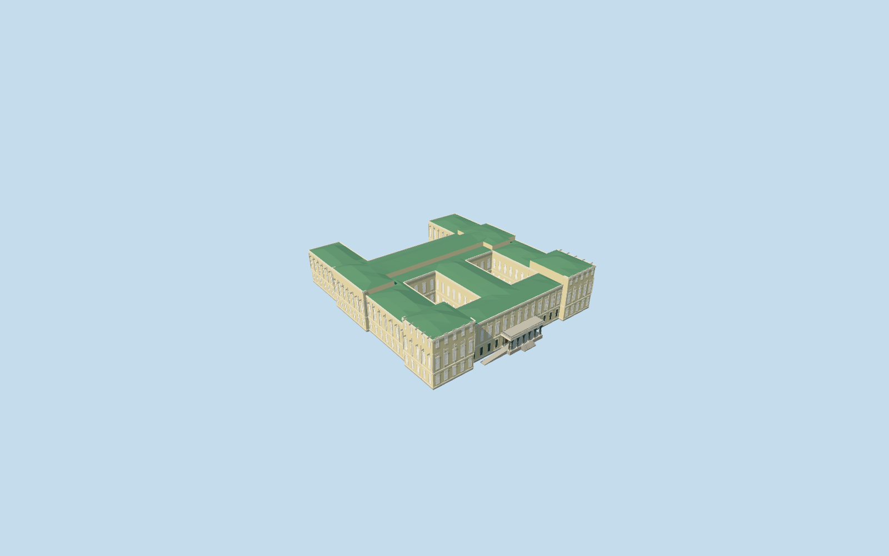

# new_hermitage — New Hermitage

Geometry reviewed2026-10-21. **Incomplete: native terrain fit is unapproved; catalog placement remains inactive draft.**

## Appearance

Inspected all47 current source/shared/medium-fi/native frames in one author/build/inspect/fix pass. Specific irregular main block/two enclosed courtyards/open northern recess, three mapped raised sections, cream two-storey facades/high corner attic tiers, framed windows/pilasters/neutral panel masses and green faceted hip roofs. Portico has ten original faceted Atlas forms with legs, torso/head and raised bent arms supporting the lintel, occupied podium/stairs, sloped side approach, balcony rail and timber doors. Corrected the approach ramp lower endpoint and simplified district bodies/rail repeats before final rendering. Ground statue niches are neutral recessed backs; copied sculpture/anatomy/faces/relief subjects/lettering and furnished collections excluded. Portable backgrounds visible through the courts are intentional: the viewer supplies their native ground. Geometry appearance reviewed; native terrain fit remains rejected.

## Shared surfaces and browser budgets

Six existing shared256px graphs: stucco, stone_limestone_raw, metal_standing_seam, window_grid, metal_painted and wood_plain. Eight roles merge to six near draws/one skyline draw. Stone graph reused for grey original figures, cream trim and paving with vertex tint. No embedded images/private atlas/new graph; every graph read once. Separate POSITION/NORMAL streams and equal CPU/GPU accounting. Opaque shared glazing approximates reflections; portable fallback panes are pale.

| Level | Triangles | Bytes | Draws |
| --- | ---: | ---: | ---: |
| skyline | 663 | 60312 | 1 |
| district | 3365 | 323064 | 6 |
| street | 15010 | 1404224 | 6 |
| closeup | 40162 | 3972588 | 6 |

Four authored browser levels 663/3365/15010/40162triangles; initial skyline plus district383376bytes. Both courts/north opening, raised halls, portico canopy and ten supports persist across all levels. District figures use chunky posed bodies and broad rails, street uses flat window-frame bands, closeup adds volumetric surrounds/figure profiles/rail uprights. Geometry/download/draw/memory-layout budgets pass. Physical ordinary-laptop/phone/tablet/dense-city timings remain pending.

## Native placement

Independent new_hermitage/Q3345111 member of the five-building main Hermitage complex. Exact native parent52776559336166/relation1202918 supplies the approximately110x123m irregular plan, two holes and northern open recess. Integrated parts52776566343852/853/854 identify raised southwest/southeast and transverse halls. +Z internal faces Millionnaya Street/Atlas portico, +X toward Winter Canal, world heading0/native east-south/internal main-site axis0.630352782657rad. Portico axis follows the signed southern map edge rather than a generic institution facing. Anchor[30.316944122314453,59.941599748307425]. Three ordinary exterior pictures actually viewed; specific body layout from PMTiles and visible forms from photographs. Only New Hermitage parent52776559336166 and three integrated raised parts52776566343852/853/854 replaced. All276 independent resident records of280/all1281 independent wider records of1285 retained, including neighboring Hermitage buildings and independently owned connectors. Both enclosed courtyards and the northern open recess stay intact. Eight strictly occupied entrance/main-floor terrain openings; no precinct slab or courtyard filling. Original6m samples/roads/1254383.7251141325square metres water unchanged. Nine actual PMTiles13/14/15 cases pass, including all four owned detailed records. Failure keeps280 originals; all LOD unloads restore terrain/water/zero live geometry. Ownership/lifecycle checks pass; native terrain fit remains failed. PENDING NATIVE TERRAIN FIT: current standard main-site elevation is roof/tree influenced and neighboring Hermitage fits have failed. Keep original6m Mapzen samples, roads, water and independent buildings unchanged. Main ground opening is partitioned around both actual courts; northern recess remains open. Separate tightly bounded entrance-floor/step/ramp outlines remain occupied at all levels. No precinct slab, flattening, courtyard filling or bespoke elevation data. Public placement stays inactive draft until native ground fit is approved.

## Scope and limits

Three ordinary photographs actually viewed: 2008 entrance frontage, undated Atlas close-up uploaded2009, 2007 canal-facing corner. Native map supplies the particular footprint/holes/raised parts. Mapped8m parent/11m parts have an unqualified datum. Picture-led working main wall20.5m, corner pavilions25.5m/transverse hall23.3m and low green roofs up to28.3m. Entrance podium1.55m, Atlas plinth2.1m/heads7.4m/hands7.85m, supported lintel7.9..9.2m, balcony9.45m/rail10.5m. Ten original posed figures arranged as six street-facing and four return supports; dimensions/placement, niches/panels/window inventory and internal wing heights are visualization approximations, not copied sculptures or surveyed reconstruction. Original common plaza floor-22.05109339911213m relative to raw datum39.59706871674957m retains the existing Winter Palace south-plaza control. Photographs2007/2008 and an undated uploaded2009 close-up establish reference appearance, not current-condition certification. Original representative Atlas forms and neutral niche/panel masses approximate the architecture without copied fine statuary, relief subjects, inscriptions or roof-eagle inventory. No bespoke survey/terrain research. Geometry reviewed; geographic completion remains pending. hermitage_museum requires all five independent members to become ready.

## Selected checks

Six Khronos files: zero errors/warnings. 858 actual mesh/contact checks; 47 inspected views; nine actual map-level cases. Selected source/import/draft placement/strict medium-fi/scene/sim30/lint pass. Sim30 hash4d4870e112df6ccb6570807d5008add52c5fb7db3fc340abc31ae999e641145f.

Source sha256:529bc5892d631a48005fa49b31d1b2470fd72fd590c5c99e03cd4ddfe99426b7

Runtime sha256:45029bd214fc74b3fb4b3e300c42262c41fcb782109aefc38147188bd177d370

Input sha256:e0e34c4b61c4e657926c4cfdf0473d5c1933508b5ef03d35be4112f54efb67b2

Rebuild: node packages/worldgen/scripts/generate-additional-landmarks.mjs --ids=new_hermitage; node packages/worldgen/scripts/import-structure-models.mjs --ids=new_hermitage; node packages/tooling/scripts/generate-landmark-lods.mjs --ids=new_hermitage --force.

## Ordinary picture references

https://commons.wikimedia.org/wiki/File:NewHermitage.jpg — A. Sdobnikov; 2008-07-12; CC-BY-SA-3.0. Viewed only; no copied pixels.

https://commons.wikimedia.org/wiki/File:Atlantes_of_Hermitage_Portico.jpg — Alexweg; Undated; uploaded2009-10-04; GFDL-1.2-or-later. Viewed only; no copied pixels.

https://commons.wikimedia.org/wiki/File:New_Hermitage_Building_and_First_Zimny_bridge.jpg — Yair Haklai; 2007-08-13; CC-BY-SA-4.0. Viewed only; no copied pixels.

## Common reference correction — 2026-10-21

Corrected the common ground-reference metadata without changing any of the 30 GLBs. All five references now sample the existing Winter Palace south-plaza control [30.315047028387312,59.93964319761939] and subtract each member's actual native floorY. In a combined five-building scene, all five floors coincide on the original provider and on controlled flat ground at0m and137m. Controlled providers test placement portability only; they do not approve native terrain fit. All18 owned records are replaced, all507 independent resident records of525 retained; failure retains525 originals. Original native samples/roads/water stay unchanged; each of seven shared graphs is read once, all four native LODs unload to zero live model geometry. Inspected13 combined frames: the original terrain still buries the riverfront and intrudes into courts, so all five public placements remain inactive drafts.

All six geometry files remain byte-identical. Current model input sha256:e0e34c4b61c4e657926c4cfdf0473d5c1933508b5ef03d35be4112f54efb67b2. Existing geometry review retained; capture reports refreshed.
