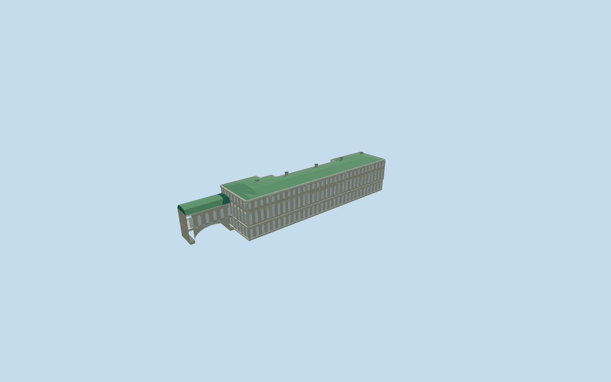

# old_hermitage — Old (Great) Hermitage

Geometry reviewed2026-10-21. **Incomplete: native terrain fit is unapproved; catalog placement remains inactive draft.**

## Appearance

Inspected all47 current source/shared/medium-fi/native frames in one author/build/inspect/fix pass. Specific long river facade with three tiers, rusticated round-arched ground windows, five central arched piano bays, alternating curved/triangular window pediments, pale risalit pilasters/cornices/dentils, low green hip roof and small chimneys. Distinct elevated Winter Canal gallery retains its segmental arch, continuous occupied upper floor, six arched windows per side/rail and curved faceted roof. No copied reliefs/art/lettering, furnished collections, temporary scaffolding or detached lower road bridge. Geometry appearance reviewed; native terrain fit remains rejected.

## Shared surfaces and browser budgets

Five existing shared256px graphs: stucco, stone_limestone_raw, metal_standing_seam, window_grid and metal_painted. Six surface roles merge to five near draws/one skyline draw. No new graph/private atlas/embedded images; each graph read once. Separate POSITION/NORMAL streams and equal CPU/GPU accounting. Shared opaque glazing approximates reflections; portable image-free fallback panes are pale.

| Level | Triangles | Bytes | Draws |
| --- | ---: | ---: | ---: |
| skyline | 118 | 12244 | 1 |
| district | 1102 | 109792 | 4 |
| street | 4502 | 449280 | 5 |
| closeup | 25686 | 2487592 | 5 |

Four authored browser levels 118/1102/4502/25686triangles; skyline plus district122036bytes. Main block/low roof/clear canal arch retained at every level. Street uses flat window-frame bands; closeup adds volumetric surrounds/mullions/pediments/dentils/rustication. Geometry/download/draw/memory-layout budgets pass. Physical ordinary-laptop/phone/tablet/dense-city timings remain pending.

## Native placement

Independent Q4092958, required old_hermitage member of the five-building main Hermitage complex. Native parent52776558403882/relation270634 supplies the approximately108.5x27.7m irregular plan; elevated connector52776566225543/layer1 supplies its approximately24.9x11.8m Winter Canal gallery. +X internal points toward the canal and Theatre; -Z faces Neva; world heading0/native east-south, internal main-site axis0.630352782657rad. Anchor[30.3161783516407,59.94213982496068]. Three ordinary photographs actually viewed establish north frontage and north-facing covered gallery. The separate lower road bridge remains native, not an owned building. Only Old Hermitage main parent52776558403882 and elevated Winter Canal gallery52776566225543 replaced. All231 independent resident records of233/all1333 independent wider records of1335 retained. The terrain opening stays inside the main occupied block; the canal gallery retains open water below the segmental arch and an occupied upper floor. Native road bridge, quays, roads, original6m samples and1254363.288530628square metres water unchanged. Nine actual PMTiles13/14/15 cases pass, including both detailed owned records. Failure keeps233 originals; every LOD unload restores terrain/water and zero live model geometry. Ownership/lifecycle checks pass; native terrain fit remains unapproved. PENDING NATIVE TERRAIN FIT: original standard main-site elevation is roof/tree influenced; Winter/Small Hermitage already failed elevation fit. Keep original6m Mapzen samples, roads, water and independent buildings unchanged. The ground opening stays inside the occupied main block; no terrain/water opening beneath the covered canal gallery. Original-contact piers and continuous occupied upper floor support the bridge. No terrain flattening, precinct slab or bespoke elevation data; public placement remains inactive draft until native fit is approved.

## Scope and limits

Three ordinary exterior photographs actually viewed: 2007 daylight long facade, 2016 night facade, 2007 covered canal gallery/east end. No bespoke research. Native11m main and8m elevated-gallery heights have an unqualified datum. Picture-led working exterior: main walls22.2m/green roof up to25m/chimneys25.9m, gallery occupied floor7.8m/walls16.2m/curved roof19m, open canal arch spring1.25m/rise5.5m. Common plaza floor-23.457581735412308m relative to original datum41.00355705304975m reuses the retained Winter Palace plaza sample for a coherent main-site frame. Internal heights, window/pediment/chimney/rustication inventory and bridge arch profile remain visualization approximations, not survey/engineering/access certification. 2007/2016 photos establish visible reference configuration, not present-condition certification. The 2007 roof repair scaffolding is excluded; the low metal roof is reconstructed rather than a dated worksite. Hidden party-wall details remain plain plaster rather than an invented rear facade inventory. Geometry reviewed; geographic completion remains pending. hermitage_museum Hermitage is not complete until all five independent required members are ready.

## Selected checks

Six Khronos files: zero errors/warnings. 830 actual mesh/contact checks; 47 inspected views; nine actual map-level cases. Selected source/import/draft placement/strict medium-fi/scene/sim30/lint pass. Sim30 hashb10b123a6fdc5963b2d50813081e0e265110098a272648d1f84681f4c6e29388.

Source sha256:975923f4d31f051689f504cc13b99e89bfb0a5f551d239fc26552124494266e5

Runtime sha256:543b69171005d08077333b27949ab794c08b3e62022c6c4592bc1bf7b78ca487

Input sha256:23656e7e9e6e2d50740ad816a032739827b9fafe0d978177bfed854e3e10182e

Rebuild: node packages/worldgen/scripts/generate-additional-landmarks.mjs --ids=old_hermitage; node packages/worldgen/scripts/import-structure-models.mjs --ids=old_hermitage; node packages/tooling/scripts/generate-landmark-lods.mjs --ids=old_hermitage --force.

## Ordinary picture references

https://commons.wikimedia.org/wiki/File:Great_Hermitage.jpg — Monoklon (Nikita Ivanov); 2016-12-30; CC-BY-SA-4.0. Viewed only; no copied pixels.

https://commons.wikimedia.org/wiki/File:Palace_Embakment-34-36.jpg — AndreyA, Russian Wikipedia; 2007-09-08; Public domain (author release). Viewed only; no copied pixels.

https://commons.wikimedia.org/wiki/File:Zimny_Canal_in_Saint-Peterburg.JPG — AndreyA (Andrey); 2007-09-06 per description; EXIF2007-09-08; CC-BY-SA-3.0. Viewed only; no copied pixels.

## Common reference correction — 2026-10-21

Corrected the common ground-reference metadata without changing any of the 30 GLBs. All five references now sample the existing Winter Palace south-plaza control [30.315047028387312,59.93964319761939] and subtract each member's actual native floorY. In a combined five-building scene, all five floors coincide on the original provider and on controlled flat ground at0m and137m. Controlled providers test placement portability only; they do not approve native terrain fit. All18 owned records are replaced, all507 independent resident records of525 retained; failure retains525 originals. Original native samples/roads/water stay unchanged; each of seven shared graphs is read once, all four native LODs unload to zero live model geometry. Inspected13 combined frames: the original terrain still buries the riverfront and intrudes into courts, so all five public placements remain inactive drafts.

All six geometry files remain byte-identical. Current model input sha256:23656e7e9e6e2d50740ad816a032739827b9fafe0d978177bfed854e3e10182e. Existing geometry review retained; capture reports refreshed.
