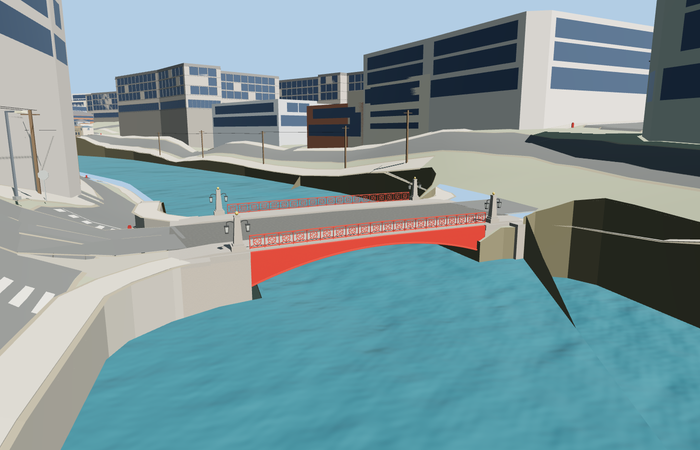

# Red Bridge, Saint Petersburg

Reviewed 2026-10-27. **Scoped medium-fi exterior and approximate native placement complete.**

Inspected 62 current frames: 11 portable, 11 shared-material/geographic, 23 medium-fi and 17 native. The complete shallow red iron arch, plate spandrels, underside ribs, open circular/floral railings, four tapered granite obelisks, gold finials and paired hanging black lanterns are present. Corrected inward-facing longitudinal surfaces and disconnected ornament during the same build pass. Distance levels remove fittings while preserving the red arch and four corner markers.

Three existing shared 256px material graphs: metal_painted, stone_granite and concrete_plain, with metric UVs and linear vertex tints. Lantern glass is a local physical translucent material. No embedded/private images, copied photograph pixels or downloaded meshes. Each shared graph is read once per native view; all four runtime GLBs use separate GPU attribute streams.

| Level | Triangles | Bytes | Draws |
| --- | ---: | ---: | ---: |
| skyline | 960 | 76036 | 1 |
| district | 3256 | 246404 | 3 |
| street | 14912 | 1141988 | 4 |
| closeup | 24016 | 1756924 | 4 |

Detailed source master: 36032 triangles / 4326680 bytes. Runtime levels: 960 / 3256 / 14912 / 24016 triangles, 76036 / 246404 / 1141988 / 1756924 bytes and 1 / 3 / 4 / 4 draws. Initial skyline plus district is 322440 bytes. All strict medium-fi budgets pass; physical laptop/phone timing remains unmeasured.

Exact-QID OSM relation 5552481 / Q2994703 supplies the retained skewed 25.999m by 16.915m central footprint; standard PMTiles supplies the two named road directions and sidewalks. Anchor [30.3153079,59.9329842], heading -0.936225120965: +X southeast along Gorokhovaya Street, -X northwest, +Z southwest along the Moika. A 0.147 plan shear follows the mapped edges. The nominal 33.6m longitudinal extent includes approximate abutments; small supported bank aprons extend beyond it. A 17.030528m source datum fits the complete native fixture's 17.555132m water surface. All 27 actual mapped road/footway width probes have both road and model support, within 0.047155m at all four levels. These are renderer-to-model join differences, not surveyed geographic accuracy.

All 465 resident buildings and 1,290 independent input road records remain. Raw map roads, DEM samples and water geometry stay unchanged. A declared 34.9m by 19.5m cut removes obstructing displayed ground/shore faces inside the support footprint while the model is resident; eight outside-ground probes stay exact. Connected paving is deliberately graded. Failed loading retains the original map crossing; unloading restores the exact native ground geometry and releases all model/support geometry.

## Reconstruction limits

- Photo-based iron sections, arch rise, granite blocks and lamp heights are approximate; no as-built survey is claimed.
- The retained 25.999m by16.915m map polygon describes the central crossing. The nominal33.6m reference length is interpreted along the sheared longitudinal coordinate including abutments; it is not substituted for the mapped clear deck.
- Floral ironwork is a regularized open circle-and-rosette pattern. Rivet counts, internal ribs and lamp fittings are representative rather than surveyed.
- The17.030528m source datum follows the17.555132m water surface in the complete retained native fixture. Water/ground levels depend on semantic tile context; this is a visualization datum rather than a survey. Coarse quays and neighboring architecture are outside this asset.
- Skyline merges subpixel rail ornament into mean-color bands; district simplifies the pattern and hanging lanterns.
- Thin bank paving and rectangular support wings overlap the generalized map lane/footway widths. A bounded34.9m by19.5m terrain cut follows those supports; native ground restores on unload. Surrounding quays retain the coarse standard terrain.
- The surrounding procedural buildings, coarse quays, automatic retaining faces, power lines and approach terrain are context, not a reconstruction of historic Saint Petersburg. Some road-facing native cameras are obstructed by those coarse faces; whole-crossing and canal views show the bridge fit.
- The final 4.8cm maximum paving join difference includes generalized skewed footway edges. The whole fixture is a standard-terrain approximation; no exact curb, foundation or river-stage claim.
