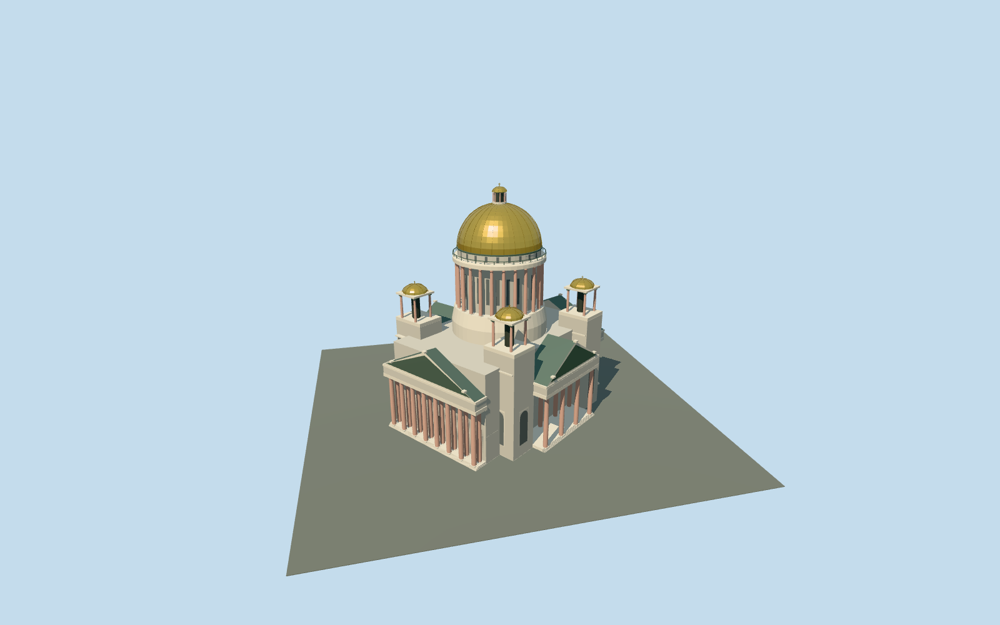

# Saint Isaac cathedral, five domes and four porticos

Saint Isaac cathedral principal exterior: mapped central body/four corner pylons, four granite-columned pediment porticos with two column rows, real primary recessed arched doorway/threshold, colonnaded drum/clerestory, ribbed gilded main dome/lantern/cross and four open belfries/smaller gilded domes. Shared pale limestone, rose granite, painted-metal gold substitute, patinated copper and opaque glazing. Preserve all independent buildings and original roads/water. Historic sculpture, lettering, interior/operating religious fixtures and exact reliefs are omitted or abstracted.

## Evidence and reconstruction

Published dimensions and reconstructed details are separated in spec.json. Primary references:

- [Reference](https://commons.wikimedia.org/wiki/File:Saint_Isaacs_cathedral_Southern_facade.jpg)
- [Reference](https://commons.wikimedia.org/wiki/File:Saint_Isaac%27s_Cathedral_-_Dome.jpg)

Saint Isaac cathedral principal exterior: mapped central body/four corner pylons, four granite-columned pediment porticos with two column rows, real primary recessed arched doorway/threshold, colonnaded drum/clerestory, ribbed gilded main dome/lantern/cross and four open belfries/smaller gilded domes. Shared pale limestone, rose granite, painted-metal gold substitute, patinated copper and opaque glazing. Preserve all independent buildings and original roads/water. Historic sculpture, lettering, interior/operating religious fixtures and exact reliefs are omitted or abstracted.

## Model and axes

23,950 triangles; 69,016 vertices; 7 material groups; 2,776,376 bytes. Native bounds: -52.747, -1.200, -48.524 to 54.256, 101.500, 50.509. Source hash: `sha256:e5f896b8a812cfd5e752e59b37f7e230c4cd9ebde7763f35a05a5e4f440210fc`.

{"x":"east","y":"up","z":"south"}

The geographic proposal uses exact-QID OpenStreetMap evidence. Map-derived orientation and estimated architectural details require real-site visual review; preview eligibility is distinct from geographic/fidelity approval. Map attribution: © OpenStreetMap contributors, ODbL-1.0.

## Reproduce

Run `node packages/worldgen/scripts/generate-additional-landmarks.mjs --ids=saint_isaacs_cathedral` (or add `--check`). The generator preserves manually edited masters by checking their baseline hashes. Import through the standard authored-model workflow with optimization disabled; then capture all QA cameras, including shared-surface views.

## Pending work

- Saint Isaac cathedral principal exterior: mapped central body/four corner pylons, four granite-columned pediment porticos with two column rows, real primary recessed arched doorway/threshold, colonnaded drum/clerestory, ribbed gilded main dome/lantern/cross and four open belfries/smaller gilded domes. Shared pale limestone, rose granite, painted-metal gold substitute, patinated copper and opaque glazing. Preserve all independent buildings and original roads/water. Historic sculpture, lettering, interior/operating religious fixtures and exact reliefs are omitted or abstracted.
- Q215423 plus named cathedral relation3229838/native52776561363086 and13 integral height-tagged parts. Four porticos and four corner-tower positions follow actual parts; dome center/radius follow relation3229897. Own14 records only. Existing reviewed map-axis anchor[30.30614274,59.934092874]. InternalX south-southeast along broad southwest facade; internalZ west-southwest toward its portico. +Y up, geometry baked into native east/south coordinates, heading0. Two nearby5m buildings remain independent.
- Most map parts have unqualified heights: main body/drum support50m, porticos45m, corner towers60m, central drum50..75m, dome75..96m, lantern90..99m and small cross100.4..100.8m. Reconstruct wall/roof subdivisions from ordinary photos rather than extruding every height tag as a solid box. Working main walls38m, corner-pylon cornice45m, portico column shafts1.28..24m/entablature29.5m/pediments42m, main drum50..75.5m, gilded cup75.5..93.5m/lantern to100m and overall cross101.5m. The existing retained Wikidata height101.5m has no qualified reference URL; overall height and exact historic dimensions remain approximate. Eight front columns/two rows at the broad pair and four/two at the side pair,24 drum columns and simplified Corinthian blocks follow photo-led reconstruction. Hidden elevations, exact counts, sculpture and bronze reliefs are simplified.
- NATIVE FIT DRAFT. Standard Protomaps20261020 and unmodified MapzenTerrarium201x201/6m grid. Uncovered southwest approach fixes datum40.21964233688743m; original parent-boundary grades-20.819..-0.356m. The coarse urban elevation field varies about20m across the footprint and cannot establish a credible cathedral foundation. Preserve the architectural master plinth1.2m below floor instead of inventing a20m masonry pedestal. Inspect the native render; geographic readiness remains pending standard terrain recovery/grade handling. No bespoke terrain sources or custom per-artifact flattening.

This bundle follows the medium-fi standard. Medium-fi appearance and geographic fit are reviewed separately. Hash-bound visual acceptance is recorded separately after capture inspection.
