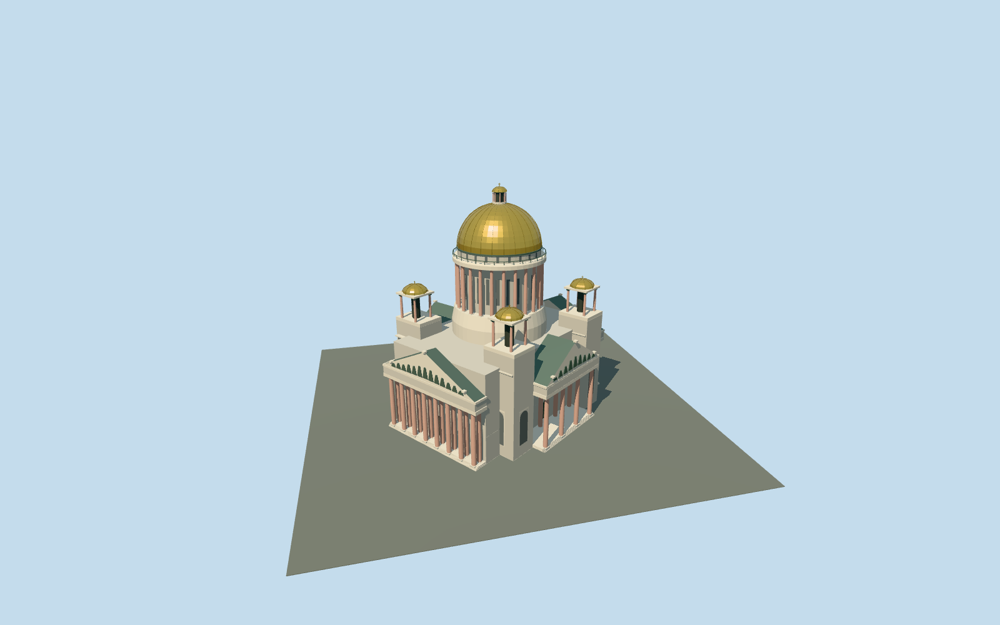

# Saint Isaac cathedral, five domes and four porticos

Saint Isaac’s Cathedral exterior follows the mapped central body, four corner pylons and four granite-columned porticos. Recessed bronze doors on the south, west and north faces, faceted pediment reliefs, the colonnaded drum and five gilded domes distinguish its silhouette. Shared limestone, rose granite, painted metal, patinated copper and glazing supply the surfaces. Religious interiors and exact historical sculpture are outside the exterior scope.

## Evidence and reconstruction

Published dimensions and reconstructed details are separated in spec.json. Primary references:

- [Reference](https://commons.wikimedia.org/wiki/File:Saint_Isaacs_cathedral_Southern_facade.jpg)
- [Reference](https://commons.wikimedia.org/wiki/File:Saint_Isaac%27s_Cathedral_-_Dome.jpg)
- [Reference](https://commons.wikimedia.org/wiki/File:High_reliefs_on_the_exterior_doors_of_the_North_portico_of_St._Isaac's_Cathedral.jpg)
- [Reference](https://commons.wikimedia.org/wiki/File:Pediment_of_the_South_portico_and_colonnade_of_St._Isaac%27s_Cathedral.jpg)

Saint Isaac’s Cathedral exterior follows the mapped central body, four corner pylons and four granite-columned porticos. Recessed bronze doors on the south, west and north faces, faceted pediment reliefs, the colonnaded drum and five gilded domes distinguish its silhouette. Shared limestone, rose granite, painted metal, patinated copper and glazing supply the surfaces. Religious interiors and exact historical sculpture are outside the exterior scope.

## Model and axes

24,923 triangles; 71,801 vertices; 7 material groups; 2,888,312 bytes. Native bounds: -52.747, -1.200, -48.524 to 54.256, 101.500, 50.509. Source hash: `sha256:702ae9c7d159cf8961a75fcc7ca81cc575f9f41bedb24cb0cceb9485e59fae78`.

{"x":"east","y":"up","z":"south"}

The geographic proposal uses exact-QID OpenStreetMap evidence. Map-derived orientation and estimated architectural details require real-site visual review; preview eligibility is distinct from geographic/fidelity approval. Map attribution: © OpenStreetMap contributors, ODbL-1.0.

## Reproduce

Run `node packages/worldgen/scripts/generate-additional-landmarks.mjs --ids=saint_isaacs_cathedral` (or add `--check`). The generator preserves manually edited masters by checking their baseline hashes. Import through the standard authored-model workflow with optimization disabled; then capture all QA cameras, including shared-surface views.

## Pending work

- Saint Isaac’s Cathedral exterior follows the mapped central body, four corner pylons and four granite-columned porticos. Recessed bronze doors on the south, west and north faces, faceted pediment reliefs, the colonnaded drum and five gilded domes distinguish its silhouette. Shared limestone, rose granite, painted metal, patinated copper and glazing supply the surfaces. Religious interiors and exact historical sculpture are outside the exterior scope.
- Q215423 plus named cathedral relation3229838/native52776561363086 and13 integral height-tagged parts. Four porticos and four corner-tower positions follow actual parts; dome center/radius follow relation3229897. Own14 records only. Existing reviewed map-axis anchor[30.30614274,59.934092874]. InternalX south-southeast along broad southwest facade; internalZ west-southwest toward its portico. +Y up, geometry baked into native east/south coordinates, heading0. Two nearby5m buildings remain independent.
- Most map parts have unqualified heights: main body/drum support50m, porticos45m, corner towers60m, central drum50..75m, dome75..96m, lantern90..99m and small cross100.4..100.8m. Reconstruct wall/roof subdivisions from ordinary photos rather than extruding every height tag as a solid box. Working main walls38m, corner-pylon cornice45m, portico column shafts1.28..24m/entablature29.5m/pediments42m, main drum50..75.5m, gilded cup75.5..93.5m/lantern to100m and overall cross101.5m. The existing retained Wikidata height101.5m has no qualified reference URL; overall height and exact historic dimensions remain approximate. Eight front columns/two rows at the broad pair and four/two at the side pair,24 drum columns and simplified Corinthian blocks follow photo-led reconstruction. Hidden elevations, exact counts, sculpture and bronze reliefs are simplified. The three entrance depths, simplified door relief panels and small pediment silhouettes are picture-led approximations.
- The 18.25 m local visualization grade follows the stable side-approach samples in the retained 6 m standard Terrarium grid. The grade follows all four porticos and blends into the surrounding street field. The mapped footprints, roads and water are retained.

This bundle follows the medium-fi standard. Medium-fi appearance and geographic fit are reviewed separately. Hash-bound visual acceptance is recorded separately after capture inspection.
