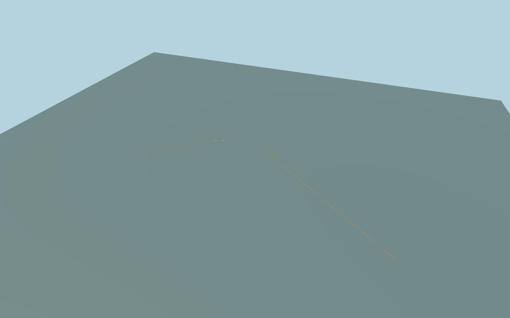

# Saint Petersburg Dam

Both maritime arms of the Saint Petersburg flood barrier, the six raised-gate sluice bridges, S-1 open navigation passage with parked sector gates and tunnel approaches, and the S-2 lift bridge and approach decks.

Rebuild: `node packages/worldgen/scripts/generate-saint-petersburg-dam.mjs`;append `--check` for exact source bytes. Select import/LOD/placement with `--ids=saint_petersburg_dam`. Detailed source and four browser tiers are separate ignored GLB outputs.

Both maritime arms of the Saint Petersburg flood barrier, the six raised-gate sluice bridges, S-1 open navigation passage with parked sector gates and tunnel approaches, and the S-2 lift bridge and approach decks.

The named A-118 carriageways and current PMTiles place the corridor and crossings. Official span and gate counts control the architecture. Width profiles and precise wall, gate housing and deck grades are visual estimates. Native Kotlin terrain and roads connect the two arms. Gates are static in the normal open position. The z12 regional field is coarser than a sluice opening. The operator section and centerline lengths describe different extents. Exact bathymetry, shoreline contact and hidden machinery are unverified. Physical-device and dense-scene timing remain unmeasured.

Original geometry:repository license. Map:© OpenStreetMap contributors,ODbL-1.0;Protomaps. Standard terrain:terrain-grid.json. Ordinary pictures stay local and are not redistributed or used as textures. Current acceptance:qa.json.
