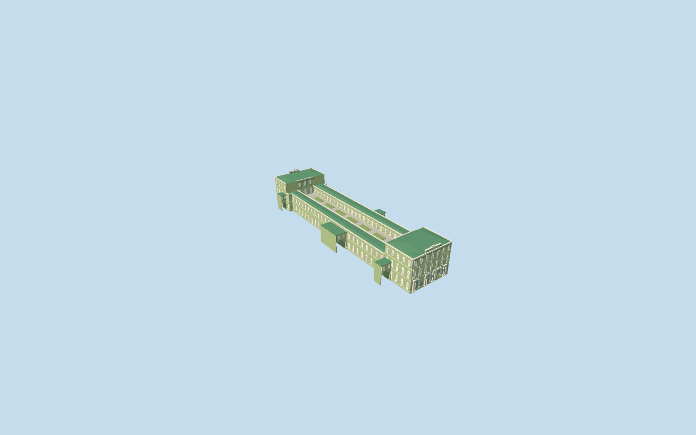

# Small Hermitage

Small Hermitage exterior: distinct north and south green classical pavilions, six riverfront giant-order round columns, paired south columns/pilasters/balconies and central attics, long side galleries, occupied lower rooms beneath a raised hanging-garden deck, faceted green metal roofs and all six native connecting wings with open ground-level arches. Seven exact mapped records only; preserve independent Winter/Old/New Hermitage/Theatre and surrounding streets/water. Geometric roof group is an original simplified silhouette. No furnished museum rooms, copied sculpture/reliefs/lettering, ornamental garden inventory or off-site museum branches.

## Evidence and reconstruction

Published dimensions and reconstructed details are separated in spec.json. Primary references:

- [Reference](https://commons.wikimedia.org/wiki/File:Small_Hermitage_SPB.jpg)
- [Reference](https://commons.wikimedia.org/wiki/File:Small_Hermitage_SPB_01.jpg)

Small Hermitage exterior: distinct north and south green classical pavilions, six riverfront giant-order round columns, paired south columns/pilasters/balconies and central attics, long side galleries, occupied lower rooms beneath a raised hanging-garden deck, faceted green metal roofs and all six native connecting wings with open ground-level arches. Seven exact mapped records only; preserve independent Winter/Old/New Hermitage/Theatre and surrounding streets/water. Geometric roof group is an original simplified silhouette. No furnished museum rooms, copied sculpture/reliefs/lettering, ornamental garden inventory or off-site museum branches.

## Model and axes

38,086 triangles; 114,258 vertices; 5 material groups; 4,573,740 bytes. Native bounds: -60.693, -20.607, -73.758 to 60.458, 6.413, 73.396. Source hash: `sha256:815f768acde2d414796c3cff3a112339b752555ab83b20802aafc8a900f0d905`.

{"x":"east","y":"up","z":"south"}

The geographic proposal uses exact-QID OpenStreetMap evidence. Map-derived orientation and estimated architectural details require real-site visual review; preview eligibility is distinct from geographic/fidelity approval. Map attribution: © OpenStreetMap contributors, ODbL-1.0.

## Reproduce

Run `node packages/worldgen/scripts/generate-additional-landmarks.mjs --ids=small_hermitage` (or add `--check`). The generator preserves manually edited masters by checking their baseline hashes. Import through the standard authored-model workflow with optimization disabled; then capture all QA cameras, including shared-surface views.

## Pending work

- Small Hermitage exterior: distinct north and south green classical pavilions, six riverfront giant-order round columns, paired south columns/pilasters/balconies and central attics, long side galleries, occupied lower rooms beneath a raised hanging-garden deck, faceted green metal roofs and all six native connecting wings with open ground-level arches. Seven exact mapped records only; preserve independent Winter/Old/New Hermitage/Theatre and surrounding streets/water. Geometric roof group is an original simplified silhouette. No furnished museum rooms, copied sculpture/reliefs/lettering, ornamental garden inventory or off-site museum branches.
- Independent Q4279216/Small Hermitage, member small_hermitage of hermitage_museum five-building main museum complex; not the Hermitage institution centroid. Exact native parent52776559201196/relation1067948 supplies the approximately36.75x156.8m outline and raised-garden opening. Six small connecting wing records are owned explicitly. Anchor[30.315708965063095,59.941255818912424]/world heading0/native east-south; internal axis0.630352782657rad places north pavilion toward Neva and south pavilion toward Palace Square. Ordinary north/south photographs actually viewed; map footprint establishes fit, photos establish visible architecture.
- Mapped11m main/8m connector heights have unqualified datum. Picture-led working heights: occupied garden floor8.35m, galleries14.6m, pavilions22.5m, roofs24.1m, attic/abstract roof group26.62m. Working common floor-20.20704379702497m relative to anchor datum37.75301911466241m reuses the existing original Winter Palace south-plaza sample, preserving a coherent main-site grade. Column/window/arch/roof/planting/ornament counts and optics are approximations, not surveyed reconstruction. 2015/2016 photographs establish visible reference appearance, not present-condition certification.
- A common ground sample at the mapped south plaza aligns all five building floors. Molen’s bounded Hermitage waterfront grade is 17.50 m and blends into the retained Terrarium field. Source building outlines, courtyard openings and independent roads are preserved.

This bundle follows the medium-fi standard. Medium-fi appearance and geographic fit are reviewed separately. Hash-bound visual acceptance is recorded separately after capture inspection.
