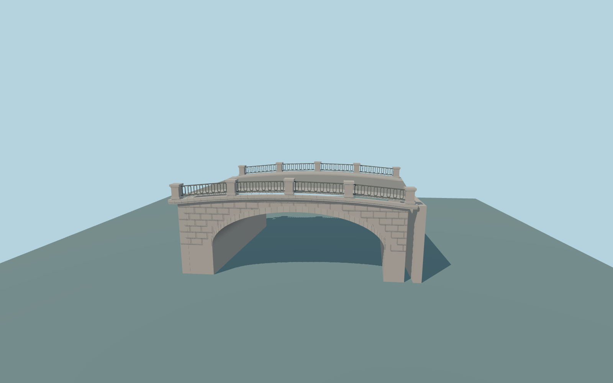

# Stone Bridge

Stone Bridge (Saint Petersburg) exterior: a single broad granite arch with a continuous open masonry vault, wedge-shaped arch ring, coursed spandrels, rounded cornice, cambered two-carriageway deck, two outer walks, ten capped granite parapet piers and iron oval-loop railing panels. Short skewed bearing aprons meet mapped approaches.

Rebuild: `node packages/worldgen/scripts/generate-stone-bridge.mjs`;append `--check` for exact source bytes. Select import/LOD/placement with `--ids=stone_bridge`. Detailed source and four browser tiers are separate ignored GLB outputs.

Fixed 25 m model datum, approximate 28.5 m end deck and 0.55 m center crown fit the standard viewer field, whose city surface returns are biased above sea level. Standard review water samples 23.437 m. Heights, arch profile and masonry sections are ordinary-photo visualization approximations, not surveyed elevations.

Original picture-led medium-fi exterior. The 197 m candidate quantity is incompatible with the exact-QID 19.466 m mapped plan. Granite blocks, railing pattern, arch profile and submerged foundations are approximations. Independent canal walls, street lamps, signs, surrounding buildings and vehicles remain separate map context. No copied photo pixels, downloaded mesh or interiors; physical laptop and phone timings remain pending.

Original geometry:repository license. Map:© OpenStreetMap contributors,ODbL-1.0;Protomaps. Standard terrain:terrain-grid.json. Ordinary pictures stay local and are not redistributed or used as textures. Current acceptance:qa.json.
