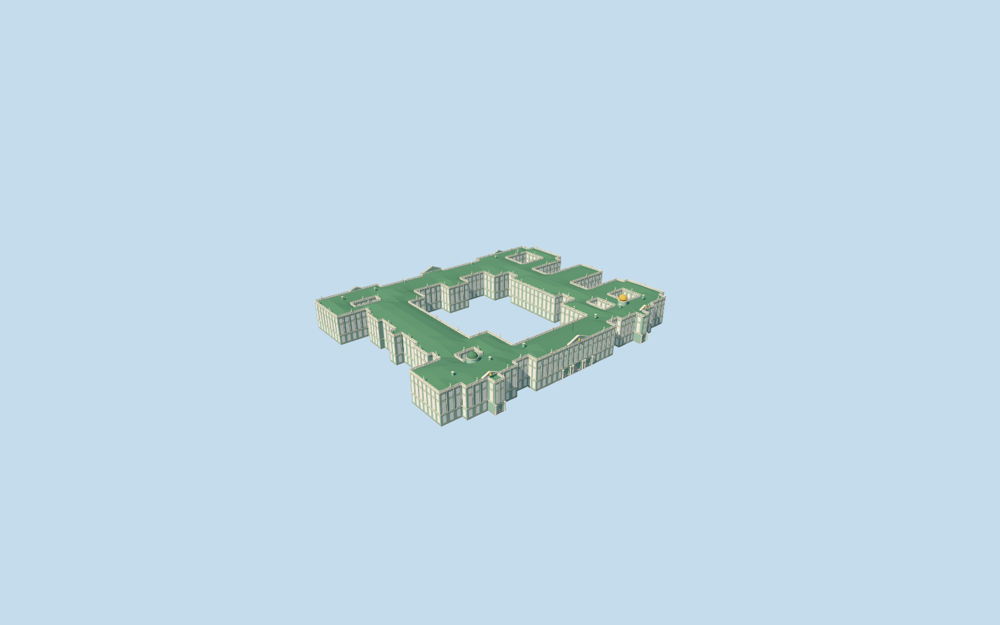

# Winter Palace

The Winter Palace exterior is an individual candidate and one of five independently placed buildings in the Hermitage museum collection. Complete native irregular perimeter and six courtyard openings, three true central entrance passages and two recessed side porticoes, green/white three-storey Baroque facade rhythm, projecting risalits/cornices/pediments, faceted green metal roofscape, two distinct gilded/green cupolas, simplified roofline statuary silhouettes and small roof chimneys. Only four integrated Winter Palace records are replaced. The attached museums and theatre have independent models. The courtyard hut, nearby gardens, embankment and Palace Square remain part of the native map. No duplicate Winter Palace asset; no furnished imperial rooms, copied reliefs/inscriptions/artworks, ceremonial crowds or off-site museum branches.

## Evidence and reconstruction

Published dimensions and reconstructed details are separated in spec.json. Primary references:

- [Reference](https://putidorogi-nn.ru/evropa/1190-zimnij-dvorets)
- [Reference](https://commons.wikimedia.org/wiki/File:Winter_Palace_Panorama_4.jpg)
- [Reference](https://commons.wikimedia.org/wiki/File:Winter_Palace_Panorama_2.jpg)
- [Reference](https://commons.wikimedia.org/wiki/File:Inner_yard_of_Winter_Palace.jpg)

The Winter Palace exterior is an individual candidate and one of five independently placed buildings in the Hermitage museum collection. Complete native irregular perimeter and six courtyard openings, three true central entrance passages and two recessed side porticoes, green/white three-storey Baroque facade rhythm, projecting risalits/cornices/pediments, faceted green metal roofscape, two distinct gilded/green cupolas, simplified roofline statuary silhouettes and small roof chimneys. Only four integrated Winter Palace records are replaced. The attached museums and theatre have independent models. The courtyard hut, nearby gardens, embankment and Palace Square remain part of the native map. No duplicate Winter Palace asset; no furnished imperial rooms, copied reliefs/inscriptions/artworks, ceremonial crowds or off-site museum branches.

## Model and axes

63,729 triangles; 191,187 vertices; 6 material groups; 7,651,372 bytes. Native bounds: -144.952, -3.452, -135.527 to 133.981, 32.020, 130.098. Source hash: `sha256:7e541926aa577330409389ca2b6db51dba990d1aacd1933e4b4d0efbe0321859`.

{"x":"east","y":"up","z":"south"}

The geographic proposal uses exact-QID OpenStreetMap evidence. Map-derived orientation and estimated architectural details require real-site visual review; preview eligibility is distinct from geographic/fidelity approval. Map attribution: © OpenStreetMap contributors, ODbL-1.0.

## Reproduce

Run `node packages/worldgen/scripts/generate-additional-landmarks.mjs --ids=winter_palace` (or add `--check`). The generator preserves manually edited masters by checking their baseline hashes. Import through the standard authored-model workflow with optimization disabled; then capture all QA cameras, including shared-surface views.

## Pending work

- The Winter Palace exterior is an individual candidate and one of five independently placed buildings in the Hermitage museum collection. Complete native irregular perimeter and six courtyard openings, three true central entrance passages and two recessed side porticoes, green/white three-storey Baroque facade rhythm, projecting risalits/cornices/pediments, faceted green metal roofscape, two distinct gilded/green cupolas, simplified roofline statuary silhouettes and small roof chimneys. Only four integrated Winter Palace records are replaced. The attached museums and theatre have independent models. The courtyard hut, nearby gardens, embankment and Palace Square remain part of the native map. No duplicate Winter Palace asset; no furnished imperial rooms, copied reliefs/inscriptions/artworks, ceremonial crowds or off-site museum branches.
- Retained Q182147/relation69424 and named native Winter Palace parent52776558202672 establish the building identity. Standard PMTiles supplies the approximately225.2x182.6m irregular outer and six holes; three integrated projection records lie entirely inside it. Retained axis0.630352782657rad resolves positive internalX northeast toward Small Hermitage and positiveZ southeast toward Palace Square, using actually viewed aerial/south/north/courtyard pictures. Anchor[30.313884235,59.940441442]/world heading0/native east-south. Q132783 describes the Hermitage institution; this is only its Winter Palace member, not a completed Hermitage collection.
- Mapped22m base/three levels have an unqualified datum. Working front plaza-2.9797029112900084m relative to original anchor datum20.525678228927447m; palace walls22m, cornice/balustrade23.5m, faceted green roof up to25.5m, main pediments27.5m and cupolas approximately34/33m above the working floor. Front portal widths/roof/cupola placement, facade rhythm, ornament/statue/chimney inventory and material optics are picture-led approximations, not surveyed reconstruction or engineering/access certification. Photographs2013/2014/2016 and undated aerial establish visible configuration, not current-condition certification.
- A common ground sample at the mapped south plaza aligns all five building floors. Molen’s bounded Hermitage waterfront grade is 17.50 m and blends into the retained Terrarium field. Source building outlines, courtyard openings and independent roads are preserved.

This bundle follows the medium-fi standard. Medium-fi appearance and geographic fit are reviewed separately. Hash-bound visual acceptance is recorded separately after capture inspection.
