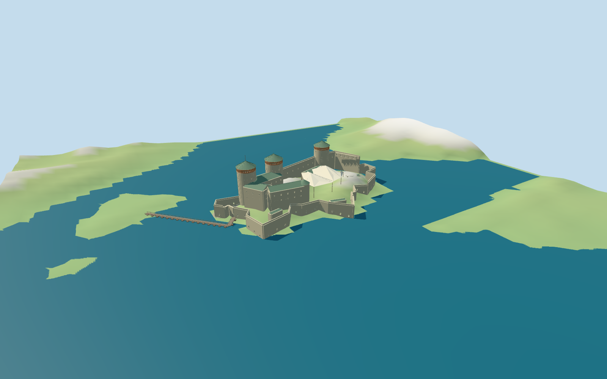

# Olavinlinna Castle

Individual Olavinlinna island castle: three rubble-stone cylindrical towers, reddish open arcade crowns and muted green conical roofs; stepped curtains, broad roofed ranges, small round stair tower, low angular bastions, rock bank and narrow mapped pontoon bridge. The large courtyard retains an approximate light festival canopy visible in the linked photographs.

## Evidence and reconstruction

Published dimensions and reconstructed details are separated in spec.json. Primary references:

- [Reference](https://img.marinas.com/v2/733718cf2a6b7854ab0a897ac766fb108434517312393c80df7f8ea7a2fe6b1f.jpg)
- [Reference](https://www.llegarsinavisar.com/wp-content/uploads/2022/12/castillo-olavinlinna-1-4.jpg)

Six canonical256-square graphs supply rubble stone, granite rock, green metal panels, brick, wood and canvas. Metric UVs and linear tints; no bespoke bitmap or embedded photograph.

## Model and axes

56,764 triangles; 170,292 vertices; 6 material groups; 6,815,560 bytes. Native bounds: -56.087, -8.621, -80.899 to 43.343, 42.400, 139.273. Source hash: `sha256:2c95e598db544b5113ccf9e2bee684ad20cbbba2597ebff36c85082b3cd4e474`.

{"x":"bisector of the undirected pontoon segment axes","y":"up","z":"perpendicular to bridge"}

Current named castle and pontoon bridge plus retained identity-matched OSM relation11335890 control approximate geographic placement, topology and scale. Height, facade openings, canopy and rock profiles remain picture-led.

## Reproduce

Run `node packages/worldgen/scripts/generate-additional-landmarks.mjs --ids=olavinlinna_castle` (or add `--check`). The generator preserves manually edited masters by checking their baseline hashes. Import through the standard authored-model workflow with optimization disabled; then capture all QA cameras, including shared-surface views.

## Pending work

- Architectural heights, roof/range plans, openings, rock bank profile and small stair tower are exterior-picture approximations; not a measured conservation model.
- The seasonal courtyard canopy is a fixed approximate visual representation, not a year-round claim or engineered structure. Interiors, furnishings, festival seats and certified walkable collision are excluded.
- Standard viewer terrain is coarse. Preview PMTiles lake-mask clipping and review water level are explicit fixture approximations, not runtime terrain carving or verified real shoreline/deck elevation. Pontoon water contact and precise entrance joins remain approximate.
- Physical laptop and phone frame-rate measurements remain pending.

This bundle follows the medium-fi standard. Medium-fi appearance and geographic fit are reviewed separately. Hash-bound visual acceptance is recorded separately after capture inspection.

## Additional geographic data

© OpenStreetMap contributors; Protomaps; Mapzen/USGS terrain tiles.
