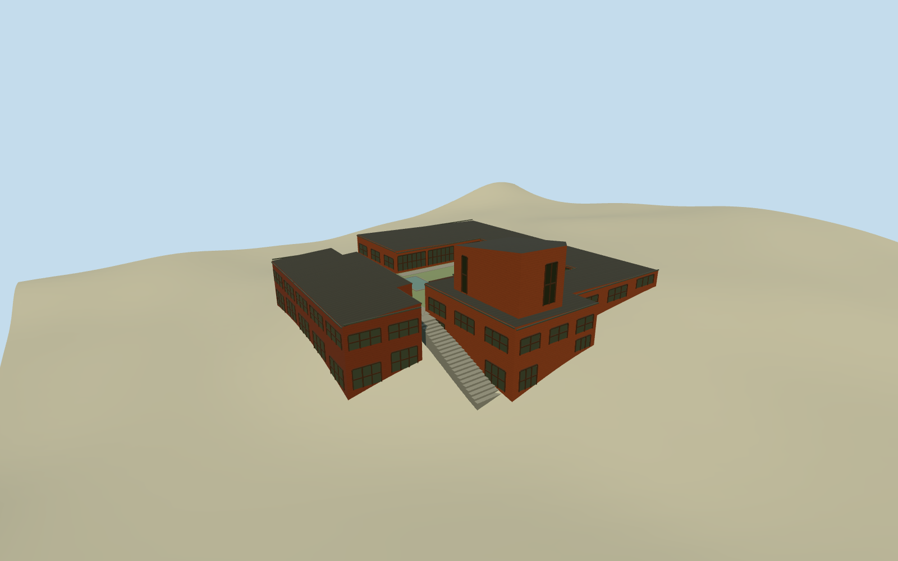

# Säynätsalo Town Hall

Säynätsalo Town Hall with its tall red-brick council chamber, raised courtyard, granite stair and original library wing.

Authoring state: **review-in-qa.json**. Current completion evidence is in [qa.json](qa.json) and the [completion ledger](../../../../qualla-structures/batches/qualla-004.PROGRESS.md).

- [Saynatsalo Town Hall](https://qualla.com/saynatsalo-town-hall/)

Unpublished envelope levels and secondary facade openings are approximate.

Scope includes the original town hall and library exterior at their mapped outlines, and the raised courtyard. Interior spaces and artwork are outside scope.

Build: `node content/worldgen/source/places/ue/ue4/saynatsalo_town_hall/models/generate-saynatsalo-town-hall.mjs`. Add `--check` to verify exact regeneration. 4205 triangles; 8 materials; no embedded photographs.
