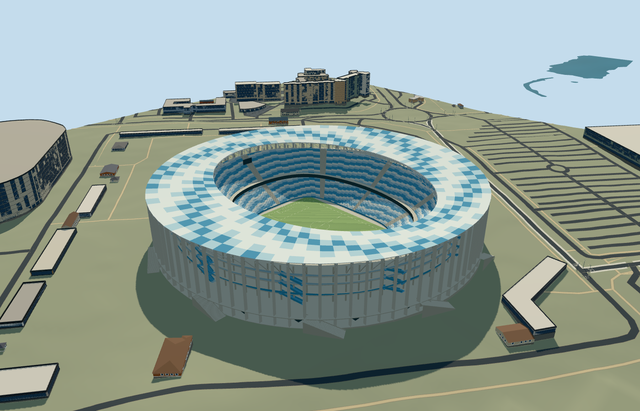

# N0717 — Nizhny Novgorod Stadium

Reviewed 2026-10-20 in one continuous author/build/inspect/fix round.

## Appearance

Inspected48 current portable/shared/medium-fi/native-site frames in one ordinary-photo/PMTiles/build/inspect/fix pass, with full-size native colonnade and circulation views. Own circular white triangular-column ring, blue/pale/white closed annular roof and renderable underside/deep elliptical inner truss/radial lattice, two blue/white seating bands/open field, raised circular gallery, eleven tangent entrance-flight approximations, wavy blue/pale gallery fronts/near blue stair treads and closed guards, recessed closed services/glazing, supported end displays/lights and neutral football markings/goals are present. Corrected pillar/roof contact, display hangers, tangent-flight width, smooth closed parapet caps, internal flight/deck attachment and near stair treads. No missing side or old duplicate stadium shell in loaded native views. Individual seats merge into colored terrace patches; hidden rooms/event artwork are excluded.

## Shared materials and browser levels

Four existing256-square shared graphs: concrete_plain for columns/decks/footings, metal_painted for pale steel/blue circulation/seat patches/marks/screens, window_grid for closed inner glazing, fabric_canvas for blue/pale/white opaque roof-panel proxies and turf grain. Five near draws because roof and turf use distinct slots of the same graph; no unique image/atlas or embedded image. Actual nearby material graphs each read once. Metric repeats/linear tints, separate POSITION/NORMAL buffer views and equal reported CPU/GPU geometry bytes verified. Roof/glazing are opaque shared approximations, not exact translucent polycarbonate or optical transmission.

| Level | Triangles | Bytes | Draws |
| --- | ---: | ---: | ---: |
| skyline | 824 | 73336 | 1 |
| district | 3814 | 347992 | 5 |
| street | 15542 | 1454400 | 5 |
| closeup | 56702 | 5365824 | 5 |

Inspected24 current noon/late Economy/High street/block/skyline/silhouette/matched-level/transition frames. All four levels retain circular colonnade/blue-white roof/open bowl and correct field direction; near levels refine roof framing/treads/wavy galleries/entrances, close-up adds blue circulation stair treads and roof cross members. Column/panel/row inventories deliberately coarsen with distance. Initial skyline plus district421328bytes, below3MB phone/6MB laptop targets. Synthetic context is not geographic evidence. Physical ordinary-laptop/phone/dense-city timings remain pending. Levels824/3814/15542/56702 triangles; at most five draws.

## Approximate map fit

Exact-QID OSMrelation5317016 identifies Nizhny Novgorod Stadium. Its505x444m leisure relation includes surrounding land; actual circular building parent52776567785786 controls the roughly300m shell. Its115.025725x80.766131m rectangular opening is pitch surround, not roof size. Own anchor[43.96334958336796,56.3375026456889]/heading0/native east-south; internal X[.0020491481475900905,.9999979004937306]/Z[-.9999979004937306,.0020491481475900905] preserves nearly north-south field direction. Picture-led roof/bowl ellipses remain separate from neutral105x68m pitch. Only that stadium parent replaced with zero residual record/area. All61 independent resident building inputs of62 originals/173 wider records, original6m terrain/native roads and1614474.6272274917m2 source water remain unchanged; all172 wider independent footprints disjoint from cutout. Own column/stair contacts and supported occupied floor/bounded opening within90percent main body/common floor handle coarse elevation. Failure retains62 original buildings/original ground; every level unloads with restored ground/water/zero live model geometry. No entire riverside platform, cathedral/independent arena replacement or water/sample edits.

## Limits

Seven ordinary JSC Stroytransgaz gallery photos actually viewed (2018 labels, published2019-11-03): aerial roof, dusk exterior, daylight white fins/tangent stairs, close circulation/roof underside, two river/cathedral context pictures and pitch-level two-tier bowl/deep truss. Rights retained; viewed only, no pixels/sponsors copied. Native53.6m height has unqualified datum. Working outer roof53.6/inner49.5m, inner truss6.5m, gallery8.4/16/25/32m, seating1.4..15.2/19..39.5m, roof aperture radii112x87m and upper bowl122x101m are picture-led visualization estimates.88 near triangular columns/eleven tangent flights/panel/row/portal/stair counts and20degree/2m fine facing are approximate. Shared opaque roof/window/canvas surfaces do not reproduce polycarbonate transparency, exact perforations or seat inventory. No structural/access certification, hidden furnished circulation or later/current physical-condition claim. Anchor DEM73.01441859453917m/individual contacts/bounded opening address coarse standard terrain, not surveyed excavation. Synthetic flat ground does not reproduce local grade. No crowd/emblems/seat lettering/event artwork; native river/cathedral/city/independent arena remain separate. Physical device/dense-city timings remain pending.

## Selected checks

Six Khronos files: zero errors/warnings.10377 actual mesh/material/contact checks; 48 current inspected views. Scene validation/sim30 and strict selected medium-fi audit pass. Source/runtime/LOD hashes and material bindings verified.

Rebuild: node packages/worldgen/scripts/generate-additional-landmarks.mjs --ids=N0717; node packages/worldgen/scripts/import-next-1000-models.mjs --ids=N0717; node packages/tooling/scripts/generate-landmark-lods.mjs --ids=N0717 --force.

Source: sha256:c2a6713cd7babb873e9cafa2aad90da98a258bcaf823b429dffc1f8e29ae8b18

Runtime: sha256:2b83dc890eddb49594344a855fb7fc1801f21fd972d54aaaed358b9652ff7f7a

Input: sha256:bcba9760a944a1feb563830b37aab2154abe6537292720a5935765abf23fd200

## Viewed ordinary pictures

https://www.archdaily.com/927550/nizhny-novgorod-stadium-football-stadium-pi-arena — https://images.adsttc.com/media/images/5dba/0968/3312/fd14/3300/0be3/newsletter/feature_-_2018_NIZHNIY-NOVGOROD_FIFA-2018_Stroygazmontazh_010.jpg?1572473173; JSC Stroytransgaz, credited by project gallery; Copyright retained by photographer/rights holder; viewed only/no photograph pixels copied. Viewed only; no pixels copied.

https://www.archdaily.com/927550/nizhny-novgorod-stadium-football-stadium-pi-arena — https://images.adsttc.com/media/images/5dba/0850/3312/fd14/3300/0bdc/newsletter/2018_NIZHNIY-NOVGOROD_FIFA-2018_Stroygazmontazh_001.jpg?1572472896; JSC Stroytransgaz, credited by project gallery; Copyright retained by photographer/rights holder; viewed only/no photograph pixels copied. Viewed only; no pixels copied.

https://www.archdaily.com/927550/nizhny-novgorod-stadium-football-stadium-pi-arena — https://images.adsttc.com/media/images/5dba/093a/3312/fd14/3300/0be2/newsletter/2018_NIZHNIY-NOVGOROD_FIFA-2018_Stroygazmontazh_014.jpg?1572473129; JSC Stroytransgaz, credited by project gallery; Copyright retained by photographer/rights holder; viewed only/no photograph pixels copied. Viewed only; no pixels copied.

https://www.archdaily.com/927550/nizhny-novgorod-stadium-football-stadium-pi-arena — https://images.adsttc.com/media/images/5dba/08db/3312/fd7c/7e00/045b/newsletter/2018_NIZHNIY-NOVGOROD_FIFA-2018_Stroygazmontazh_007.jpg?1572473031; JSC Stroytransgaz, credited by project gallery; Copyright retained by photographer/rights holder; viewed only/no photograph pixels copied. Viewed only; no pixels copied.

https://www.archdaily.com/927550/nizhny-novgorod-stadium-football-stadium-pi-arena — https://images.adsttc.com/media/images/5dba/08ad/3312/fd7c/7e00/045a/newsletter/2018_NIZHNIY-NOVGOROD_FIFA-2018_Stroygazmontazh_005.jpg?1572472986; JSC Stroytransgaz, credited by project gallery; Copyright retained by photographer/rights holder; viewed only/no photograph pixels copied. Viewed only; no pixels copied.

https://www.archdaily.com/927550/nizhny-novgorod-stadium-football-stadium-pi-arena — https://images.adsttc.com/media/images/5dba/087f/3312/fd7c/7e00/0459/newsletter/2018_NIZHNIY-NOVGOROD_FIFA-2018_Stroygazmontazh_002.jpg?1572472944; JSC Stroytransgaz, credited by project gallery; Copyright retained by photographer/rights holder; viewed only/no photograph pixels copied. Viewed only; no pixels copied.

https://www.archdaily.com/927550/nizhny-novgorod-stadium-football-stadium-pi-arena — https://images.adsttc.com/media/images/5dba/090a/3312/fd7c/7e00/045c/newsletter/2018_NIZHNIY-NOVGOROD_FIFA-2018_Stroygazmontazh_012.jpg?1572473078; JSC Stroytransgaz, credited by project gallery; Copyright retained by photographer/rights holder; viewed only/no photograph pixels copied. Viewed only; no pixels copied.
