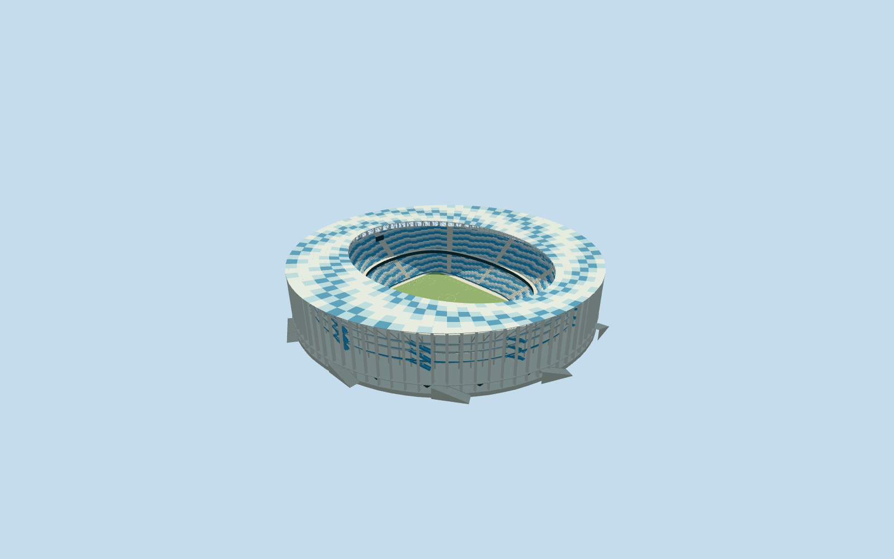

# Nizhny Novgorod Stadium

Specific Nizhny Novgorod Stadium: own mapped circular perimeter/tall triangular white colonnade, closed blue/pale/white radial roof-panel ring with matching renderable underside/deep inner elliptical truss/radial lattice, two blue/white seating bands/open rectangular football floor, raised circular pedestrian gallery with eleven tangential entrance-flight approximations, inner wavy white/blue galleries/blue diagonal circulation flights, recessed closed services/glazing and supported end displays/lights. Four existing shared concrete/paint/window-grid/canvas graphs. Independent rivers/cathedral/city blocks remain separate. No generic stadium substitution, copied event/sponsor artwork, whole peninsula slab or furnished hidden interiors.

## Evidence and reconstruction

Published dimensions and reconstructed details are separated in spec.json. Primary references:

- [Reference](https://www.archdaily.com/927550/nizhny-novgorod-stadium-football-stadium-pi-arena)

Specific Nizhny Novgorod Stadium: own mapped circular perimeter/tall triangular white colonnade, closed blue/pale/white radial roof-panel ring with matching renderable underside/deep inner elliptical truss/radial lattice, two blue/white seating bands/open rectangular football floor, raised circular pedestrian gallery with eleven tangential entrance-flight approximations, inner wavy white/blue galleries/blue diagonal circulation flights, recessed closed services/glazing and supported end displays/lights. Four existing shared concrete/paint/window-grid/canvas graphs. Independent rivers/cathedral/city blocks remain separate. No generic stadium substitution, copied event/sponsor artwork, whole peninsula slab or furnished hidden interiors.

## Model and axes

56,702 triangles; 170,106 vertices; 5 material groups; 6,807,680 bytes. Native bounds: -158.298, -3.547, -159.363 to 156.732, 53.600, 157.961. Source hash: `sha256:c2a6713cd7babb873e9cafa2aad90da98a258bcaf823b429dffc1f8e29ae8b18`.

{"x":"east","y":"up","z":"south"}

The geographic proposal uses exact-QID OpenStreetMap evidence. Map-derived orientation and estimated architectural details require real-site visual review; preview eligibility is distinct from geographic/fidelity approval. Map attribution: © OpenStreetMap contributors, ODbL-1.0.

## Reproduce

Run `node packages/worldgen/scripts/generate-additional-landmarks.mjs --ids=N0717` (or add `--check`). The generator preserves manually edited masters by checking their baseline hashes. Import through the standard authored-model workflow with optimization disabled; then capture all QA cameras, including shared-surface views.

## Pending work

- Specific Nizhny Novgorod Stadium: own mapped circular perimeter/tall triangular white colonnade, closed blue/pale/white radial roof-panel ring with matching renderable underside/deep inner elliptical truss/radial lattice, two blue/white seating bands/open rectangular football floor, raised circular pedestrian gallery with eleven tangential entrance-flight approximations, inner wavy white/blue galleries/blue diagonal circulation flights, recessed closed services/glazing and supported end displays/lights. Four existing shared concrete/paint/window-grid/canvas graphs. Independent rivers/cathedral/city blocks remain separate. No generic stadium substitution, copied event/sponsor artwork, whole peninsula slab or furnished hidden interiors.
- Exact-QID retained OSMrelation5317016 identifies stadium; its505x444m mapped leisure relation includes surrounding land and is not used as the building scale. Standard PMTiles building52776567785786 supplies actual approximately300m circular shell and115.025725x80.766131m rectangular central opening/pitch surround. Own anchor[43.96334958336796,56.3375026456889]/heading0/native east-south; internal X[0.0020491481475900905,0.9999979004937306]/Z[-0.9999979004937306,0.0020491481475900905] follows that opening, nearly north-south. Lower bowl has rounded rectangular inner boundary around neutral105x68m pitch; upper bowl/roof aperture are separate picture-led ellipses, not stretched pitch bounds. Fine column/stair/panel/portal allocation retains20degree/2m picture-facing uncertainty.
- Native53.6m parent height has no qualified datum. Working outer roof53.6m/inner49.5m, visible deep inner truss6.5m, raised gallery8.4m and inner galleries16/25/32m, lower tier1.4..15.2m/upper19..39.5m, elliptical roof aperture112x87m radii/upper bowl122x101m radii are picture-led visualization estimates.88 near triangular columns/eleven tangent flights/roof panel inventory/blue stair/riser counts are visual approximations, not surveyed inventories. Four shared opaque graphs approximate translucent polycarbonate/glazing/mesh/turf; no optical transmission, engineering/access, hidden furnished circulation or later current-condition certification. Pictures are2018-labels/published2019, not2026 surveys.
- Original standard6m Mapzen terrain samples/native roads/water and independent buildings remain unchanged. Anchor sample defines modelY0; each column and tangent stair retains its own local contact. Occupied retaining floor and bounded opening inside90percent main building/common floor handle coarse elevation without original-sample flattening, whole-riverside platform or water edits. Only owned native stadium parent replaced; load failure/unload keep/restore all original context.

This bundle follows the medium-fi standard. Medium-fi appearance and geographic fit are reviewed separately. Hash-bound visual acceptance is recorded separately after capture inspection.
