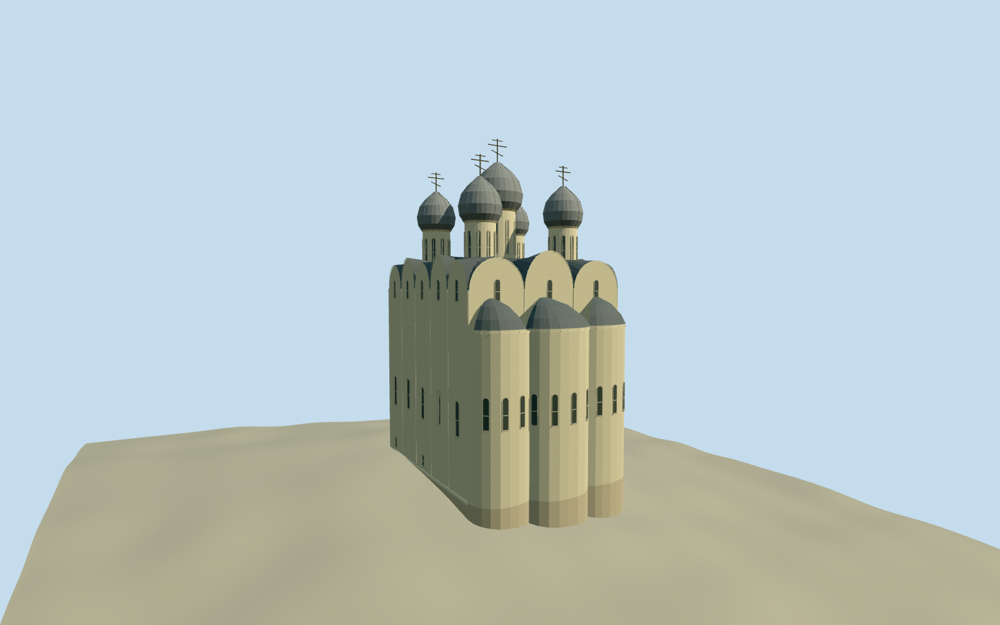

# Saint Sophia Cathedral, Vologda

The white Saint Sophia Cathedral in Vologda with five tall, silver onion domes, the curved apse range, and a west porch.

Authoring state: **review-in-qa.json**. Current completion evidence is in [qa.json](qa.json) and the [completion ledger](../../../../qualla-structures/batches/qualla-004.PROGRESS.md).

- [Saint Sophia Cathedral, Vologda](https://qualla.com/saint-sophia-cathedral-vologda/)

Exterior of the main cathedral. The independently mapped bell tower and nearby churches are separate monuments.

Curved gable subdivisions, secondary ornaments and cross metalwork are approximations based on the cleared photographs.

Build: `node content/worldgen/source/places/uf/ufs/saint_sophia_cathedral_vologda/models/generate-saint-sophia-cathedral-vologda.mjs`. Add `--check` to verify exact regeneration. 18721 triangles; 7 materials; no embedded photographs.
