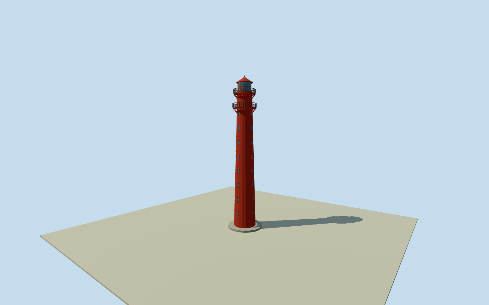

# Andenes Lighthouse — Andøya

Whole named Andenes lighthouse tower exterior: original mapped outer base and tower part, full40m cast-iron tower, two exterior galleries on iron consoles and railings, lantern with second-order lens, conical metal roof, concrete foundation/entry steps, teak door and cast-iron windows. Nearby separately owned keeper houses, sheds, detached machinehouse and harbour are separate structures, excluded. Native outlines supply horizontal control; their foundation/tower role and all upper section divisions, taper, fitting positions and finishes are explicitly estimated from primary construction facts. No imagery used or photographic fidelity claimed.

Authoring state: **review-in-qa.json**. Current completion evidence is in [qa.json](qa.json) and the [completion ledger](../../../../qualla-structures/batches/qualla-002.PROGRESS.md).

- [Andenes Lighthouse](https://qualla.com/andenes-lighthouse/)

Whole named Andenes lighthouse tower exterior: original mapped outer base and tower part, full40m cast-iron tower, two exterior galleries on iron consoles and railings, lantern with second-order lens, conical metal roof, concrete foundation/entry steps, teak door and cast-iron windows. Nearby separately owned keeper houses, sheds, detached machinehouse and harbour are separate structures, excluded. Native outlines supply horizontal control; their foundation/tower role and all upper section divisions, taper, fitting positions and finishes are explicitly estimated from primary construction facts. No imagery used or photographic fidelity claimed.

Primary owner record gives40m height, red brick-lined cast-iron construction, two galleries one storey apart, iron consoles/railings, second-order lantern, conical metal roof, concrete foundation/steps, teak door and iron window frames. No photograph/figure/drawing was viewed or adopted. No photographic fidelity is claimed.

Original two19-control nested native outlines retained in one fixed geographic frame. Whole-building envelope is interpreted as foundation and smaller tower part as shaft base; vertical roles and taper are bounded estimates, not surveyed profiles. Entire named tower exterior included; no keeper-house or detached machinehouse substituted.

Tower taper, gallery/lantern/roof vertical divisions, railing/post/console census, iron panel joints, window count/bearings, door/step position, lens detail and all surface finishes are explicit reconstruction estimates. Lens represented as simple optical form with no navigational light simulation or exact optics.

Original independent128m/16641height source field frozen before floor/main section choices. Provider heights may include coarse coastal relief, buildings, water and void artifacts. No masks, flattening, cutouts, re-acquisition or visual terrain refit; no exact ground-contact certification.

Dated2025-11-18 approximate representation follows native mapping and owner construction text; not an automatic current-world replacement or current condition certification.

Build: `node content/worldgen/source/places/uk/uk7/andenes_lighthouse/models/generate-house.mjs`. Add `--check` to verify exact regeneration. 15614 triangles; 5 materials; no embedded photographs.
