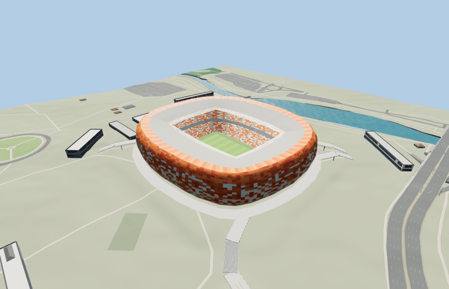

# Mordovia Arena

The orange and white cassette façade curves into the annular canopy above the open playing field. All four browser levels retain that silhouette, the pitch markings and the six mapped approach stairs. The street and close-up models add seating, supports and a translucent canopy rim. The detailed master retains individual seats, roof trusses and façade panels.

The mapped pitch fixes the north-up orientation. The west approach supplies the elevation reference, about 127.10 m. Local grades tie the deck and low stair landings to the apron. The viewer replaces only the stadium building record and preserves the other 24 mapped building records and all 201 road records in the fixture.

| Detail level | Triangles | Download bytes | Draws |
| --- | ---: | ---: | ---: |
| skyline | 994 | 83,116 | 6 |
| district | 3,966 | 312,660 | 7 |
| street | 15,982 | 1,236,112 | 7 |
| closeup | 54,446 | 4,218,564 | 8 |

The source rebuild reproduces the original 1,351,284 triangles byte for byte. The first two browser tiers total 395,776 bytes. All four browser models use shared materials and contain zero embedded images. The portable source and runtime each contain a 768-byte mask baked from the shared square-perforation graph.

A failed model load retains the mapped stadium. All four tiers release their geometry on unload. The review covers 61 captures and 105 placement samples.

The stair grades, panel color layout and seating patterns are reconstructed. The field stands slightly above the fitted ground so native landcover stays beneath the pitch.

The model covers the stadium and its approaches. Enclosed rooms and temporary event fixtures are outside the modeled area.

[Stadium photographs](https://arenamordovia.ru/stadium/about/) · [Façade photographs](https://met-form.ru/projects/facade/stadiona-mordoviya-arena/) · [Mapped terrain fit](site-fit.json) · [QA evidence](qa.json)
