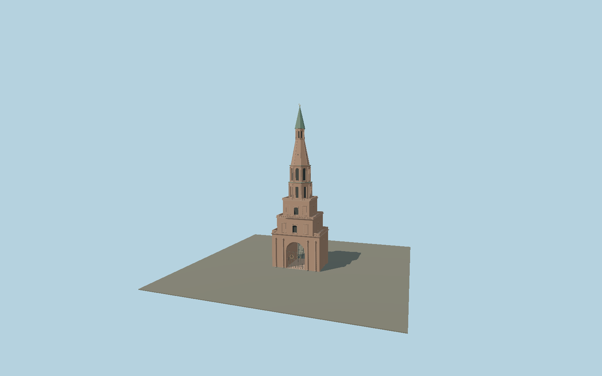

# Söyembikä Tower

Seven-tier leaning brick gate tower of the Kazan Kremlin: open vaulted gate, pylon columns, recessed shirinka parapets, square gallery stages, octagonal upper chambers, tall faceted brick tent and green spire with gilded crescent.

## Identity and geometry

Catalog N0574, [Q2166466](https://www.wikidata.org/wiki/Q2166466). Kazan Kremlin museum-reserve dimensions and architectural description; official exterior photograph constrains the stepped stage envelopes. The separate OSM parts 228963086–228963092 supply stage elevations and a 9 m green roof; opening dimensions are photo-fitted.

Mapped tower outline center at nominal exterior ground. +Z is the approximately west-facing gate facade; +Y is up. The geographic proposal identifies its anchor and orientation evidence separately from remaining terrain and azimuth uncertainty.

Source facts and measured references are recorded in spec.json. References: [1](https://kazan-kremlin.ru/en/architectural-objects/bashnya-syuyumbike), [2](https://www.openstreetmap.org/way/228963085). Reference pages and images are not redistributed.

## Original source and shared materials

Geometry is authored in `packages/worldgen/scripts/next-heritage-tower-models.mjs`. Shared material graphs with metric repeat UV0 and original vertex tints; GLB PBR fallback remains self-contained. No per-model texture duplication. No third-party mesh or photograph is embedded.

42,720 triangles; 83,444 vertices; 3 material groups; 3,518,960 source bytes. Source hash: `sha256:e6f612e049fc3f0befa5e6d1c8b54ece1b146d8f909c9603a5028d1843428fc4`. Geometry validation checks finite Float32 coordinates, indices, triangle area and winding before export.

Regenerate with `node packages/worldgen/scripts/generate-heritage-towers.mjs N0574`; add `--check` for reproducibility. The generator refuses to overwrite a master whose hash differs from source.json. Import uses `--no-optimize` to preserve facade recesses.

## Remaining detail and review

- Complete static medium-fi exterior of the seven-tier gate tower, including both passage facades, eight lower attached columns, small north/south stair doors, round vent indications, three square terraces, two octagonal chambers, eight-sided brick tent, upper watch chamber and long green spire with apple and crescent. Original detailed source remains reproducible. The lower envelope follows the attributed OSM outline, while the architectural field study supplies the 6.90 m passage; the previous sqrt(140) square shaft is preserved only in the original draft. Museum Russian and English pages report different base areas (140 and 147 m²); neither defines whether the passage or projections are counted, so these values do not certify the reconstructed rectangular dimensions. Upper widths, window heights, decorative panels and the tapered north reinforcement are proportional interpretations of exterior photography and published descriptions, not a measured restoration survey. The 1.98 m NE lean is a linear exterior shear. Gate bars and sun/crescent motifs are simplified; mythological figures, individual brick damage, inscriptions, interiors, foundations and adjacent independent palace gates are outside this static exterior scope. Four tiny tent vents are closed dark geometric indications, not openings into an interior. The canonical normally restored crescent is retained despite its temporary removal announced 6 October 2026. No downloaded reference mesh or photograph is embedded or redistributed. Two common material graphs supply brick and painted metal; the small gilded ornaments use a warm stylized tint. Physical phone/laptop timings and host terrain contact remain unmeasured.

Named near/far cameras are included for lit visual review. A valid export is not maximum-fidelity certification.
