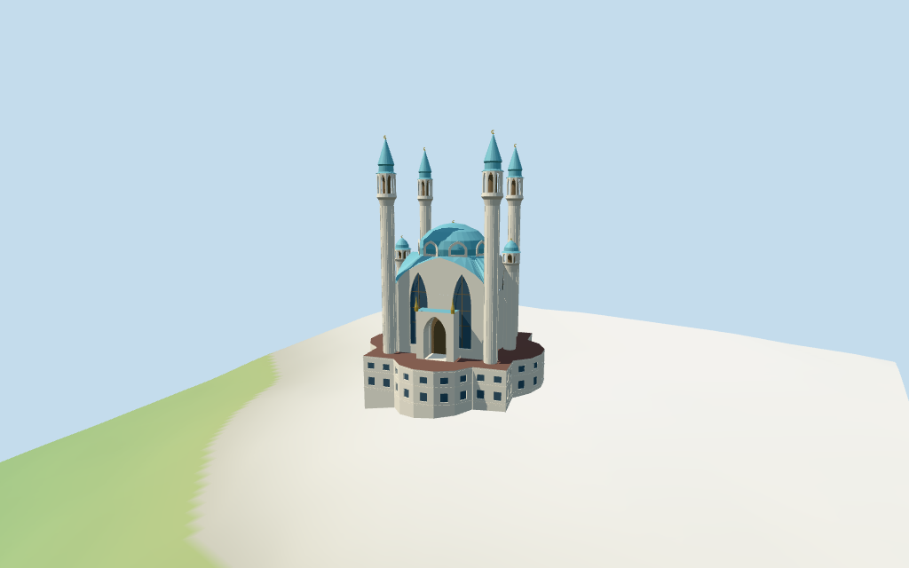

# Qol Şärif Mosque

Individual medium-fi Qol Şärif Mosque:four58m white faceted minarets/pointed gallery heads/blue lanterns and spires,two35m side turrets,blue central dome/white pointed petal collar,folded blue upper roof and pale pointed gables with tall paired lancet glazing,8m rounded two-storey podium/closed lower windows and projecting upper entry portico with selected gold pinnacles. Five existing shared256² graphs,eight merged groups,four authored budgeted levels. Nine current map components retain exact plan/height envelopes;profiles,subdivisions,doorway facing and portico are picture estimates. Fine inscriptions/carvings,unseen roofs/interiors,current finish and precise podium/terrain joins unverified or omitted.

## Evidence and reconstruction

Published dimensions and reconstructed details are separated in spec.json. Primary references:

- [Reference](https://commons.wikimedia.org/wiki/File:Kul-Sharfif_Mosque_Kazan_overview.jpg)
- [Reference](https://commons.wikimedia.org/wiki/File:Front_view_of_Kul_Sharif_Mosque_Kazan_Tartarstan_Russia_(14422822426).jpg)
- [Reference](https://commons.wikimedia.org/wiki/File:Minaret_of_Qol_Sharif_mosque.jpg)
- [Reference](https://commons.wikimedia.org/wiki/File:Kazan_Kremlin._Qolşärif_Mosque_P8111900_2900.jpg)

Five existing shared256² limestone,standing-seam metal,mosaic,plain wood and bronze graphs;eight material groups. Pale walls/trim,turquoise-blue roofs/dome and sparse gold finials use metric UVs/linear tints. Retained whole roof colour#7C5A51 used on low podium roof only;upper blue follows pictures. Zero embedded images,baked lighting/weathering or copied inscriptions/carvings.

## Model and axes

13,851 triangles; 41,553 vertices; 8 material groups; 1,666,844 bytes. Native bounds: -21.824, -3.089, -21.474 to 21.839, 60.725, 21.437. Source hash: `sha256:8f94d6c1078b5e02685a16258777e1d2163a1fcc9c1e3936ac8a4f083c82ba90`.

{"x":"retained whole-map axis towards southeast;internal main +u approximately east-southeast","y":"up","z":"retained perpendicular whole-map axis towards southwest;main +v approximately south-southwest/model entry"}

Standard viewer DEM datum82.214506m;perimeter-2.74..2.48m relative to anchor. Working floor2.725m is maximum bilinear whole-footprint sample at1m spacing plus0.25m,not surveyed paving. Raw DEM retained without cutout/flattening;adaptive footings crossY=0 below terrain. Exact altitude,podium/approach thresholds and terrain joins,walking and exterior ramp levels remain unverified.

## Reproduce

Run `node packages/worldgen/scripts/generate-additional-landmarks.mjs --ids=qol_sarif_mosque` (or add `--check`). The generator preserves manually edited masters by checking their baseline hashes. Import through the standard authored-model workflow with optimization disabled; then capture all QA cameras, including shared-surface views.

## Pending work

- Retained exact way/230132591 /Q121198 matches current PMTiles whole35184602221423 (2*2^44+230132591). Anchor[49.1051597,55.79834865] and heading−0.715370228567rad unchanged,no horizontal rescale. Earlier30-vertex closed outer retained separately from current29-point whole. Nine exact current controls/111 raw points locate8m whole,31m core,31–39m dome,four58m minarets and two35m turrets. Main architectural corners derive from current core vertices0/1/6/7;its internal basis remains separate from the whole-map axes. Entry on the+v main face is picture-based facing,approximately south-southwest,not an extra mapped doorway. Detached pavilion,curved approaches and neighbouring Kremlin ranges remain host context.
- Retained height/width/length fact arrays are empty. Current map components specify whole8m,main core31m,central dome min_height31/top39m,two shorter turrets35m and four full minarets58m. Keep8m as the low podium envelope,not a cap on the taller mapped components. Working main facade shoulders22.5m/gable peaks31m,white petal collar31–34m,blue dome to38.4m/crescent39m;large shafts to44m/gallery44–49.6m/blue lantern and spire to57.3m/crescent58m,small turret gallery29.5–32m/blue cap/crescent35m. These untagged subdivisions,openings,fluting,crescents and portico are picture estimates within about2m/facing about4°. The whole roof colour#7C5A51 is retained as a low-podium working tint;blue upper roofs/dome/spires follow inspected pictures. Exact material/finish/roof details,interiors and engineering unverified.
- Standard viewer DEM datum82.214506m;perimeter-2.74..2.48m relative to anchor. Working floor2.725m is maximum bilinear whole-footprint sample at1m spacing plus0.25m,not surveyed paving. Raw DEM retained without cutout/flattening;adaptive footings crossY=0 below terrain. Exact altitude,podium/approach thresholds and terrain joins,walking and exterior ramp levels remain unverified.
- Nine tagged controls locate the8m podium,31m main body,31–39m dome,four58m minarets and two35m turrets. Four inspected2014/2017 pictures guide pointed gables,paired tall lancets,blue folded roof/white petal collar,faceted shafts/pointed gallery heads,lanterns/spires/crescents and upper entry portico/gold pinnacles. Untagged profiles,portico/facade facing,subdivisions and roof material/current finish are estimates. Gallery apertures look into closed dark central cores;windows and entry doors close before interiors. Skyline uses solid gallery heads,closed glazing proxies,simple petal teeth,coarse blue caps and finial rods;district opens coarse heads and uses flat podium glazing proxies,near levels add recessed podium windows,selected mullions/flutes/trim and crescents. Fine inscriptions/carvings,exact motifs,railings and unseen roofs/rooms/stairs unverified or omitted. Detached blue pavilion,curved approaches and neighbouring Kremlin ranges remain host context. Exact datum/podium/ramp/threshold contacts,walking,engineering and physical-device performance unverified.

This bundle follows the medium-fi standard. Medium-fi appearance and geographic fit are reviewed separately. Hash-bound visual acceptance is recorded separately after capture inspection.

## Additional geographic data

©OpenStreetMap contributors;Protomaps;Mapzen/USGS terrain tiles.
