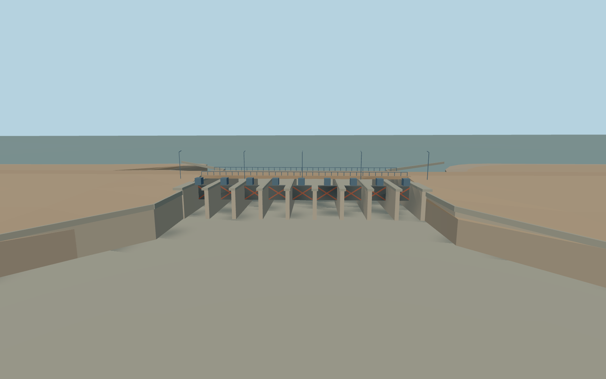

# Dyke Kokaral

Whole V-shaped Kokaral embankment at the retained exact map identity, both shoreline tie-ins, the mapped gravel crest, nine-bay regulator with a continuous road crossing, and the separate tapered intake and outlet apron.

Rebuild: `node packages/worldgen/scripts/generate-dyke-kokaral.mjs`;append `--check` for exact source bytes. Select import/LOD/placement with `--ids=dyke_kokaral`. Detailed source and four browser tiers are separate ignored GLB outputs.

The exact retained dyke polygon and current KNA-22 geometry control horizontal placement. The North Aral reservoir is on local negative Z. The southwest regulator flows toward the native outlet. Gates, lamps, bracing and railings follow the ordinary photographs. Terrain-derived crest, sill, tailwater, and foundation levels are visual estimates. The retained 13034m length is distinct from the sampled crest trace and plan extents.

The 64 m standard terrain grid constrains the regional fit. The gate cross-section, operating levels, roadway grade and fine transitions between the embankment and shoreline are approximate. The model shows a static regulator and carries no control or navigation simulation.

Original geometry:repository license. Map:© OpenStreetMap contributors,ODbL-1.0;Protomaps. Standard terrain:terrain-grid.json. Ordinary pictures stay local and are not redistributed or used as textures. Current acceptance:qa.json.
