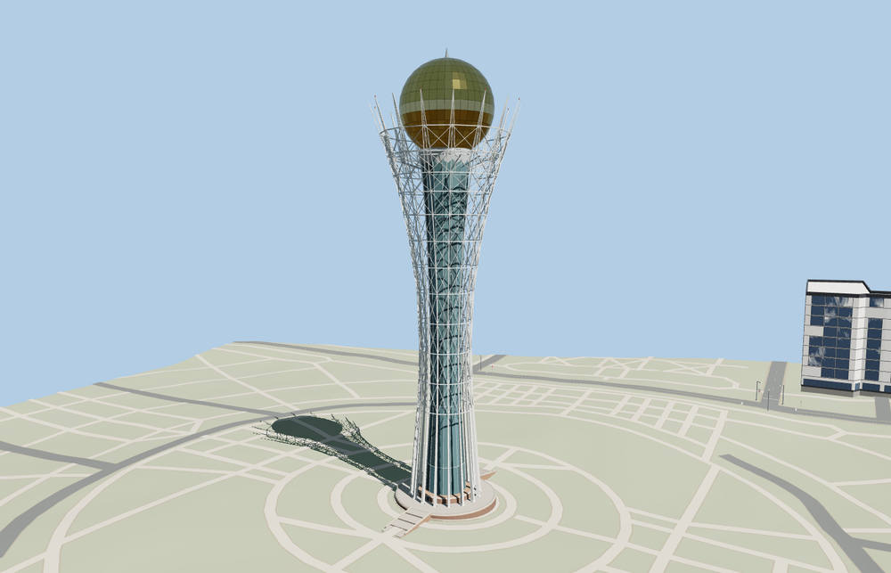

# Bayterek

Bayterek’s white flared lattice, paneled gold sphere, circular plinth and two stairs on the Nurzhol Boulevard axis.

The 18,652-triangle source rebuilds byte for byte. Skyline, district, street and close-up use 990, 3,720, 9,740, 16,580 triangles. The first two tiers total 374,100 bytes. Six GLBs validated and 38 current views were inspected.

Each tier passes eight foundation contacts, six stair thresholds, two landings, four globe probes and six surrounding plaza probes. The first tread rises no more than 0.16 m over the sampled terrain. The viewer retains 9 independent buildings, 156 mapped road parts and the original terrain. Failed loading restores both mapped tower features.

The modeled 97 m observation level and 105 m mast height are distinct. The two mapped building height tags are retained as source evidence. Standard terrain and exterior photographs determine the reconstructed plinth and branch proportions. The sphere uses reflective opaque panels and modeled seams. The visitor interiors, fountain animation and independent landscape fixtures remain outside the landmark model. The generic pedestrian surface still overlaps the center of the lowest east treads in the standard terrain capture. Physical-device timings are unmeasured.

Rebuild with `node packages/worldgen/scripts/generate-bayterek.mjs`. Append `--check` to compare exact bytes. Use `--ids=bayterek` for targeted import, LOD, placement and readiness.
