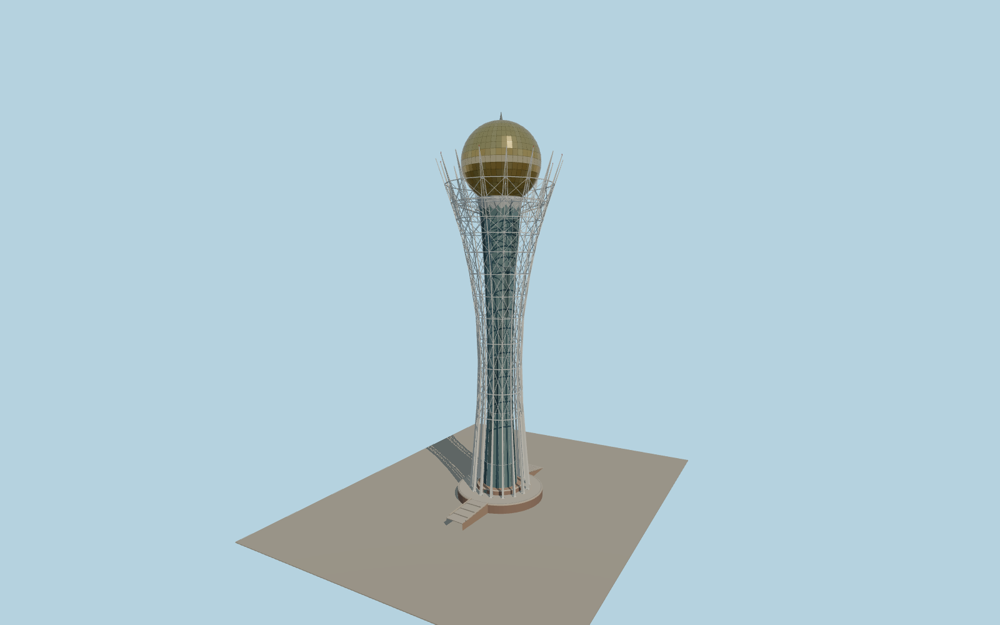

# Bayterek

Bayterek’s white flared lattice, paneled gold sphere, circular plinth and two stairs on the Nurzhol Boulevard axis.

Run `node packages/worldgen/scripts/generate-bayterek.mjs` to rebuild the source master. Append `--check` to compare the exact bytes. Use `--ids=bayterek` for targeted import, LOD generation and placement.

The modeled 97 m observation level and 105 m mast height are distinct. The two mapped building height tags are retained as source evidence. Standard terrain and exterior photographs determine the reconstructed plinth and branch proportions.

The sphere uses reflective opaque panels and modeled seams. The visitor interiors, fountain animation and independent landscape fixtures remain outside the landmark model.

Original geometry follows the repository license. Map data is © OpenStreetMap contributors under ODbL-1.0 via Protomaps. Terrain samples are described in terrain-grid.json. Ordinary pictures stay local and are not redistributed or used as textures. Current acceptance:qa.json.
