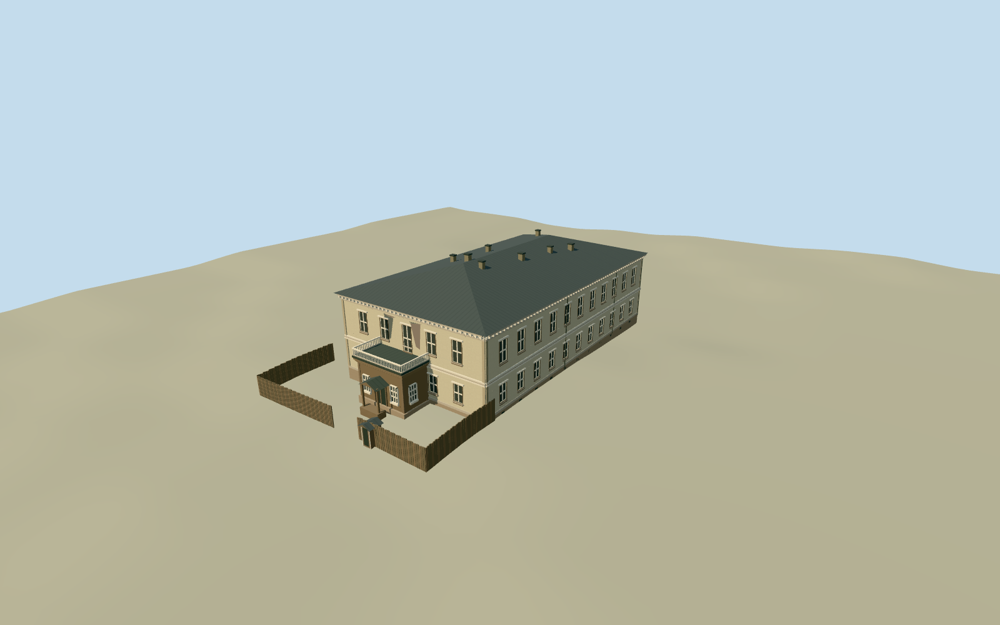

# Governor's Mansion (Tobolsk, Russia)

The September 1917 Governor’s Mansion with a five-axis square facade, deep cornice, timber entrance porch and balcony.

Authoring state: **review-in-qa.json**. Current completion evidence is in [qa.json](qa.json) and the [completion ledger](../../../../qualla-structures/batches/qualla-004.PROGRESS.md).

- [Governor's Mansion, Tobolsk](https://qualla.com/governor-s-mansion-tobolsk-russia/)

Exterior is dated to September 1917, when the photo-documented timber vestibule, balcony and enclosure were in place. The dated view represents the documented internment period.

Historic placement uses the extant masonry outline and original river-town grade. Finish colors, pent roof detailing, rear windows, street fencing and small fittings are approximate.

Build: `node content/worldgen/source/places/vd/vd2/governor_s_mansion_tobolsk_russia/models/generate-governor-s-mansion-tobolsk-russia.mjs`. Add `--check` to verify exact regeneration. 9870 triangles; 7 materials; no embedded photographs.
