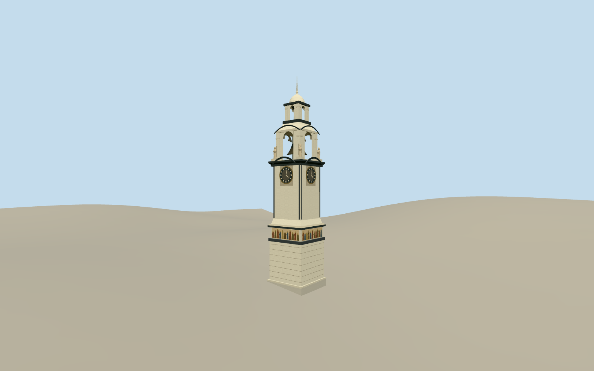

# Birch Memorial Clock Tower

A white square clock tower with inset painted panels, four dark clock faces, a black curved cornice, open belfry with corner figures, small lantern and tall pale finial.

Authoring state: **review-in-qa.json**. Current completion evidence is in [qa.json](qa.json) and the [completion ledger](../../../../qualla-structures/batches/qualla-003.PROGRESS.md).

- [Birch Memorial Clock Tower](https://qualla.com/birch-memorial-clock-tower/)

The mapped point fixes the position. Footprint width, overall height and exact orientation use photographic and site estimates.

The four painted panels and statues are simplified geometric representations. Bell details and obscured elevations are approximate. The tower retains a fixed illustrative clock reading.

The original elevation field is preserved. Immediate plinth contact remains approximate at the terrain source resolution.

Build: `node content/worldgen/source/places/w0/w0z/birch_memorial_clock_tower/models/generate-birch-memorial-clock-tower.mjs`. Add `--check` to verify exact regeneration. 3494 triangles; 5 materials; no embedded photographs.
