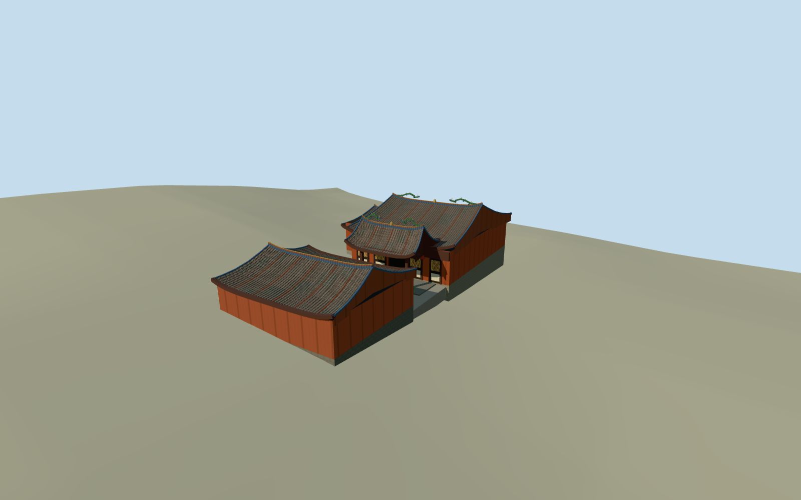

# Snake Temple

The main Snake Temple shrine with an open timber entrance, upturned ceramic ridges, brick wings and a small paved approach.

Authoring state: **review-in-qa.json**. Current completion evidence is in [qa.json](qa.json) and the [completion ledger](../../../../qualla-structures/batches/qualla-004.PROGRESS.md).

- [Snake Temple](https://qualla.com/snake-temple/)

The photographed entrance and ridge ornament use visual proportions. Roof and trim detail on the rear building faces and the lesser forecourt building is approximate.

Build: `node content/worldgen/source/places/w0/w0z/snake_temple/models/generate-snake-temple.mjs`. Add `--check` to verify exact regeneration. 21112 triangles; 8 materials; no embedded photographs.
