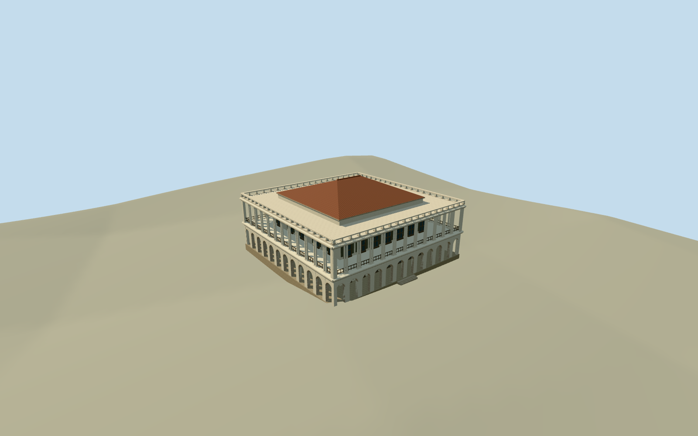

# Suffolk House, Penang

Suffolk House in Penang with a limewashed wraparound ground arcade, paired upper columns, open terraces and a central clay-tiled jack roof.

Authoring state: **review-in-qa.json**. Current completion evidence is in [qa.json](qa.json) and the [completion ledger](../../../../qualla-structures/batches/qualla-004.PROGRESS.md).

- [Suffolk House, Penang](https://qualla.com/suffolk-house-penang/)

Draft exterior: approximate photographic proportions and simplified ornament. It is not a survey, photogrammetric reconstruction or approved current geographic replacement.

Shown are the ground-floor open semicircular arcades, paired upper columns, dark timber doors, parapet and high center jack roof. The conservation record specifies limewash and clay tiles.

Terrain sampling/contact, geographic alignment and site activation remain pending. Runtime LODs are produced by the registered after-import pipeline and require visual review.

Reference photos remain in the local Qualla corpus; only provenance, paths and hashes are retained here.

Build: `node content/worldgen/source/places/w0/w0z/suffolk_house_penang/models/generate-suffolk-house-penang.mjs`. Add `--check` to verify exact regeneration. 21152 triangles; 5 materials; no embedded photographs.
