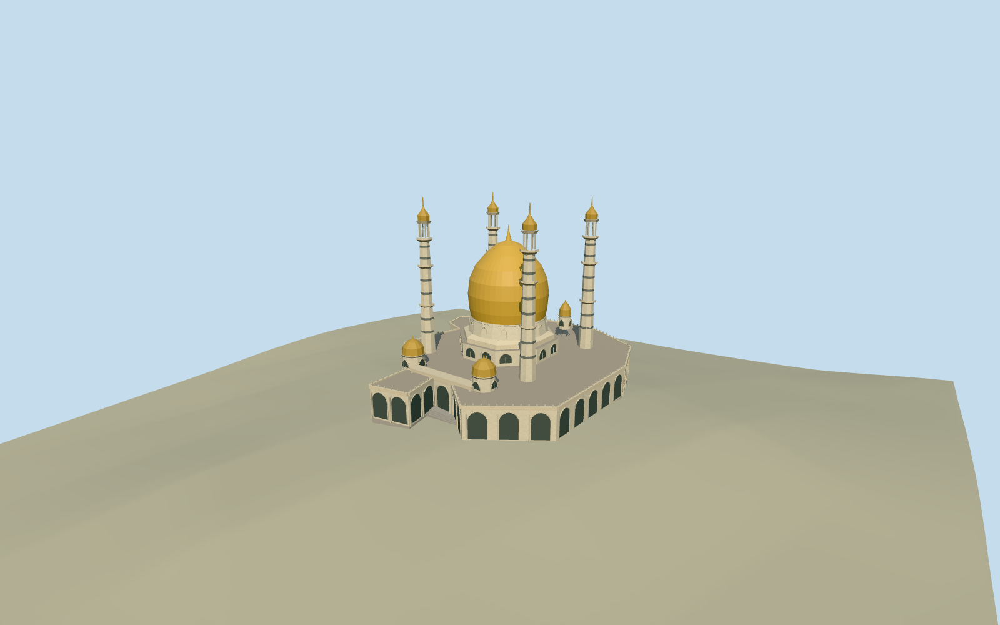

# Ubudiah Mosque

Masjid Ubudiah with its golden onion dome, pointed arcades and four white, banded minarets at Bukit Chandan.

Authoring state: **review-in-qa.json**. Current completion evidence is in [qa.json](qa.json) and the [completion ledger](../../../../qualla-structures/batches/qualla-004.PROGRESS.md).

- [Ubudiah Mosque](https://qualla.com/ubudiah-mosque/)

The standing worship building with the attached entry and four major minarets. Detached service blocks, cemetery and site furnishings are outside scope.

Precise minaret heights, cornice details and side bays are estimated from the public-domain photographs.

Build: `node content/worldgen/source/places/w0/w0z/ubudiah_mosque/models/generate-ubudiah-mosque.mjs`. Add `--check` to verify exact regeneration. 13871 triangles; 7 materials; no embedded photographs.
