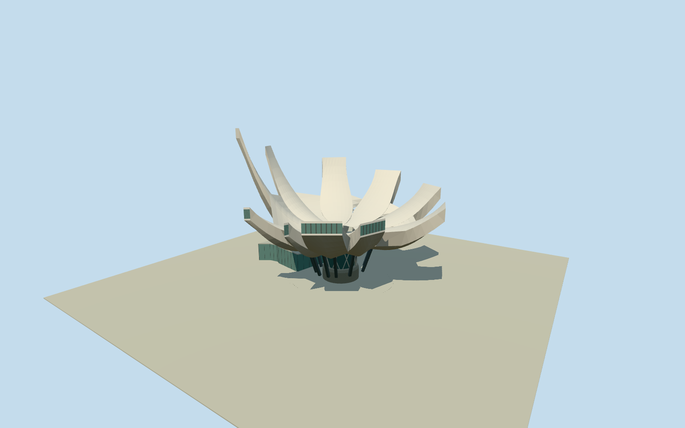

# ArtScience Museum

Singapore’s ArtScience Museum with ten white gallery petals, a central rainwater oculus and splayed steel supports above the waterfront.

Authoring state: **review-in-qa.json**. Current completion evidence is in [qa.json](qa.json) and the [completion ledger](../../../../qualla-structures/batches/qualla-003.PROGRESS.md).

- [ArtScience Museum](https://qualla.com/artscience-museum/)

The model represents the Marina Bay waterfront museum exterior as photographed in February 2013, including its petals, open central oculus, support basket and entry pavilion. Interior galleries and neighboring Marina Bay Sands buildings are outside scope.

The mapped outline fixes the petal rim positions and compass directions. The heights of individual petals, shell profiles, underside junctions and glass details are estimated from the bay view and published overall dimensions.

The original regional elevation field provides the surrounding waterfront grade. The reflecting pool and access thresholds are represented approximately.

Build: `node content/worldgen/source/places/w2/w21/artscience_museum/models/generate-artscience-museum.mjs`. Add `--check` to verify exact regeneration. 8096 triangles; 6 materials; no embedded photographs.
