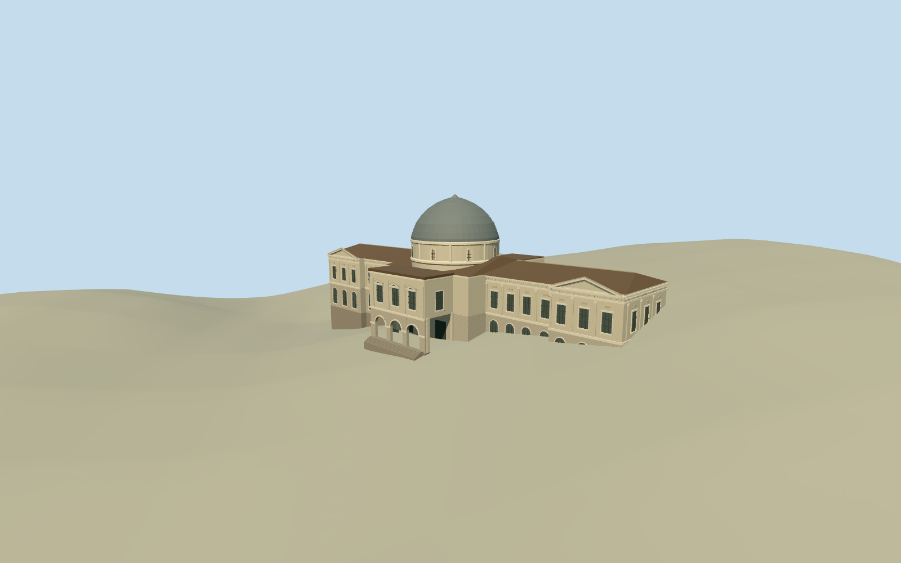

# National Museum of Singapore Monument Building

The original Stamford Road museum with Neo-Palladian wings, an arcaded entrance and its zinc rotunda dome.

Authoring state: **review-in-qa.json**. Current completion evidence is in [qa.json](qa.json) and the [completion ledger](../../../../qualla-structures/batches/qualla-004.PROGRESS.md).

- [National Museum of Singapore](https://qualla.com/national-museum-of-singapore/)

The model covers the original Monument Building frontage and rotunda. Later rear gallery wings and the independent modern glass rotunda are outside this exterior scope.

The archive confirms the original composition. Exact rear openings, roof slopes and small heraldic and floral ornament are representative.

Build: `node content/worldgen/source/places/w2/w21/national_museum_of_singapore_monument_building/models/generate-national-museum-of-singapore-monument-building.mjs`. Add `--check` to verify exact regeneration. 14223 triangles; 8 materials; no embedded photographs.
