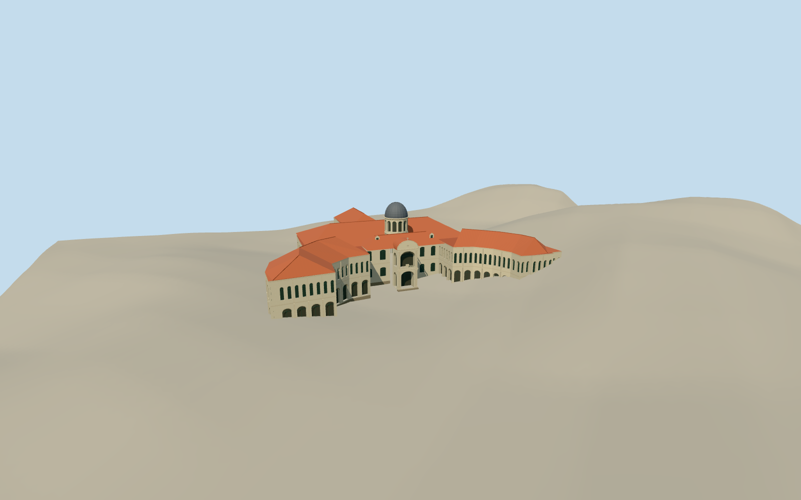

# Singapore Art Museum at Bras Basah

The Singapore Art Museum’s former Bras Basah Road home with white arcades, two curving school wings, terracotta roofs and a gray domed tower behind the central portico.

Authoring state: **review-in-qa.json**. Current completion evidence is in [qa.json](qa.json) and the [completion ledger](../../../../qualla-structures/batches/qualla-003.PROGRESS.md).

- [Singapore Art Museum](https://qualla.com/singapore-art-museum/)

The model depicts the November 2013 exterior of the former St Joseph’s Institution at 71 Bras Basah Road, during its use by the Singapore Art Museum.

The named polygon fixes the footprint. The cleared photograph constrains the entrance, dome, orange tile, and forecourt openings. Rear openings, the chapel roof section and minor ornament are reconstructed estimates.

The original Terrarium field is preserved. Its elevations climb sharply on the east wing and may include roof or canopy elevations. Model contact uses approximate forecourt paving.

Build: `node content/worldgen/source/places/w2/w21/singapore_art_museum/models/generate-singapore-art-museum.mjs`. Add `--check` to verify exact regeneration. 34051 triangles; 5 materials; no embedded photographs.
