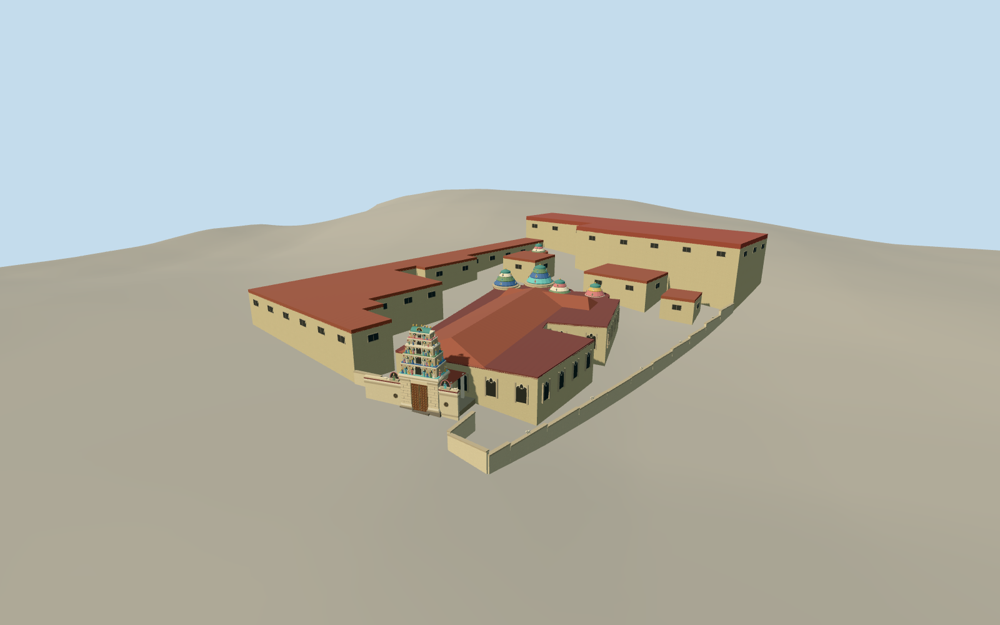

# Sri Mariamman Temple, Singapore

The temple’s sculpted five-tier gateway and carved wooden entrance face South Bridge Road. Four temple shrines, tiled roofs and a walled compound stand behind the gate.

Authoring state: **review-in-qa.json**. Current completion evidence is in [qa.json](qa.json) and the [completion ledger](../../../../qualla-structures/batches/qualla-003.PROGRESS.md).

- [Sri Mariamman Temple, Singapore](https://qualla.com/sri-mariamman-temple-singapore/)

Tower and shrine heights, vivid paint tones and simplified sculptural groups are estimates. The figures represent architectural mass and placement. Individual sculptures and historic murals are not reproduced.

The main hall, street wall and mapped secondary structures are represented as exterior volumes. Some roof edges and courtyard arrangements are inferred from the available survey.

Build: `node content/worldgen/source/places/w2/w21/sri_mariamman_temple_singapore/models/generate-sri-mariamman-temple.mjs`. Add `--check` to verify exact regeneration. 45576 triangles; 5 materials; no embedded photographs.
