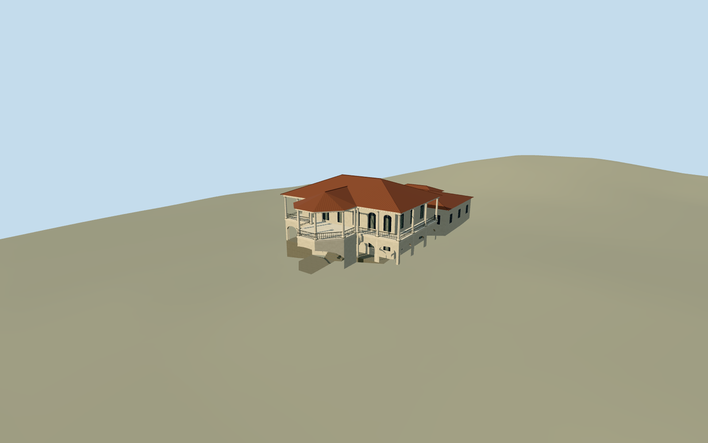

# Sun Yat Sen Nanyang Memorial Hall

Conserved Wan Qing Yuan villa with a curved carriage porch, open Corinthian verandas, iron balustrades, terracotta hipped roofs and a connected rear memorial hall extension.

Authoring state: **review-in-qa.json**. Current completion evidence is in [qa.json](qa.json) and the [completion ledger](../../../../qualla-structures/batches/qualla-003.PROGRESS.md).

- [Sun Yat Sen Nanyang Memorial Hall](https://qualla.com/sun-yat-sen-nanyang-memorial-hall/)

The model shows the conserved exterior familiar from the 2011 reopening through the September 2024 closure. Scaffolding, temporary works and any changes made in the conservation project are omitted.

The published measured building outline controls the plan. Floor, ridge and window heights, rear extension articulation and iron and plaster ornament are estimates. Interiors, statues and garden structures are outside the scope.

Build: `node content/worldgen/source/places/w2/w21/sun_yat_sen_nanyang_memorial_hall/models/generate-sun-yat-sen-nanyang-memorial-hall.mjs`. Add `--check` to verify exact regeneration. 19346 triangles; 7 materials; no embedded photographs.
