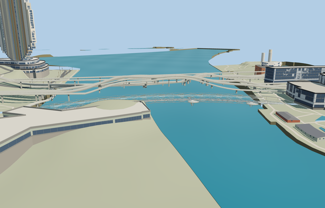

# The Helix Bridge — completed current medium-fi pass

Reviewed2026-10-25. **Complete scoped bridge exterior and approximate native placement. Original detailed recipe preserved; current master intentionally corrected.**

## Geometry and shared materials

Inspected62 current frames in one author/inspect/fix pass:11 portable,11 shared,27 medium-fi and13 native. Complete curved walkway, six major/five minor helical strands, four bay-facing pods and their necks, four paired tripod groups, glass rails and alternating canopy leaves remain. Corrected a source bug that treated mapped viewpoint X coordinates as arc stations, moving pods/piers and rail openings to projected stations. Smooth reconstructed phase transitions clear all four pod thresholds without cutting the continuous primary strands.192 near/source threshold rays pass. The original505124-triangle master recipe remains byte-reproducible; the intentionally corrected detailed master has504896 triangles and40070112 bytes.

Three existing256px shared graphs (concrete_plain, stone_granite, metal_stainless) provide metric-repeat concrete, paving and steel. Glass and perforated-canopy mean use two small transparent local PBR materials without images. No private bitmap atlas, embedded images or copied photo pixels. Textured LODs use five draws and load each graph once; skyline bakes shared means into one vertex-color draw. Separate vertex streams avoid duplicate uploads; model/support disposal passes.

| Level | Triangles | Bytes | Draws |
| --- | ---: | ---: | ---: |
| skyline | 988 | 96412 | 1 |
| district | 3980 | 400440 | 5 |
| street | 15968 | 1692600 | 5 |
| closeup | 62900 | 7137608 | 5 |

Four authored browser LODs: 988/3980/15968/62900 triangles. Initial skyline + district 496852 bytes; closeup 7137608 bytes. Skyline uses four representative opposed ribbons; district retains all eleven strands as crossed ribbons; near levels use six/twelve-sided tubes. Fine paving relief, collars and secondary hardware stay in the detailed master. Noon/late, economy/high, silhouette and all transitions were inspected beside procedural neighbors. Physical laptop/phone timings remain pending.

## Placement and preservation

Approximate native fit at [103.860485341,1.287468009], heading1.497794301143; +X roughly north and pods to the bay-facing west. Standard Protomaps/Mapzen and ordinary photographs establish fit. Reservoir water/pier-cap zero and6m endpoint deck levels are provisional, not surveyed elevations. A249-point body/pod replacement outline removes only overlapping mapped paths; the57-sample curved deck profile aligns the retained side connector. The earlier ignored review reader halved terrain elevations; this review re-reads the original archive at its correct scale (center28.3448m matches the28.3448407m independent decoder sample). Bounded walkway/pod and direct-approach ground openings keep coarse ground/shoreline walls out of the structure without editing DEM samples or native water. Three immediate mesh joins meet the authored deck within0.02m. This proves internal consistency, not geodetic accuracy. The outer side-link/cycleway junction, native shore morphology, generic approach grades/widths and neighboring procedural bridge heights remain coarse approximations, outside the scoped bridge exterior. High, steep coarse bank walls remain beside the narrow landings; this is not a polished street-level waterfront reconstruction.

All 191 resident / 336 wider mapped buildings, 1131 independent transportation records, correctly decoded original DEM samples and native water remain. Bayfront Avenue road bridge (two lane records) and the independent Marina Promenade cycleway (one through record) retain exact geometry plans and hints. Bounded ground/bank openings deliberately alter only the rendered terrain beneath the model and direct approach strips; outside ground probes remain exact and all ground/bank geometry restores on unload. Native shoreline walls now respect model ground openings while retaining water. Failed load keeps original native content without supports. Fixture/engine hashes are pinned.56 targeted Earth ground/placement/connector tests,24 shoreline/ground/semantic tests, affected package typechecks and changed-file formatter checks passed. Full engine CI was not rerun; earlier livery-schema failures remain recorded.

## Checks

Selected generator --check, strict medium-fi, scene validation and30-tick simulation pass. Six GLBs have zero Khronos errors/warnings;1407 geometry checks pass.62 inspected frames bind current source/runtime/LOD and fixture/engine hashes. Bulk images stay local; two small previews stay with source.

## Ordinary references and limits

Inspected [COX project photographs](https://www.coxarchitecture.com.au/project/the-helix-bridge/) for the complete counter-rotating structure, pod floors, tripod supports, clear walkway and canopy leaves. No photographic pixels redistributed. Source historical dimensions remain explicit where the narrative280m length differs from the285m span sum; mapped curved length is approximately282.2m. Phase/pitch transitions, canopy boundaries and hardware are reconstructed rather than fabrication geometry. Standard2026-10-20 PMTiles/Mapzen guides native fit. Reservoir datum, shore grades and adjacent procedural bridge remain approximate. Dynamic nighttime lighting, foundation piles and physical device measurements are outside this review.

The six model files retain exact hashes, so their existing 1,407 geometry checks were reused. Eleven portable images also retain exact reviewed hashes; the 51 changed shared/style/native images were inspected. Remaining steep coarse bank walls and the outer side-link/cycleway height mismatch are explicit limitations of the native surroundings.
